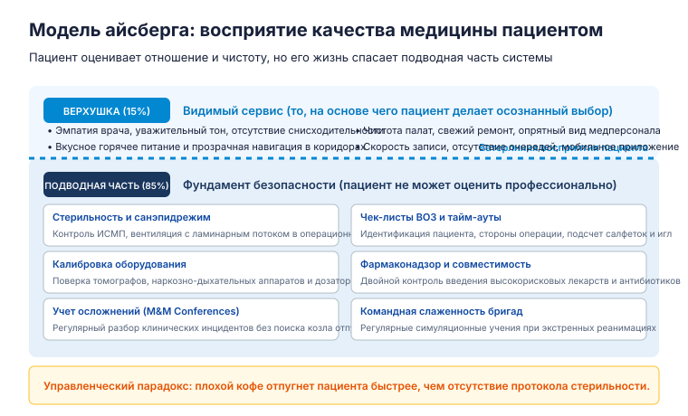
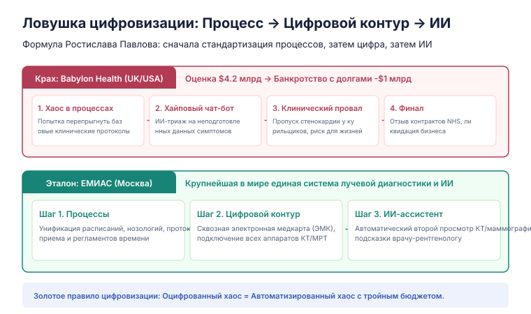
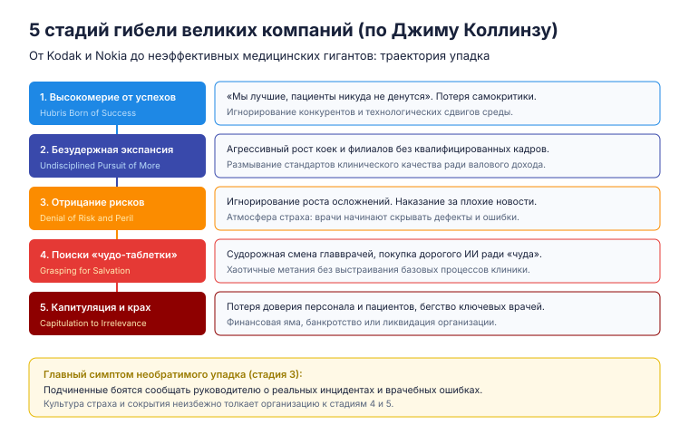
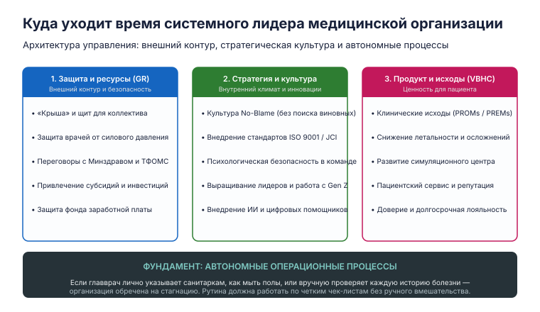

<span class="eyebrow">Организация и экономика здравоохранения · 11 ноября 2026</span>

# Базовые принципы управления медицинской организацией: от процессов и ИИ до лидерства и культуры безопасности

* **Спикер:** **Павлов Ростислав Владимирович** — вице-президент Сбербанка, руководитель индустрии здоровья; кандидат медицинских наук, хирург-онколог; экс-главный врач Гатчинской клинической межрайонной больницы (КМБ); выпускник «Высшей школы онкологии» Фонда профилактики рака.
* **Дисциплина:** Организация и экономика здравоохранения (рус), 1 курс магистратуры (2 модуль).
* **Дата и время:** Среда, **11 ноября 2026 года**, 1-я пара (лекция, 18:10–19:30) и 2-я пара (семинар со студентами, 19:40–21:00).
* **Аудитория:** Мясницкая ул., д. 11, ауд. 422.

!!! tip "TL;DR: Семь ключевых управленческих законов Ростислава Павлова"
    1. **Закон 15-го камня сада Рёан-дзи:** С любой точки веранды монастыря в Киото видно лишь 14 камней из 15. Руководитель неизбежно слеп к своим «слепым зонам», если сидит на одном месте и слушает только себя. Сила лидера — в команде, способной видеть скрытый камень и говорить правду в лицо.
    2. **Модель айсберга:** Пациент выбирает клинику и пишет отзывы по 15% видимой верхушки (эмпатия врача, чистота, вкусный кофе, скорость записи, отсутствие хамства). Но его жизнь спасают 85% скрытого фундамента (стерильность, тайм-ауты ВОЗ, калибровка оборудования, фармаконадзор). Если слаб фундамент — пациенты умирают; если слаб фасад — они уходят к конкурентам.
    3. **Формула цифровизации:** `Стандартизированный процесс → Цифровой контур → ИИ-ассистент`. Попытка автоматизировать бардак порождает лишь автоматизированный хаос с гигантскими убытками (кейс банкротства Babylon Health на -$1 млрд против системного успеха ЕМИАС).
    4. **Закон необходимого разнообразия Эшби:** Сложность управляющей системы обязана соответствовать сложности объекта. Больницу на 2 500 сотрудников невозможно вести ручным микроменеджментом и криком. Рутина должна быть упакована в автономные чек-листы.
    5. **Культура безопасности (Safety Culture) взамен поиска виновных (Blame Culture):** Когда происходит врачебная ошибка или трагедия, вопрос «Кто виноват?» уничтожает доверие и заставляет персонал скрывать инциденты. Вопрос зрелого главврача — «Какая дыра в системе это допустила?» (метод *5 Whys* и уроки клиники Virginia Mason).
    6. **Три функции системного лидера:** Главврач не должен решать, как мыть полы. Его время делится между тремя вещами: (1) **GR и «крыша»** — защита команды от силового и чиновничьего давления; (2) **Стратегия и культура** — среда психологической безопасности и стандарты ISO 9001/JCI; (3) **Клинический продукт** — ценностно-ориентированные исходы (VBHC).
    7. **Уроки «Теда Лассо» для медицины:** Лидерство держится на табличке `BELIEVE`, искреннем любопытстве вместо осуждения (*«Be curious, not judgmental»*), заботе о незаметных аналитиках (кейс Нейта) и утреннем «печенье с боссом» ради честного диалога.

---

## 1. Карьерный трек, сад камней Рёан-дзи и слепые зоны лидера

Лекция Ростислава Павлова — это редкий сплав академической онкохирургии, жесткого государственного антикризисного менеджмента и масштабирования цифровых платформ в крупнейшем банке страны.

```
Хирург-онколог (ВШО, Пироговка СПбГУ)
        │
        ▼
Топ-менеджмент: Флагман «СОГАЗ Медицина» (135 000 м², проектная мощность)
        │
        ▼
Госпитальный сектор: Главврач Гатчинской КМБ (230 тыс. населения, 2 500 сотрудников)
[Результат: разворот бюджета от -400 млн руб. до +1 млрд руб.]
        │
        ▼
BigTech & Экосистемы: Вице-президент Сбера, руководитель Индустрии здоровья
```

### Притча о 15-м камне храма Рёан-дзи
В дзен-буддийском монастыре Рёан-дзи (Киото, Япония) расположен знаменитый сухой сад камней: на белом гравии выложено 15 черных валунов. Однако веранда спроектирована так, что из какой бы точки посетитель ни смотрел на сад, он видит одновременно **только 14 камней**. Пятнадцатый камень всегда загорожен другими. Увидеть все 15 камней сразу, согласно преданию, можно лишь в двух случаях: либо достигнув духовного просветления (взлетев над верандой), либо перемещаясь по саду и собирая коллективную картину.

<figure class="lecture-figure" markdown>

| Параметр сада Рёан-дзи | Управленческая проекция в медицине |
| :--- | :--- |
| **14 видимых камней** | Данные операционных отчетов, финансовый баланс, официальные проверки, текущие KPI. |
| **15-й скрытый камень** | Реальные настроения персонала в ординаторских, скрытые побочные эффекты, выгорание медсестер, токсичные конфликты между зав. отделениями, пациенты, молча ушедшие в частный сектор. |
| **Ловушка руководителя** | Иллюзия «я контролирую всё из своего кабинета». Сидение на одном месте обрекает главврача на слепоту к главному риску клиники. |
| **Решение лидера** | Выход в «поле» (Gemba Walk), регулярные обходы без предупреждения, поощрение инакомыслия и привлечение внешних экспертов с незамыленным взглядом. |

</figure>

### Кейс гибели мобильного гиганта Nokia
В качестве иллюстрации управленческой слепоты спикер привел историческую драму компании Nokia. В 2007 году финский концерн контролировал более 40% мирового рынка сотовых телефонов, обладал передовой инженерией и колоссальной маржой. Однако высшее руководство проигнорировало тектонический сдвиг: появление сенсорных интерфейсов и платформ приложений (iOS и Android). 

На прощальной пресс-конференции при продаже мобильного бизнеса Microsoft генеральный директор Стивен Элоп произнес фразу, ставшую хрестоматийной:

> *«We didn't do anything wrong, but somehow, we lost»* (Мы не сделали ничего плохого, но почему-то проиграли).

В медицине происходит ровно то же самое: клиника может образцово выполнять все санитарные нормы 1980-х годов и гордиться «профессорскими обходами», но внезапно обнаружить, что пациенты ушли туда, где есть телемедицина, понятный сервис, личный кабинет и цифровой триаж.

---

## 2. Восприятие качества пациентом и 5 трендов здравоохранения

### Модель айсберга: верхушка сервиса против подводного фундамента
Ключевая ошибка многих главных врачей — непонимание когнитивных фильтров пациента. Пациент без медицинского образования физически не способен оценить прецизионность сосудистого анастомоза, качество эндоскопической оптики или класс чистоты воздушных фильтров в операционной.

<figure class="lecture-figure" markdown>

{ loading=lazy }
  <figcaption markdown>Модель айсберга качества медицинской помощи: почему субъективный сервис определяет выбор пациента, а невидимые процессы спасают его жизнь.</figcaption>
</figure>

* **Верхушка айсберга (15%):**
  * Это единственный уровень, доступный органолептическому восприятию человека.
  * Пациент считывает доброжелательность медрегистратора, чистоту сантехники, отсутствие очередей, теплую еду, удобство диванов и понятное объяснение диагноза без латинского птичьего языка.
  * *Вывод:* Если верхушка разрушена, пациент переживает стресс, теряет комплаентность к лечению и пишет жалобы в Росздравнадзор, даже если его прооперировал академик мирового уровня.
* **Подводная часть айсберга (85%):**
  * Твердый фундамент клинической безопасности: стерилизационные автоклавы, двойная идентификация группы крови перед гемотрансфузией, тайм-аут хирургической бригады, бактериологический мониторинг, поверка медицинских приборов.
  * *Вывод:* Если разрушен фундамент, безупречный сервис превращается в циничную бутафорию, которая заканчивается сепсисом, ятрогениями и уголовными делами.

!!! quote "Ростислав Павлов о балансе качества"
    «Если вы нальете пациенту потрясающий зерновой капучино, но забудете вовремя ввести периоперационный антибиотик — вы преступник. Но если вы филигранно спасли ему жизнь, а санитарка в отделении нахамила его плачущей матери, а в выписке написаны неразборчивые каракули — для семьи вы останетесь плохой больницей. Системный менеджер обязан развивать обе части айсберга параллельно».

### Пять глобальных трендов индустрии здоровья

1. **Искусственный интеллект и генеративные ассистенты (Ambient AI):**
   * Переход от исследовательских экспериментов к масштабному сокращению рутины.
   * Системы распознавания речи (Voice-to-Text / Ambient Listening) слушают диалог врача и пациента, автоматически формируя структурированный дневник в МИС. Врач освобождает до 30–40% рабочего времени, возвращая глаза и внимание пациенту.
   * Компьютерное зрение в лучевой диагностике: второе чтение КТ легких, маммографии и флюорограмм, отсекающее пропуски ранней онкологии.
   * Зарубежные бенчмарки: китайский гигант **Ping An Good Doctor** (сотни миллионов онлайн-консультаций с ИИ-триажем) и модели типа Kimi, анализирующие гигантские массивы медицинских карт.
2. **Ценностно-ориентированное здравоохранение (Value-Based Healthcare, VBHC):**
   * Смена парадигмы оплаты: от оплаты за процесс («койко-день» или число выполненных инъекций) к оплате за долгосрочный клинический исход, значимый для самого пациента.
   * Внедрение метрик **PROMs** (*Patient-Reported Outcome Measures* — мобильность сустава через год после эндопротезирования, возвращение к труду, качество жизни) и **PREMs** (*Patient-Reported Experience Measures*).
3. **Глобальная стандартизация и аккредитация (ISO 9001 / JCI):**
   * Отказ от парадигмы «незаменимых гениев». Безопасная клиника строится на стандартных операционных процедурах (СОП), где любой дежурный врач и медсестра действуют по отточенному алгоритму.
4. **Симуляционное обучение и регулярные учения:**
   * Нельзя учиться сердечно-легочной реанимации на живом пациенте во время остановки сердца.
   * Практика Гатчинской КМБ: внезапные учения с манекеном «Максимка» на полу вестибюля взрослой поликлиники. Проверяется не знание теории реаниматологом, а время прибытия бригады с дефибриллятором через лестничные пролеты и готовность охранника освободить проход.
5. **Сервис-дизайн и персонализация опыта:**
   * Проектирование клинических путей с точки зрения снижения тревожности пациента и его родственников (от удобной навигации до прозрачного информирования о ходе сложной операции).

---

## 3. Ловушка цифровизации: Процесс → Цифровой контур → ИИ

Одна из самых разрушительных болезней современного государственного и частного менеджмента — **карго-культ технологий**. Руководители ошибочно полагают, что покупка лицензий дорогой МИС, чат-бота или нейросети мгновенно решит проблему очередей и врачебных ошибок.

<figure class="lecture-figure" markdown>

{ loading=lazy }
  <figcaption markdown>Архитектура цифровой трансформации: почему автоматизация хаоса гарантирует банкротство, а пошаговая стандартизация создает масштабируемый результат.</figcaption>
</figure>

### Кейс крушения Babylon Health (-$1 млрд)
Британский стартап **Babylon Health** привлек мировое внимание амбициозным лозунгом: *«Сделать здравоохранение доступным и бесплатным для каждого человека на Земле с помощью искусственного интеллекта»*. Компания вышла на Нью-Йоркскую фондовую биржу с оценкой **\$4.2 млрд**, заключив контракты с британской NHS.

* **В чем была фатальная ошибка?** Основатели попытались перепрыгнуть стадию наведения порядка в клинических процессах. ИИ-чат-бот был запущен на «сырых» и противоречивых медицинских данных без жесткой клинической верификации.
* **Результат:** Независимые врачебные аудиты выявили катастрофические ошибки триажа. Например, когда 60-летний курящий пациент вводил симптомы внезапной давящей боли за грудиной и одышки, чат-бот диагностировал «паническую атаку», советовал выпить ромашковый чай и отказывался вызывать неотложку.
* **Финал:** Потеря доверия регуляторов, разрыв контрактов NHS, обвальное падение акций до нуля и банкротство с долгами свыше **\$1 млрд** в 2023 году.

### Положительный эталон: Единая медицинская информационно-аналитическая система (ЕМИАС) Москвы
Москва прошла диаметрально противоположный, эволюционный и научно обоснованный путь:

1. **Этап 1. Стандартизация процессов (2011–2015):** Прежде чем писать сложный код, правительство города унифицировало штатные расписания, нормативы приема терапевтов (12–15 минут), маршрутизацию пациентов, списки льготных лекарств и единые справочники нозологий.
2. **Этап 2. Сквозной цифровой контур (2015–2020):** Все поликлиники, стационары, лаборатории и диагностические аппараты (КТ, МРТ, ангиографы) были соединены в единую защищенную облачную сеть с электронной медицинской картой (ЭМК), доступной пациенту со смартфона.
3. **Этап 3. Масштабное внедрение ИИ (2020–н.в.):** К единому радиологическому хранилищу (ЕРИС) были подключены десятки сертифицированных нейросетей, которые в автоматическом режиме осуществляют второе чтение сотен тысяч снимков, размечая патологии и снижая риск врачебного пропуска рака на ранних стадиях.

!!! warning "Золотое правило цифровизации Павлова"
    «Если вы оцифруете бардак — вы получите **автоматизированный бардак**, пожирающий бюджет со скоростью света. Сначала — жесткий аудит процесса с секундомером и бумагой. Затем — его оптимизация и исключение лишних звеньев. Затем — цифровая фиксация. И только на самом верху — ИИ как усилитель человека».

---

## 4. Операционный менеджмент: чек-листы Гаванде, целеполагание и алгоритм внедрения изменений

### Чек-листы Атула Гаванде и принцип «See One → Do One → Teach One»
Хирургия исторически была кастой индивидуалистов. Великие хирурги считали себя непогрешимыми мастерами, для которых любые формальные регламенты были оскорблением достоинства.

Американский хирург и писатель **Атул Гаванде** в своей книге *«Чек-лист» (The Checklist Manifesto)* описал революцию, которую произвел простой 90-секундный хирургический чек-лист ВОЗ:

```
[Перед вводным наркозом] -> [Перед разрезом кожи (Time-out)] -> [Перед ушиванием раны]
- Подтверждена личность   - Бригада назвала имена и роли  - Подсчет салфеток и игл
- Размечено место разреза - Доза антибиотика введена      - Маркировка биоптата
- Пульсоксиметр подключен - Критические риски кровопотери - План послеоперационного ведения
```

Внедрение этого элементарного чек-листа в 8 госпиталях по всему миру (от США до Танзании) привело к мгновенному **падению послеоперационной летальности на 47%** и сокращению тяжелых осложнений на 36%. 

Обучение персонала строится на проверенном принципе американской хирургической школы:
$$\text{See One} \longrightarrow \text{Do One} \longrightarrow \text{Teach One}$$
*(Увидел, как делает мастер $\to$ Выполнил сам под строгим контролем $\to$ Обучил младшего коллегу).*

### Опасность слепых KPI: кейс приемных отделений NHS
Спикер предостерег от бездумного увлечения числовыми KPI. Если система мотивации построена криво, сотрудники начнут оптимизировать показатель ценой здоровья пациентов.

В Великобритании Национальная служба здравоохранения (NHS) ввела жесткий KPI для приемных отделений скорой помощи: время ожидания пациента от момента поступления до осмотра врачом не должно превышать **4 часов** (под угрозой гигантских штрафов для руководства больницы).

* **К чему привел слепой KPI?** Главные врачи больниц запретили фельдшерам скорой завозить пациентов внутрь приемного покоя, если отделение было перегружено. Кареты скорой помощи часами стояли в живой очереди перед воротами госпиталя с включенными двигателями, удерживая тяжелых больных, потому что *«официальный таймер включается только при пересечении дверного проема»*.
* **Последствия:** Городские бригады скорой помощи оказались заблокированы на парковках, не имея возможности выехать на новые экстренные вызовы к людям с инфарктами и ДТП.

### Как пересадить 600 врачей на новую МИС: алгоритм Гатчинской больницы
Возглавив Гатчинскую КМБ (крупнейшую районную больницу Ленинградской области), Ростислав Павлов столкнулся с классическим сопротивлением среды: 600 врачей годами вели учет на бумаге либо в разрозненных архаичных базах данных. Попытка приказать «с завтрашнего дня всем работать в единой МИС» вызвала бы забастовку, саботаж и массовые увольнения ключевых специалистов.

<figure class="lecture-figure" markdown>

```
[Шаг 1: Поиск агентов изменений]
Найти 5–7 молодых, прогрессивных врачей в разных отделениях.
                    │
                    ▼
[Шаг 2: Кастомизация и снятие боли]
Настроить интерфейс и быстрые шаблоны выписок лично под их запросы.
                    │
                    ▼
[Шаг 3: Мотивация и наставничество]
Ввести доплату за каждого обученного коллегу («врач обучает врача»).
                    │
                    ▼
[Шаг 4: Визуальная победа логики]
Новаторы уходят домой в 16:30 (карты заполнены в клике).
Консерваторы сидят до 20:30 с рукописными журналами.
                    │
                    ▼
[Шаг 5: Органический переход]
Консерваторы сами приходят к наставникам с просьбой научить их работать в МИС.
```
  <figcaption markdown>Алгоритм преодоления сопротивления при внедрении новой медицинской информационной системы в Гатчинской КМБ.</figcaption>
</figure>

### Кейс выездной вакцинации заводчан (+1000 рублей)
Еще один яркий пример взаимовыгодного win-win менеджмента: крупный промышленный завод в Ленинградской области срывал план по вакцинации сотрудников от гриппа и коронавируса из-за нежелания людей тратить рабочий день на поездку в поликлинику.

* **Решение главврача:** Павлов договорился с генеральным директором завода о коммерческом договоре на выезд мобильных прививочных комплексов прямо в заводские цеха без остановки конвейера.
* **Финансовый стимул:** Больница установила прозрачную премию для выездной бригады: **1 000 рублей на руки врачу и медсестре за каждого вакцинированного сотрудника сверх оклада**.
* **Результат триумфален для всех:**
  * Завод сохранил непрерывность производства и минимизировал сезонные больничные листы;
  * Медицинские работники за выходные заработали достойную прибавку к зарплате;
  * Больница выполнила план диспансеризации и получила внебюджетную прибыль.

---

## 5. Стратегические риски, уроки Земмельвейса и стадии гибели компаний

### Закон необходимого разнообразия Эшби (*Ashby's Law*)
В кибернетике и теории систем закон Уильяма Росса Эшби гласит:

$$\text{Разнообразие управляющей системы} \ge \text{Разнообразие управляемого объекта}$$

Если система состоит из сотен сложных подразделений (хирургия, реанимация, акушерство, клиническая лаборатория, поликлиники, автопарк), ей невозможно управлять с помощью примитивных командных окриков одного человека. Либо руководитель делегирует полномочия заведующим отделениями и настраивает автоматические контуры обратной связи, либо система коллапсирует под грузом энтропии.

### Кейс пожарной лестницы в Гатчине: 5 Whys вместо уголовного преследования стрелочников
Трагический инцидент в практике спикера: пожилой пациент с прогрессирующей старческой деменцией ночью самостоятельно покинул палату терапевтического отделения, вышел через незапертую пожарную дверь в неотапливаемый аварийный переход и погиб от переохлаждения.

<figure class="lecture-figure" markdown>

| Традиционный подход (*Blame Culture*) | Системный подход лидера (*Safety Culture*) через метод «5 Почему» |
| :--- | :--- |
| **Реакция:** Немедленно найти виновного, уволить дежурную санитарку и медсестру поста, передать материалы в следственные органы. | **Вопрос 1:** Почему пациент вышел незамеченным? Постовая медсестра в этот момент выполняла внутривенное вливание тяжелому больному в палате. |
| **Следствие:** Персонал запуган, при любых ЧП врачи начинают прятать карты и уничтожать документацию. Новая медсестра окажется в тех же условиях. | **Вопрос 2:** Почему дверь перехода была открыта? Согласно предписанию пожарной инспекции, пути эвакуации не должны закрываться на глухой ключ. |
| **Проблема:** Фундаментальная уязвимость здания не устранена. Через месяц на той же лестнице замерзнет следующий дезориентированный больной. | **Вопросы 3–5:** Почему не сработал датчик объема? Почему на дементных больных нет браслетов? Почему архитектура отделения не предусматривает видимости коридора с поста? |
| **Итог:** Репрессии без изменений. | **Решение:** Установка электромагнитных СКУД, размыкающихся при сигнале пожарной тревоги, датчиков движения на постах и внедрение протокола сестринского надзора за когнитивно сниженными больными. Ни один стрелочник не был показательно казнен — система стала безопасной. |

</figure>

### Драма доктора Игнаца Земмельвейса: почему фактов недостаточно
Венгерский акушер **Игнац Земмельвейс** в 1847 году совершил величайшее открытие в истории медицины: он доказал, что послеродовая горячка (сепсис рожениц) вызывается переносом «трупных частиц» на руках врачей и студентов, возвращавшихся из секционного зала прямо к родам. Заставив персонал мыть руки и инструменты хлорной водой, Земмельвейс снизил смертность рожениц в Первой венской клинике с **18% до менее чем 1%**.

<figure class="lecture-figure" markdown>

```
           [ФАКТЫ И ДАННЫЕ (Hard Data)]
           Статистика снижения смертности рожениц с 18% до 1%
                        ▲
                       ╱ ╲
                      ╱   ╲
                     ╱     ╲
                    ╱       ╲
[КОММУНИКАЦИЯ И ЭМПАТИЯ] ───── [ИНСТИТУТЫ И РЕГЛАМЕНТЫ]
  (Soft Skills & Уважение)      (Поддержка руководства, СОПы)
```
  <figcaption markdown>Три опоры успешного внедрения инноваций: почему Земмельвейс потерпел фиаско, несмотря на безупречные цифры.</figcaption>
</figure>

* **Почему медицинское сообщество отвергло гения?**
  * Земмельвейс полностью провалил коммуникацию (*Soft Skills*). Он публично называл профессоров и главврачей клиник «хладнокровными убийцами матерей», оскорблял коллег в открытых письмах и категорически отказывался вести научную полемику в уважительном ключе.
  * В то время еще не была открыта бактериальная теория Луи Пастера, и академический мир счел его требования мыть руки хлоркой шаманством.
* **Печальный финал:** Земмельвейс был уволен из клиники, подвергся травле, перенес тяжелый нервный срыв, был обманом помещен в психиатрическую больницу в Вене и погиб от побоев санитаров в возрасте 47 лет.
* **Урок для управленца:** Мало быть правым по цифрам. Если лидер не умеет договариваться, не уважает коллег и не умеет выстраивать институциональную поддержку, система отвергнет и уничтожит его вместе с его инновациями.

### Пять стадий упадка великих компаний по Джиму Коллинзу
Опираясь на классическое исследование Джима Коллинза *«How the Mighty Fall»*, спикер показал, как даже признанные мировые лидеры и процветающие клиники скатываются к банкротству.

<figure class="lecture-figure" markdown>

{ loading=lazy }
  <figcaption markdown>Пять стадий деградации организаций по Джиму Коллинзу: анатомия краха лидеров рынка.</figcaption>
</figure>

1. **Высокомерие, рожденное успехом (*Hubris Born of Success*):** Клиника убеждена в своей исключительности, перестает изучать конкурентов и слушать обратную связь пациентов.
2. **Безудержная погоня за большим (*Undisciplined Pursuit of More*):** Руководство лихорадочно открывает новые филиалы и наращивает коечную мощность, жертвуя качеством кадров и размывая культуру.
3. **Отрицание риска и опасности (*Denial of Risk and Peril*):** Первые тревожные звонки (рост жалоб, увольнения звездных врачей, падение маржи) игнорируются, а тех, кто приносит плохие вести, наказывают или увольняют.
4. **Судорожные поиски спасения (*Grasping for Salvation*):** Руководство ищет «серебряную пулю» — хаотично меняет замов, нанимает дорогих консультантов или покупает модный ИИ в надежде на чудо.
5. **Капитуляция или уход в небытие (*Capitulation to Irrelevance or Death*):** Полная потеря репутации, финансовый крах и поглощение конкурентами.

!!! quote "Анекдот от Павлова: «Три конверта нового главврача»"
    Уходящий главврач передает новому руководителю три запечатанных конверта с напутствием: *«Когда будет тяжело — открывай по очереди»*.  
    * Через полгода начинаются первые проверки и недовольство персонала. Главврач открывает **первый конверт**, там написано: **«Вали всё на предшественника»**. Он заявляет коллективу: *«Мне досталось разрушенное хозяйство и долги прежней команды!»* Это дает передышку.  
    * Через год надзорные органы снова задают вопросы. Главврач вскрывает **второй конверт**: **«Проводи масштабную реорганизацию»**. Он объединяет отделения, переименовывает должности и пересаживает зав. отделениями. Все заняты бумагами еще год.  
    * Через два года наступает системный кризис. Главврач дрожащими руками открывает **третий конверт**, а там записка: **«Готовь три конверта»**.

---

## 6. Лидерство, поколение Z и культура безопасности No-Blame

### 5 контрольных вопросов лидера перед зеркалом
Каждый руководитель медицинского учреждения должен регулярно задавать себе пять предельно честных вопросов:

```
1. Какую реальную клиническую и ценностную пользу я создаю сегодня?
2. Куда я веду эту клинику через 3–5 лет (образ будущего)?
3. Безопасно ли моим подчиненным прийти ко мне и сказать правду в лицо?
4. Сможет ли организация безупречно работать месяц, если я выключу телефон?
5. Растут ли люди рядом со мной в профессии и доходе?
```

### Архитектура времени системного лидера
Главный врач, который бегает по отделениям и проверяет, хорошо ли санитарки отжали половые тряпки — это плохой менеджер, страдающий микроменеджментом от страха перед реальной стратегией.

<figure class="lecture-figure" markdown>

{ loading=lazy }
  <figcaption markdown>Архитектура времени системного главврача: почему автономные процессы освобождают ресурс для GR, стратегии и продукта.</figcaption>
</figure>

* **Внешний контур и GR («Крыша команды»):** Лидер защищает своих врачей от необоснованных нападок страховых компаний, прокуратуры и контрольных ведомств, обеспечивает устойчивые тарифы ОМС и привлекает инвестиции.
* **Стратегия и внутренняя культура:** Внедрение международных стандартов качества (ISO 9001, JCI, практические рекомендации Росздравнадзора). Опыт Красноярской краевой клинической больницы (Егор Корчагин) и БСМП г. Набережные Челны доказал, что крупная региональная государственная больница в РФ может работать на уровне лучших клиник Германии и Израиля.
* **Клинический продукт:** Фокус на улучшении выживаемости, снижении госпитальной летальности и обеспечении идеального пациентского пути.

### Уроки философии сериала «Тед Лассо» (Ted Lasso) для медицины
Американский футбольный тренер Тед Лассо, приехавший в Англию тренировать клуб Премьер-лиги «Ричмонд», показал модель лидерства через эмпатию, которую Ростислав Павлов рекомендует каждому руководителю клиники.

```
                  ┌──────────────────────┐
                  │    ТАБЛИЧКА BELIEVE  │
                  │ (Вера в людей команды)│
                  └──────────┬───────────┘
                             │
       ┌─────────────────────┼─────────────────────┐
       ▼                     ▼                     ▼
[Тренер Бирд]         [Печенье с боссом]     [Кейс аналитика Нейта]
Тихий стратег за      15 минут неформального Дефицит признания
спиной харизматика;   диалога в день снимают рождает токсичность;
баланс рацио и эмоций напряжение лучше совещаний нельзя игнорировать таланты
```

* **Табличка `BELIEVE` над дверью:** Вера в способность людей меняться и расти. Без веры лидера коллектив скатывается в формальное отбывание номера от звонка до звонка.
* **Тренер Бирд (Coach Beard):** За каждым ярким визионером должен стоять глубокий, молчаливый стратег и системщик, знающий правила игры, удерживающий границы и отрезвляющий лидера.
* **Трагедия Нейта («Великого Нейта»):** Тихий экипировщик, обладавший блестящим тактическим умом, вознесся на роль тренера, но из-за эмоциональной глухоты руководства и жажды признания превратился в жестокого предателя. *Управленческий урок:* не оставляйте без внимания незаметных аналитиков и умниц — их депривация порождает самых опасных саботажников.
* **Печенье с боссом (*Biscuits with the Boss*):** Тед каждое утро приносил строгому президенту клуба Ребекке свежеиспеченное печенье в розовой коробке. Эти 15 минут теплого, безопасного разговора без повесток разрушили стену недоверия. Главврач обязан регулярно встречаться с лидерами коллектива за чашкой чая без протоколов.
* **Цитата Уолта Уитмена:** *«Be curious, not judgmental»* (Будь любознательным, а не осуждающим). Прежде чем накричать на допустившего оплошность сотрудника, спроси: *«Что у тебя произошло? Как я могу помочь тебе исправить ситуацию?»*.

### Работа с Поколением Z: от школьных медклассов до корпоративного мерча
Молодые врачи и медсестры (зумеры) принципиально отличаются от советского поколения: они не реагируют на угрозы увольнения или депремирования, ценят баланс работы и личной жизни (work-life balance), требуют уважительного тона и хотят гордиться местом, где работают.

* **Медицинские классы в Гатчине:** Павлов открыл двери больницы для старшеклассников района. Подростки надевали хирургические халаты, тренировались вязать швы на тренажерах и держали лапароскопические манипуляторы. Это сформировало поток мотивированных абитуриентов, вернувшихся в больницу по целевым договорам.
* **Культура крутого бренда («10 из 10»):** Разработка удобных, стильных хирургических костюмов, худи с символикой больницы, качественных бейджей и современных ординаторских. Молодежь хочет ассоциировать себя с современной компанией, а не с унылой советской богадельней.

### Культура безопасности (Safety Culture) против обвинений (Blame Culture)
Исторический кейс гибели пациентки **Мэри МакКлинтон** в 2004 году в госпитале *Virginia Mason* (Сиэтл, США): во время интервенционной процедуры медсестра по ошибке наполнила шприц бесцветным кожным антисептиком хлоргексидином вместо такого же прозрачного контрастного вещества. Обе жидкости находились в одинаковых немаркированных металлических чашах. Пациентка скончалась от токсического шока.

* **Реакция руководства Virginia Mason:** Больница не стала прятать инцидент или сажать медсестру в тюрьму. Руководство открыто признало вину перед семьей, взяло ответственность на организацию и провело тотальную перестройку процессов по методологии **Toyota Production System (TPS)**:
  * Введение цветовой кодировки емкостей (антисептики окрашены в яркий оранжевый цвет);
  * Запрет на нахождение в стерильной зоне любых жидкостей без заводской контрастной маркировки;
  * Право любого сотрудника (включая младшую медсестру) остановить операцию нажатием «кнопки андон» при малейшем сомнении в безопасности.

---

## 7. Чек-лист руководителя клиники и домашнее задание

### Чек-лист: 10 признаков зрелой управленческой системы

- [ ] **1. Прозрачность ватерлинии:** Пациентский сервис (верхушка) гармонично поддержан регламентами стерильности и безопасности (подводная часть).
- [ ] **2. Защита No-Blame:** Сотрудники добровольно фиксируют инциденты и ошибки в специальном журнале без страха наказания.
- [ ] **3. Чек-листы ВОЗ в операционных:** Тайм-аут соблюдается на 100% операций, а не заполняется формально задним числом.
- [ ] **4. Процесс предшествует ИИ:** Перед закупкой любого софта клинический маршрут расписан, стандартизирован и хронометрирован.
- [ ] **5. Регулярные симуляции:** Внезапные проверки реанимационных бригад с манекеном проводятся не реже одного раза в квартал.
- [ ] **6. Доверие и «печенье с боссом»:** У руководителей отделений есть регулярный слот для открытого диалога с главным врачом.
- [ ] **7. Закон Эшби в действии:** Рутинные клинические протоколы делегированы заведующим; главврач не занимается микроменеджментом.
- [ ] **8. Внимание к поколению Z:** Налажена система наставничества, сформирован привлекательный HR-бренд и комфортная среда.
- [ ] **9. Учет 15-го камня:** Руководство регулярно совершает обходы в формате Gemba Walk и привлекает независимый внешний аудит.
- [ ] **10. Ценностная ориентация (VBHC):** Оценка эффективности врачей учитывает отдаленные клинические исходы и качество жизни пациента.

---

### Домашнее задание и рекомендуемые материалы

1. **Кинематограф и разбор управленческих стилей:**
   * **Сериал «Тед Лассо» (Ted Lasso, Apple TV+):** Посмотреть 1-й и 2-й сезоны. Проанализировать баланс между харизмой Теда, стратегической молчаливостью тренера Бирда и управленческими ошибками в коммуникации с Нейтом.
   * **Художественный фильм об Игнаце Земмельвейсе («Semmelweis»):** Проанализировать конфликт между научной истиной и отсутствием навыков переговоров и влияния на сообщество.
2. **Обязательная литература для лидера в здравоохранении:**
   * **Атул Гаванде:** *«Чек-лист. Как избежать глупых ошибок, ведущих к фатальным последствиям»* (The Checklist Manifesto).
   * **Джим Коллинз:** *«Как гибнут великие и почему некоторые компании никогда не сдаются»* (How the Mighty Fall).
   * **Эми Эдмондсон:** *«Организация без страха: создавая психологическую безопасность на рабочем месте для обучения, инноваций и роста»* (The Fearless Organization).
