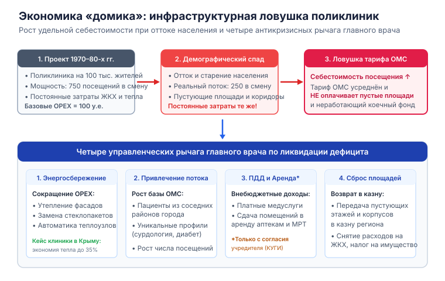
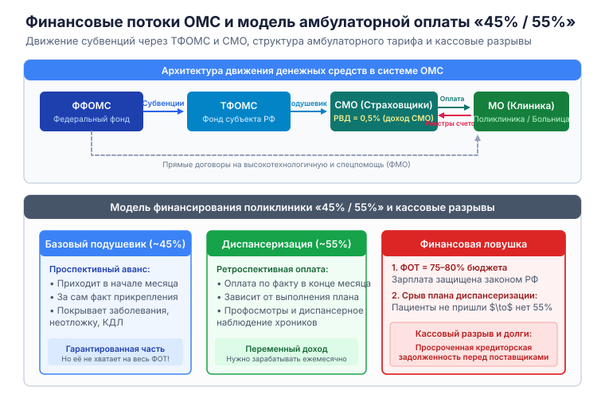

Управление медицинскими и страховыми организациями · 13 ноября 2026

# Экономика медицинской организации: финансовые потоки ОМС, подушевой норматив 45/55, инфраструктура и типы учреждений

* **Преподаватель:** **Обухова Ольга Валерьевна** — кандидат политических наук, заместитель директора по экономике здравоохранения ФГБУ «ЦНИИОИЗ» Минздрава России, доцент кафедры управления и экономики здравоохранения НИУ ВШЭ.
* **Дисциплина:** Управление медицинскими и страховыми организациями (модуль экономики и бизнес-планирования МО).
* **Формат и дата:** Практический семинар (материалы аудиозаписей 10 и 11 от 13 ноября 2026 года).
* **Контекст:** Разбор реальных механизмов амбулаторного и стационарного финансирования: где брать открытые данные, как формируется кассовый разрыв поликлиник по модели «45% / 55%», почему советская инфраструктура («домик») становится финансовой ловушкой для главврача, как рассчитывается функция врачебной должности (ФВД) и почему организационно-правовая форма (ГКУЗ vs ГБУЗ) кардинально меняет мотивацию клиники.

!!! tip "TL;DR: Ключевые выводы практического семинара"
    1. **Двойная природа ОМС:** Взносы за работающих граждан (процент от ФОТ) — это классическое *социальное страхование*, а взносы регионов за неработающих — *социальное обеспечение*. В РФ действует единая ставка без отраслевой дифференциации по вредности (в отличие от модели Бисмарка в Германии), а медицинскую помощь около 20 млн неофициально занятых граждан («в тени») де-факто оплачивают добросовестные налогоплательщики.
    2. **Экономика «домика» (инфраструктурная ловушка):** Поликлиника или стационар — капитальный объект с постоянными коммунальными издержками. При естественной или миграционной убыли населения постоянные затраты распределяются на меньшее число посещений: себестоимость единицы помощи резко подскакивает, а средний тариф ОМС не компенсирует пустующие площади и неработающие койки.
    3. **Финансовый риск амбулаторки (модель «45% / 55%»):** Базовый подушевой норматив гарантирует клинике лишь ~45% доходов в начале месяца. Оставшиеся ~55% (диспансеризация и диспансерное наблюдение) выплачиваются строго по факту выполнения половозрастного плана. Поскольку защищённый ФОТ «съедает» 75–80% бюджета, недовыполнение диспансеризации неотвратимо формирует **просроченную кредиторскую задолженность** перед коммерческими поставщиками медикаментов и расходных материалов.
    4. **Амортизация ≠ ремонт (CAPEX vs OPEX):** В частном бизнесе амортизационные отчисления накапливаются на замену фондов. В государственном секторе амортизация заложена в тариф символически, а закупка «тяжёлого» оборудования и капитальные ремонты финансируются целевыми бюджетными субсидиями (нацпроекты, программы модернизации первичного звена).
    5. **Штаты и расчёт ФВД:** Рекомендуемые нормативы Минздрава (1 700 прикреплённых на терапевта, 1 300 на ВОП) не могут снижаться произвольно. Любое изменение норм нагрузки требует локального акта на основе хронометража и обязательного согласования с профсоюзом. Годовая функция врачебной должности рассчитывается из 15-минутного слота (4 пациента в час) с обязательной поправкой на отпуска, обучение и 10% технологической неявки.
    6. **Организационно-правовая форма определяет стимулы:** Все МО обязаны лечить по единым стандартам (ст. 37 323-ФЗ), но казенные учреждения (ГКУЗ) сдают всю выручку от платных услуг в бюджет субъекта, лишая руководство стимула развивать сервис (кейс Ульяновского тубдиспансера). Бюджетные учреждения (ГБУЗ) реинвестируют доходы от платных услуг в развитие базы и надбавки персоналу (кейс Тамбовского тубдиспансера).

---

## 1. Где брать достоверные данные для аналитики здравоохранения

В прикладной аналитике и подготовке курсовых проектов исследователи регулярно сталкиваются с дефицитом открытой статистики (ограничение демографических рядов, перебои в работе портала Росстата). Для управленца критически важно опираться на первичные ведомственные и финансовые реестры:

| Источник данных | Что конкретно можно извлечь | Практическое применение для управленца |
| :--- | :--- | :--- |
| **ФЗ о бюджете ФФОМС** *(плановый закон и отчёт об исполнении)* | Переходящие остатки, профицит/дефицит фонда, сводные трансферты в регионы, нормированный страховой запас (НСЗ). | Макроэкономическая оценка достаточности тарифов и финансовой устойчивости системы ОМС. |
| **Годовой отчёт ФФОМС** *(публикуется со времён руководства И. В. Баланина)* | Посубъектная численность застрахованных, пропорции взносов за работающих и неработающих, динамика подушевых нормативов. | Межрегиональные сопоставления, оценка собираемости взносов и региональных дисбалансов. |
| **Официальный сайт Банка России (ЦБ РФ)** | Открытая статистика по рынку страхования: реестры СМО, договоры ДМС, численность застрахованных по регионам. | Независимая верификация демографических показателей и миграционной убыли населения. |
| **Портал государственных закупок и учреждений (`bus.gov.ru`)** | План финансово-хозяйственной деятельности (ПФХД), план выполнения **государственного задания**, фактическая средняя зарплата по категориям. | Полный финансовый и кадровый аудит конкретного государственного ЛПУ. |
| **Сайты ТФОМС и Тарифные соглашения регионов** | Пообъектное распределение объёмов медицинской помощи (койко-дни, посещения, КСГ, ВМП) между конкретными клиниками. | Оценка объёмных лимитов, рисков превышения плана и санкций за сверхобъёмы. |
| **Сайты ФГБУ «ЦЭККМП» и «ЦНИИОИЗ» Минздрава России** | Методические рекомендации по расчёту тарифов ОМС, клинико-статистических групп (КСГ) и нормативов трудозатрат. | Калькуляция себестоимости законченного случая и проектирование штатного расписания. |

!!! warning "Методологическое правило фактчекинга (кейс студенческой аналитики)"
    Нельзя некритично транслировать сенсационные заявления из публицистики (например: *«финансирование здравоохранения в России рухнуло с 4,5 до 1 трлн рублей»*). Подобные ошибки вызваны методологической путаницей:
    
    * **Консолидированный бюджет здравоохранения** (бюджет ФФОМС + ТФОМС + федеральный бюджет + региональные бюджеты) составляет порядка **6,5–7 трлн рублей** и стабильно индексируется.
    * Падение по одной изолированной строке федерального бюджета обычно отражает завершение разовых капитальных строек нацпроекта либо перераспределение полномочий между бюджетом и фондом ОМС.

---

## 2. Природа ОМС: социальное страхование vs социальное обеспечение

Отечественная система обязательного медицинского страхования носит гибридный характер, объединяя два несовпадающих экономических механизма:

1. **За работающее население** платежи осуществляет работодатель в виде процента от фонда оплаты труда (**ФОТ**) в составе единого социального тарифа — это классическое **социальное страхование**.
2. **За неработающее население** (дети, пенсионеры, зарегистрированные безработные) платежи перечисляют бюджеты субъектов РФ из общих налоговых доходов региона — это инструмент **социального обеспечения**.

### Сравнение российской модели ОМС с германской моделью Бисмарка

| Критерий анализа | Германия (классическое страхование Бисмарка) | Российская Федерация (гибридная модель ОМС) |
| :--- | :--- | :--- |
| **Дифференциация взносов работодателей** | Тариф дифференцирован по отраслям и классам профессионального риска (вредные и опасные производства платят существенно больше офисных компаний из-за повышенной заболеваемости). | **Единая шкала взносов:** взнос работодателя обезличен и не зависит от условий труда на конкретном рабочем месте. |
| **Принцип доступности помощи** | Страховая защита исторически привязана к занятости работника и зависимым членам его семьи. | **Всеобщий конституционный охват:** объем помощи по базовой программе одинаков для работающего донора и незанятого гражданина. |
| **Теневой сектор и занятость** | Тотальный налоговый и страховой учёт занятости; серые зоны минимальны. | Около **20 млн граждан** трудоспособного возраста находятся в «серой» зоне экономики. Формально числясь неработающими, они получают бесплатную медпомощь, которую субсидируют бюджеты за счёт добросовестных налогоплательщиков. |

!!! note "Риски регуляторного давления на самозанятых"
    Попытки вовлечь неформально занятых граждан в легальное поле через институт самозанятости (НПД со ставками 4–6%) дают хрупкий баланс. Попытки фискального давления или принудительного перевода самозанятых в статус индивидуальных предпринимателей с фиксированными страховыми взносами (~50 тыс. руб./год) неизбежно вызовут обратный отток трудоспособного населения в глухую теневую занятость.

---

## 3. Экономика «домика»: инфраструктура, CAPEX/OPEX и амортизация

Медицинская организация не существует в цифровом вакууме: это фундаментальный капитальный объект («домик»), жестко привязанный к земельному участку, коммунальным сетям и градостроительным нормам.

<article class="feature-card" markdown>
Методология планирования

**«Снизу вверх» vs «Сверху вниз»**  
* **Снизу вверх (калькуляция):** расчёт идеальной потребности на основе стандартов медпомощи, клинических рекомендаций и натуральных норм расхода.  
* **Сверху вниз (лимитирование):** реальный объём средств, выделенный Минфином и ФФОМС. Разрыв между ними порождает неизбежную *оптимизацию*.
</article>

<article class="feature-card" markdown>
Капитальные и операционные затраты

**CAPEX vs OPEX**  
* **CAPEX (Capital Expenditures):** капитальные инвестиции в здания, пристройки, реконструкцию инженерных сетей и покупку «тяжёлого» оборудования (МРТ, КТ, ангиографы).  
* **OPEX (Operational Expenditures):** текущие эксплуатационные расходы клиники (ФОТ, медикаменты, питание, коммуналка, связь, текущий ремонт).
</article>

<article class="feature-card" markdown>
Фондовооружённость

**Амортизация vs Текущий ремонт**  
* **Текущий ремонт и ТО:** операционные затраты (OPEX), оплачиваемые по тарифам ОМС и договорам сервисного обслуживания.  
* **Амортизация:** бухгалтерское списание стоимости основных фондов. В коммерческих клиниках это реальный фонд накопления на реновацию; в ОМС — расчётная величина.
</article>

### Бухгалтерский парадокс износа основных фондов
В отчётах Росстата и региональных минздравов доля изношенных медицинских зданий и оборудования нередко сохраняется на уровне 50–60%, несмотря на многомиллиардные вливания по нацпроектам. Причина кроется в управленческой мотивации:

* Главный врач и региональное министерство финансово **заинтересованы показывать высокий процент износа** основных фондов.
* Чем хуже формальное состояние фондов в паспорте учреждения, тем выше шансы ЛПУ войти в федеральную адресную инвестиционную программу (ФАИП), получить целевую субсидию на капитальный ремонт или транш на полное переоснащение «тяжёлым» парком оборудования.

### Экономическая ловушка советских поликлиник (1970-е → 2020-е годы)

Мощность советских ЛПУ закладывалась по нормам градостроительного проектирования под высокую плотность населения: в поликлиниках — в **посещениях в смену**, в больницах — в **коечной мощности**. 

Когда население малого города или моногорода за 40–50 лет сокращается со 100 тыс. до 40 тыс. человек, постоянные расходы на отопление, освещение и охрану гигантского здания («домика») остаются прежними (100 условных единиц). При падении потока пациентов себестоимость каждого амбулаторного визита резко возрастает, а тариф ОМС остаётся усреднённым:

{ loading=lazy }

#### Четыре антикризисных рычага главного врача:
1. **Энергосбережение и тепловая модернизация:** кейс поликлиники в Республике Крым, где утепление фасадов, замена окон и установка погодозависимой автоматики узла учёта тепла позволили сократить коммунальные платежи на 30–40% и перенаправить средства на медикаменты.
2. **Привлечение пациентов и расширение зоны влияния:** открытие консультативно-диагностических приёмов дефицитных специалистов, привлечение пациентов из соседних районов по межтерриториальным расчётам ОМС.
3. **Приносящая доход деятельность (ПДД) и сдача избыточных площадей в аренду:** открытие платных отделений, сдача помещений под аптечные пункты, оптику или ортопедические салоны (требует согласования с учредителем и КУГИ, так как имущество закреплено на праве оперативного управления).
4. **Возврат лишних площадей в казну региона:** юридический отказ от пустующих этажей или отдельных корпусов с передачей их муниципалитету или субъекту РФ для снятия бремени коммунальных платежей и налога на имущество.

---

## 4. Штатные нормативы и практикум по расчёту ФВД

### Нормативные границы самостоятельности главного врача

Штатное расписание медицинской организации регламентируется **Порядками оказания медицинской помощи** (по профилям заболеваний) и **Положениями об организации оказания медпомощи** (по видам — ПМСП, СМП, специализированная):

* **Участковый терапевт:** норматив — **1 700 человек** взрослого прикреплённого населения на 1 врачебный участок (в районах Крайнего Севера и приравненных местностях — порядка 1 300 человек; в переуплотнённых филиалах Москвы нагрузка на практике достигает 3 000 – 3 500 человек).
* **Врач общей практики (семейный врач / ВОП):** норматив — **1 300 человек** смешанного населения (включает детей и взрослых, что требует расширенного диагностического протокола).

!!! danger "Правовые ограничения главного врача при оптимизации штата"
    1. **Запрет на снижение штатной численности ниже норматива:** Главврач не имеет права произвольно сокращать ставки для «экономии ФОТ», если территория обслуживания и прикреплённое население требуют нормативного числа врачей.
    2. **Процедура увеличения нормы нагрузки:** Повысить норматив обслуживания или изменить хронометраж приёма главврач вправе **исключительно локальным нормативным актом**, изданным на основании локального хронометража рабочего времени и согласованным с **первичной профсоюзной организацией медработников** (ст. 372 ТК РФ). В противном случае надзорные проверки (ГИТ, Росздравнадзор, прокуратура) аннулируют приказы и наложат штрафы.
    3. **Бессмысленность раздувания штатного расписания:** В современной модели ОМС финансирование не привязано к числу физических ставок. Финансирование выделяется на подушевой контингент и выполненные объёмы помощи. Лишние незаполненные ставки в штатке лишь размывают стимулирующий фонд.

---

### Аудиторный практикум: расчёт Функции Врачебной Должности (ФВД)

**Функция врачебной должности (ФВД)** — плановое годовое число посещений на 1 ставку врача-специалиста, обеспечивающее выполнение государственного задания и объёмов территориальной программы ОМС.

$$\text{ФВД}_{\text{год}} = \left(\frac{T_{\text{смены}}}{t_{\text{приёма}}}\right) \times D_{\text{раб.год}} \times K_{\text{явки}}$$

#### Параметры расчёта для амбулаторного приёма участкового терапевта:
* **Норма времени на 1 приём ($t_{\text{приёма}}$):** **15 минут** (утверждена приказом Минздрава России № 290н). Это даёт базовую пропускную способность: 4 пациента в астрономический час.
* **Продолжительность рабочей смены ($T_{\text{смены}}$):** При 39-часовой рабочей неделе медработника норма амбулаторного приёма в кабинете составляет **6 часов в день** (остальное время отводится на обслуживание вызовов на дому и оформление электронных медицинских карт в ЕМИАС).
  * Базовая ёмкость одной рабочей смены:
    $$24 \text{ слота в день} \quad (120 \text{ слотов в пятидневную рабочую неделю}).$$
* **Число рабочих дней в году ($D_{\text{раб.год}}$):** При пятидневной рабочей неделе в календарном году порядка 247 рабочих дней. За вычетом гарантированного ежегодного отпуска врача (28 календарных дней основного отпуска + дополнительные дни за вредность и стаж, в среднем 21–24 рабочих дня) эффективный фонд рабочего времени составляет около **220–225 рабочих дней**.
* **Коэффициент явки ($K_{\text{явки}}$):** Эмпирический поправочный коэффициент, составляющий порядка **$0{,}90$** (учитывает до 10% неявки пациентов по предварительной самозаписи, экстренные снятия с приёма и сбои в расписании).

$$\text{ФВД}_{\text{план}} = 24 \times 223 \times 0{,}90 \approx 4\,817 \text{ посещений в год на 1 ставку терапевта}.$$

---

## 5. Механика оплаты в ОМС: модель «45% / 55%», СМО и кассовые разрывы

### Маршрутизация финансовых потоков ОМС

Федеральный фонд ОМС аккумулирует средства со всей страны и направляет целевые субвенции в Территориальные фонды ОМС (ТФОМС) субъектов РФ с учётом коэффициента территориальной дифференциации (КТД). ТФОМС заключает трёхсторонние договоры со страховыми медицинскими организациями (СМО) и медицинскими организациями:

{ loading=lazy }

!!! note "Экономика страховой медицинской организации (СМО)"
    СМО в системе ОМС не являются классическими коммерческими рисковыми страховщиками. Они не формируют инвестиционную прибыль из страховых резервов. Их деятельность строго регламентирована:
    
    * Финансирование расходов на ведение дела (**РВД**) законодательно зафиксировано на уровне **$0{,}5\%$** от средств, переданных из ТФОМС.
    * Две базовые государственные функции СМО:
      1. **Медико-экономический контроль и экспертиза качества (МЭК/МЭЭ/ЭКМП):** проверка выставленных реестров счетов, выявление приписок, дефектов ведения документации и наложение штрафных санкций.
      2. **Индивидуальное информационное сопровождение застрахованных:** рассылка СМС-оповещений, персональные звонки страховых представителей и маршрутизация пациентов на диспансерные осмотры.

---

### Смешанная модель финансирования поликлиники: происхождение кредиторской задолженности

В амбулаторном звене средний базовый подушевой тариф составляет условно 200–250 рублей в месяц на одного прикреплённого гражданина (исходя из эпидемиологического факта, что за медицинской помощью в течение месяца реально обращается не более **40%** прикреплённого контингента).

Чтобы амбулаторные центры не занимались пассивным ожиданием заболевших, а активно выявляли патологии на ранних стадиях, государственное финансирование разделено на две части:

| Структурный компонент | Доля в доходе | Механизм перечисления средств | Что покрывает статья финансирования |
| :--- | :---: | :--- | :--- |
| **Базовый подушевой норматив** | **~45%** | **Проспективный** *(гарантированный аванс в первых числах месяца)* | Неотложная помощь, обращения по поводу острых и обострения хронических заболеваний, плановые визиты к терапевту, общеклиническая лаборатория. Приходит за факт прикрепления полиса к ЛПУ. |
| **Диспансеризация и диспансерное наблюдение** | **~55%** | **Ретроспективный** *(оплата по факту в конце месяца за законченные случаи)* | Первый и второй этапы всеобщей диспансеризации, углублённая диспансеризация, диспансерное наблюдение хроников строго по половозрастным квотам. |

#### Анатомия кассового разрыва и механизм образования «кредиторки»:

1. **Неэластичность расходов на ФОТ:** В структуре расходов государственной поликлиники фонд оплаты труда с начислениями составляет **75–80%**. Зарплата медперсонала защищена «майскими указами» Президента РФ и трудовым законодательством: снизить её или задержать выплату главный врач не имеет права.
2. **Гарантированный аванс покрывает лишь 45% затрат:** Гарантированных средств подушевика физически недостаточно даже для выплаты аванса по заработной плате. Чтобы закрыть оставшиеся потребности, поликлиника обязана «заработать» оставшиеся 55% средств выполнением плана по диспансеризации.
3. **Системный управленческий разрыв:** Система оплаты труда участкового врача оторвана от глобального плана клиники. Врач не замотивирован обзванивать прикреплённых жителей и «за руку» приводить их в кабинеты профилактики. Кроме того, в малых городах и сельских районах значительная часть трудоспособного населения фактически проживает в мегаполисах (маятниковая и вахтовая миграция), числясь в реестре прикрепления.
4. **Формирование просроченной кредиторской задолженности:** Недовыполнение объёмов диспансеризации на 30–40% приводит к недополучению миллионов рублей из ТФОМС. Главврач вынужден направлять все поступающие средства на выплату зарплаты. В итоге клиника прекращает оплачивать счета коммерческих поставщиков за поставленные реактивы, шприцы, дезсредства и коммунальные услуги. Возникает **просроченная кредиторская задолженность**.

<article class="feature-card" markdown>
Этап 1

**Дефицит аванса**  
Гарантированный подушевик (**~45%**) не покрывает даже защищённый ФОТ поликлиники (**75–80%**).
</article>

<article class="feature-card" markdown>
Этап 2

**Срыв плана диспансеризации**  
Оставшиеся **~55%** недополучены из-за естественной неявки и миграции прикреплённого контингента.
</article>

<article class="feature-card" markdown>
Этап 3

**Кассовый разрыв**  
Все входящие средства брошены на выплату зарплаты; оплата внешних счетов поставщиков блокируется.
</article>

<article class="feature-card" markdown>
Этап 4

**Кредиторская задолженность**  
Просроченная задолженность перед коммерческими дистрибьюторами лекарств и ЖКХ $\to$ экстренная санация из бюджета.
</article>

!!! quote "Чёткое разграничение видов финансовой задолженности"
    * **Дебиторская задолженность** — *должны медицинской организации* (например, ТФОМС или СМО задержали перечисление подушевого аванса или оспаривают оплату реестров счетов по межтерриториальным расчётам).
    * **Кредиторская задолженность** — *медицинская организация должна внешним кредиторам* (неоплаченные в установленный 30-дневный срок контракты по 44-ФЗ перед фармдистрибьюторами, долги энергосбытовым компаниям, неоплаченные налоги на ФОТ).

!!! danger "Правовой запрет: исчерпание лимитов на диагностику (кейс ПЦР на ВПЧ)"
    Если поликлиника исчерпала квартальный объём квот на дорогостоящие лабораторные или инструментальные исследования (например, жидкостная цитология, ПЦР-скрининг на ВПЧ, МРТ с контрастом), **категорически запрещено отказывать пациенту или отправлять его в коммерческую лабораторию за свой счёт**.
    
    Главный врач и начмед обязаны оформить официальное направление по форме 057/у и **маршрутизировать гражданина в другое ЛПУ**, имеющее неиспользованные объёмы по программе ОМС в данном субъекте РФ. Отказ в выдаче направления образует грубый дефект оказания помощи со штрафом от СМО и Росздравнадзора.

---

## 6. Эволюция способов оплаты и типы государственных МО

### Эволюция моделей финансирования по звеньям системы

За последние 30 лет способы оплаты медицинской помощи в России прошли путь от советской постатейной сметы содержания коек до высокоточных комбинированных методов:

| Служба / Звено | Исторический путь трансформации | Действующая модель | Экономическая логика регулятора |
| :--- | :--- | :--- | :--- |
| **Скорая медицинская помощь (СМП)** | Сметное содержание подстанции $\to$ попытка оплаты за каждый выезд в ОМС *(2013 год, признана провальной)*. | **Подушевой норматив финансирования на зону ответственности станции.** | СМП — служба экстренной готовности. Оплата за вызов стимулировала необоснованные выезды и дефицит бригад на тяжёлых ДТП; подушевик оплачивает постоянное дежурство. |
| **Круглосуточный стационар** | Оплата «койко-дня» и содержания коек в СССР $\to$ оплата законченного случая. | **Клинико-статистические группы (КСГ)** с поправочными коэффициентами сложности. | Стационар финансируется за законченный клинический результат; длительное удержание пациента на койке экономически невыгодно. |
| **Амбулаторное звено** | Оплата изолированного визита/талона в 1990-х $\to$ подушевой норматив. | **Комбинированный подушевик (45%) + целевые тарифы за диспансеризацию (55%).** | Сочетание финансовой стабильности первичного звена со стимулированием профилактики и раннего скрининга. |

---

### Организационно-правовые формы государственных учреждений: мотивация главврача

Согласно ст. 37 Федерального закона № 323-ФЗ, качество и порядок оказания медицинской помощи обязаны быть одинаковыми во всех организациях независимо от формы собственности. Однако **экономическая мотивация** руководства кардинально различается в зависимости от статуса юридического лица:

| Тип учреждения | Источники финансирования | Право распоряжения платными доходами (ПДД) | Реальный отраслевой кейс из практики |
| :--- | :--- | :---: | :--- |
| **Казённое (ГКУЗ)** | Строгая бюджетная смета через орган Казначейства. | **Нет прав.** Все заработанные средства от платных услуг в полном объёме перечисляются в доход регионального бюджета. | **Противотуберкулёзный диспансер Ульяновской области (ГКУЗ):** Врачи проводили платные профосмотры трудовых мигрантов, но доходы забирал региональный минздрав на общие статьи. У главного врача отсутствовала мотивация развивать коммерческий сектор и закупать передовые тест-системы. |
| **Бюджетное (ГБУЗ)** | Субсидия на государственное задание + средства ОМС + средства от ПДД. | **Полное право.** Доходы от платных услуг поступают на лицевой счёт и расходуются по локальному ПФХД клиники. | **Противотуберкулёзный диспансер Тамбовской области (ГБУЗ):** Руководство активно развивало внебюджетные диагностические услуги, реинвестируя доходы в ремонт палат, закупку реактивов и стимулирующие выплаты врачам. |
| **Автономное (ГАУЗ)** | Госзадание + ОМС + широкие полномочия по коммерческим кредитам. | **Максимальная автономия.** Возможность открытия счетов в банках и гибкого манёвра фондами. | Эксперимент по массовому переводу больниц в статус ГАУЗ показал избыточные финансовые риски: банкротство в здравоохранении недопустимо из-за непрерывности госгарантий. |

!!! note "Трансформация специализированной фтизиатрической службы"
    В связи с успехами современной химиотерапии заболеваемость туберкулёзом в мегаполисах устойчиво снижается (в Москве официально констатирована стабилизация на рекордно низких показателях). Перед организаторами здравоохранения встаёт задача реорганизации избыточной коечной инфраструктуры фтизиатрических стационаров — в частности, их перепрофилирования под лечение сочетанных коморбидных инфекций (ВИЧ-инфекция + туберкулёз + гепатиты) и хронических неспецифических заболеваний лёгких.

---

## 7. Глоссарий ключевых понятий семинара

* **Проспективная оплата** — предварительное авансовое финансирование медицинской организации в твёрдой сумме (не зависит от фактического числа посещений; пример — подушевой амбулаторный норматив).
* **Ретроспективная оплата** — компенсация расходов по факту оказания медпомощи после предоставления и экспертной проверки реестров счетов (пример — тарифы КСГ в стационаре, 55% амбулаторного тарифа за завершённую диспансеризацию).
* **ПДД (Приносящая доход деятельность)** — официальный нормативный термин, пришедший на смену понятию «предпринимательская деятельность»; включает платные медицинские услуги, доходы от клинических исследований, научно-образовательные услуги и аренду помещений.
* **РВД (Расходы на ведение дела)** — нормативный процент от средств ОМС (в 2026 году — $0{,}5\%$), удерживаемый страховой медицинской организацией (СМО) на обеспечение экспертной, консультационной и технологической работы.
* **ФВД (Функция врачебной должности)** — нормативная расчётная нагрузка на 1 занятую врачебную ставку в год, выраженная в плановом количестве принятых пациентов.
* **Просроченная кредиторская задолженность** — не исполненные в установленный контрактом срок обязательства клиники перед коммерческими контрагентами, поставщиками энергоресурсов и внебюджетными фондами.

---

## Чек-лист практических заданий для магистра

- [ ] **Анализ федерального макроуровня:** Скачать с официального портала **ФФОМС** последний годовой отчёт фонда и закон об исполнении бюджета; проанализировать соотношение страховых взносов за работающих и неработающих граждан по своему субъекту РФ.
- [ ] **Мониторинг страхового рынка через Банк России:** На сайте **ЦБ РФ** открыть раздел «Статистика показателей страхового рынка» и сопоставить численность застрахованных в СМО с данными Росстата по выбранному региону.
- [ ] **Аудит конкретной клиники на `bus.gov.ru`:** Выбрать государственную поликлинику и изучить её утверждённый **План ФХД**, параметры выполнения государственного задания и реальный уровень средней зарплаты врачей.
- [ ] **Анализ тарифного соглашения:** На сайте своего **ТФОМС** найти действующее Тарифное соглашение на текущий год, изучить структуру базового подушевого тарифа и перечень коэффициентов специфики оказания помощи.
- [ ] **Практический расчёт ФВД:** Составить в табличном редакторе персональную модель расчёта ФВД участкового врача-терапевта и врача-кардиолога с учётом специфики отпускных периодов и коэффициента явки пациентов.
