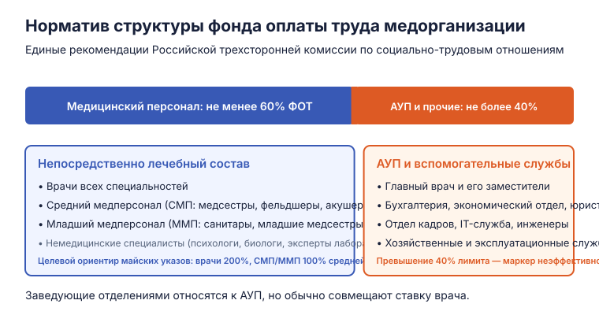
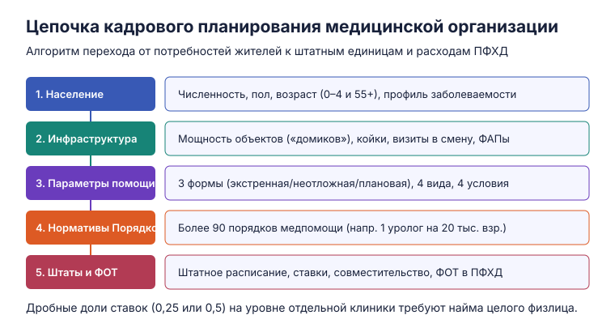
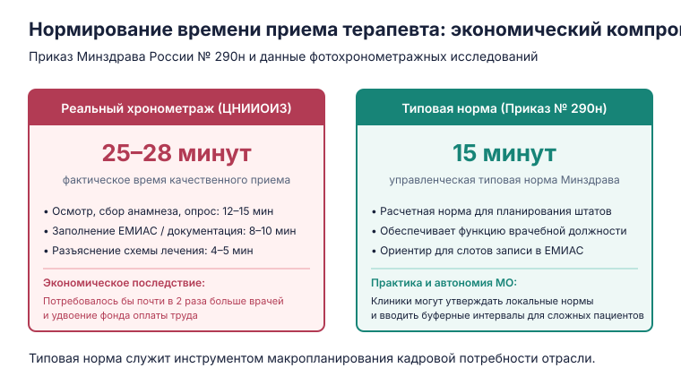

Управление медицинскими и страховыми организациями · 1 курс · 2 модуль

# ПФХД, кадровое обеспечение и нормирование труда в здравоохранении

Лектор — **Ольга Валерьевна Обухова**, заместитель директора по экономике здравоохранения ФГБУ «ЦНИИОИЗ» Минздрава России.

Материал продолжает цикл занятий по экономике медицинской организации (первая часть была посвящена [программе госгарантий, тарифам и способам оплаты помощи](medical-organizations-oms-and-tariffs.md)). В фокусе лекции — инструменты финансово-хозяйственного планирования (ПФХД), логика распределения субвенций ОМС по регионам, цепочка формирования штатного расписания и компромиссы при нормировании труда медицинских работников.

---

## 1. План финансово-хозяйственной деятельности (ПФХД) и структура затрат

**План финансово-хозяйственной деятельности (ПФХД)** — основной плановый документ государственной (муниципальной) медицинской организации, определяющий все источники её доходов и постатейные направления расходов на очередной финансовый год и плановый период.

В бухгалтерском и управленческом учёте государственного сектора каждая статья затрат классифицируется по кодам **КОСГУ** *(Классификация операций сектора государственного управления)*:

| Статья расходов (КОСГУ) | Содержание и назначение | Правовой и управленческий статус |
| :--- | :--- | :--- |
| **Оплата труда (КОСГУ 211) и начисления (КОСГУ 213)** | Заработная плата, стимулирующие и компенсационные выплаты, налоги и страховые взносы на ФОТ (30,2%). | **Главная защищённая статья**. Учреждение не имеет права задерживать выплаты или самовольно урезать гарантированную часть. |
| **Уплата налогов и сборов (КОСГУ 290)** | Налог на имущество организаций, земельный налог, транспортный налог, государственные пошлины. | **Вторая защищённая статья**. Обязательные платежи в бюджетную систему, подлежащие безусловному первоочередному списанию. |
| **Коммунальные услуги и содержание (КОСГУ 223/225)** | Отопление, водоснабжение, электроэнергия, вывоз отходов, текущий ремонт зданий и инженерных сетей. | Базовые эксплуатационные расходы. При дефиците средств формируют кредиторскую задолженность учреждения. |
| **Основные средства (КОСГУ 310)** | Закупка медицинского оборудования, санитарного автотранспорта, серверов и дорогостоящей техники. | Капитальные расходы. По программе ОМС за счёт тарифа действует ограничение стоимости единицы оборудования (до 100 тыс. руб., либо целевые средства). |
| **Материальные запасы (КОСГУ 340)** | Лекарственные препараты, медицинские изделия, реактивы, перевязочные средства, дезрастворы, мягкий инвентарь. | Текущие материальные затраты лечебного процесса. Объём запасов рассчитывается по нормам расхода на пролеченного пациента. |

---

## 2. Целеполагание: государственная vs частная медорганизация

Экономическая модель клиники напрямую вытекает из целей, зафиксированных в её **Уставе**:

* **Частная коммерческая МО:** ключевая уставная цель — **извлечение прибыли** (ст. 50 ГК РФ). Если отделение или клиника в целом генерирует операционные убытки либо не выдерживает конкуренции по качеству, собственник закрывает её или перепрофилирует бизнес.
* **Государственная (муниципальная) МО:** создаётся публичной властью ради некоммерческой цели — выполнения государственной функции по обеспечению конституционных гарантий бесплатной медицинской помощи (ст. 41 Конституции РФ, программа госгарантий).
  
### Почему государственную клинику нельзя просто закрыть?
Если районная больница или поликлиника демонстрирует низкое качество лечения, высокую смертность или хроническую кредиторскую задолженность, её **нельзя ликвидировать**, если она является единственным поставщиком помощи на закреплённой территории. Закрытие оставит жителей без базовой экстренной и первичной помощи.

### Административно-экономические рычаги санации:
1. **Смена руководства:** увольнение неэффективного главного врача и назначение кризис-менеджера.
2. **Оптимизация неэффективных структур:** перераспределение коечного фонда, консервация пустующих площадей, построенных по нормативам 1970-х годов.
3. **Централизация вспомогательных служб:** объединение бухгалтерии, кадровой службы, юридического отдела, автопарка и лабораторной диагностики нескольких ЛПУ района под эгидой одного централизованного оператора. Это снижает административные накладные расходы и высвобождает средства на закупку медикаментов и повышение зарплат врачей.

---

## 3. Финансирование медицинской помощи и субвенции ОМС

Следует строго разделять понятия **«расходы на здравоохранение»** и **«финансирование медицинской помощи»**:

* **Система здравоохранения в широком смысле:** финансирует не только лечение больных, но и государственный санитарно-эпидемиологический надзор (Роспотребнадзор), фундаментальную и прикладную медицинскую науку, подготовку кадров (медицинские колледжи и университеты Минздрава), а также ведомственную медицину (силовые ведомства, ФМБА).
* **Программа государственных гарантий (ПГГ):** финансирует исключительно непосредственное оказание бесплатной медицинской помощи застрахованным гражданам.
  * Совокупный объём ПГГ в России составляет порядка **4,5 трлн рублей в год**.
  * **Структура финансирования ПГГ:** около **90%** обеспечивается средствами обязательного медицинского страхования (ОМС) и около **10%** — прямыми ассигнованиями федерального и региональных бюджетов.

### Формула субвенции регионам из бюджета ФФОМС

Федеральный фонд ОМС аккумулирует страховые взносы со всей страны и распределяет их в территориальные фонды (ТФОМС) в виде целевых межбюджетных трансфертов — **субвенций**:

$$\text{Субвенция региону} = \text{Базовый подушевой норматив} \times \text{Численность застрахованных} \times \text{КТД}$$

* **Базовый подушевой норматив:** единая для всей страны сумма на одного застрахованного (в 2026 году — порядка 24–25 тыс. рублей).
* **КТД (*коэффициент территориальной дифференциации*):** отражает объективную региональную разницу в стоимости коммунальных услуг, северных надбавок к зарплате, цен на энергоносители и транспортную логистику. В регионах Центральной России (например, в Ярославской или Воронежской области) КТД близок к $1{,}0$. В северных и дальневосточных регионах (Якутия, Чукотка, Магадан) КТД достигает **$2{,}5–2{,}7$ и выше**.

### Системные ограничения формулы субвенций
1. **Игнорирование профиля заболеваемости:** федеральная формула рассчитывается строго от численности застрахованных и не делает поправок на локальные эпидемиологические аномалии (профессиональные пневмокониозы шахтёров в Кузбассе, радиационный след аварии на ЧАЭС в Тульской и Брянской областях, повышенный травматизм на вахтовом Севере).
   > *Принципиальная позиция ФФОМС:* введение повышающих коэффициентов к субвенциям за повышенную заболеваемость создаст порочные стимулы — регионам станет финансово невыгодно снижать заболеваемость и проводить качественную диспансеризацию.
2. **Бюджетная асимметрия территорий:** регионы-доноры с профицитными бюджетами (Москва, Санкт-Петербург, ХМАО) имеют законное право софинансировать территориальную программу ОМС за счёт собственных налоговых доходов. Например, в Москве городская бюджетная надбавка к базовому тарифу ОМС составляет около **20%**, что обеспечивает существенно более высокие оклады врачей и оснащённость. Дотационные же регионы вынуждены укладываться строго в рамки федеральной субвенции.
3. **Планирование ВМП:** расчётная потребность в высокотехнологичной помощи умножается на норматив финансовых затрат. Если лимиты федерального бюджета урезаются, клиники вынуждены либо искусственно сдерживать потоки пациентов (очереди и листы ожидания), либо перекрывать дефицит за счёт приносящей доход деятельности (платных услуг).

---

## 4. Кадровое обеспечение: структура и цепочка планирования

### Структура персонала и правило «60 / 40»

Персонал медицинской организации делится на две большие группы, фонд оплаты труда которых строго регламентируется:

<figure class="lecture-figure" markdown>

{ loading=lazy }
  <figcaption markdown>Соотношение фонда оплаты труда медицинского и немедицинского персонала согласно Единым рекомендациям РТК.</figcaption>
</figure>

1. **Медицинские работники (не менее 60% ФОТ):**
   * **Врачи:** специалисты с высшим медицинским образованием (клинический профиль, диагностика, экспертная работа).
   * **Средний медицинский персонал (СМП):** медицинские сёстры, фельдшеры, акушеры, зубные техники, медицинские технологи.
   * **Младший медицинский персонал (ММП):** санитары, младшие медицинские сёстры по уходу.
   * *Специалисты с высшим немедицинским образованием:* медицинские психологи, биологи клинико-диагностических лабораторий, судебные эксперты-химики, инструкторы-методисты ЛФК.
2. **Административно-управленческий и вспомогательный персонал (АУП и прочие — не более 40% ФОТ):**
   * Руководство: главный врач, его заместители (по лечебной части, экспертизе, КЭР, экономике, хозяйственной части).
   * Общеклинические службы: планово-экономический отдел, бухгалтерия, отдел кадров, отдел закупок (44-ФЗ), юридическая служба, IT-отдел, инженеры по медоборудованию, водители, гардеробщики, сантехники.
   * *Управленческий статус заведующих:* заведующий поликлиникой или отделением формально относится к административному персоналу, но в подавляющем большинстве случаев совмещает руководство со ставкой практикующего врача (на 0,25–0,5 ставки).

!!! important "Лимит фонда оплаты труда АУП"
    Согласно Единым рекомендациям Российской трехсторонней комиссии (РТК) по регулированию социально-трудовых отношений, доля расходов на оплату труда административно-управленческого и вспомогательного персонала не должна превышать **40% от совокупного ФОТ** клиники. Нарушение этой пропорции проверяется учредителем и фондом ОМС как признак нерационального расходования средств.

---

### Цепочка кадрового планирования: от населения к штатам

Планирование штатной численности медицинской организации строится не «от желаний руководства», а по строгому каскадному алгоритму:

<figure class="lecture-figure" markdown>

{ loading=lazy }
  <figcaption markdown>Поэтапный переход от демографического анализа к штатному расписанию и бюджету ФОТ.</figcaption>
</figure>

1. **Анализ прикреплённого населения:**
   * Численность, плотность расселения, половозрастной состав.
   * *Наиболее ресурсоёмкие когорты:* дети от 0 до 4 лет (требуют частого патронажа и диспансерных осмотров) и женщины старше 55–60 лет (наибольшая частота обращений по поводу хронических неинфекционных заболеваний).
2. **Инфраструктура и мощность («домики»):**
   * Число поликлинических отделений, фельдшерско-акушерских пунктов (ФАП), врачебных амбулаторий, многопрофильных стационаров.
   * Проектная мощность: число посещений в смену, развёрнутый коечный фонд по профилям.
   * *Исторический дисбаланс:* здания многих больниц строились в советский период (1960–1970-е гг.) под стационарозамещающие модели того времени. Сегодня избыточные койки консервируются, а вместо громоздких ФАПов возводятся компактные быстровозводимые модульные пункты.
3. **Параметры медицинской помощи:**
   * **3 формы:** экстренная, неотложная, плановая;
   * **4 вида:** первичная медико-санитарная, специализированная (включая ВМП), скорая, паллиативная;
   * **4 условия:** вне медицинской организации (СМП, санавиация), амбулаторно (включая дневной стационар на дому), в дневном стационаре, в круглосуточном стационаре.
4. **Нормативная база (Положения и Порядки Минздрава):**
   * *Положения об организации оказания медпомощи по видам* (например, Приказ Минздрава России № 202н по взрослой первичной медико-санитарной помощи).
   * *Порядки оказания медицинской помощи по профилям* (более 90 действующих приказов: кардиология, хирургия, онкология, урология и др.). Каждый Порядок включает структуру подразделений, стандарт оснащения кабинетов и **рекомендуемые штатные нормативы**.

!!! example "Пример штатного норматива кабинета уролога (Приказ Минздрава по урологии)"
    * **Врач-уролог:** 1 должность на 20 000 взрослого прикреплённого населения;
    * **Медицинская сестра:** 1 должность на 1 должность врача-уролога;
    * **Санитар:** 0,25 должности на 1 урологический кабинет.

5. **Кадровые классификаторы:**
   * *Специальность vs Должность:* в медицинском университете и ординатуре специалист получает **специальность** (например, «Терапия», «Урология»), а трудовой договор в клинике заключается на конкретную **должность** (например, «врач-терапевт участковый», «заведующий терапевтическим отделением — врач-терапевт»).
   * Номенклатура должностей медицинских и фармацевтических работников и квалификационные требования Минздрава определяют, с каким дипломом и сертификатом/аккредитацией специалист вправе занимать должность.

---

## 5. Штатное расписание, ставки и оплата труда

**Штатное расписание** — обязательный локальный нормативный акт клиники, утверждаемый главным врачом. Оно содержит перечень структурных подразделений, наименования должностей, количество штатных единиц, должностные оклады и надбавки.

### Особенности применения штатных нормативов:
1. **Рекомендуемый характер для госсектора:** нормативы из федеральных Порядков носят рекомендательный характер. Главный врач вправе ввести дополнительные ставки при доказанной потребности (высокая заболеваемость, разброс участков), но не может сократить штат ниже минимального лицензионного порога.
2. **Неприменимость к частным клиникам:** частные медицинские организации не обязаны соблюдать рекомендуемые штатные нормативы Минздрава (в каждом приказе по Порядку есть соответствующая оговорка).
3. **Пробелы регулирования:** в законодательстве до сих пор отсутствуют централизованные штатные нормативы для приёмных отделений многопрофильных стационаров (нормативы существуют лишь для инфекционных больниц).

### Три уровня учёта кадров (кейс поликлиники на 50 000 населения)

На примере должности врача-уролога (норматив: 1 ставка на 20 000 населения):

| Показатель | Значение в кейсе | Экономический и управленческий смысл |
| :--- | :--- | :--- |
| **1. Штатные должности (единицы)** | $\frac{50\,000}{20\,000} = \mathbf{2{,}5\text{ ставки}}$ | Расчётная нормативная потребность, утверждённая в штатном расписании и заложенная в ПФХД. |
| **2. Занятые должности (ставки)** | $\mathbf{2{,}0\text{ ставки}}$ | Объём ставок, покрытый действующими трудовыми договорами (0,5 ставки — вакансия). Отношение занятых к штатным даёт **коэффициент укомплектованности** ($2{,}0 / 2{,}5 = 80\%$). |
| **3. Физические лица** | $\mathbf{2\text{ человека}}$ (по 1,0 ст.) или $\mathbf{1\text{ человек}}$ (на 2,0 ст.) | Реальные специалисты, работающие в организации. |

!!! note "Агрегирование кадровой потребности"
    Дробную ставку (0,25 или 0,5) невозможно «разрезать»: в отдельно взятую участковую больницу на 0,5 ставки всё равно необходимо нанять живого человека (целое физлицо). Поэтому прямая сумма кадровой потребности отдельных юридических лиц всегда превышает макроэкономический расчёт потребности региона в целом.

### Функция врачебной должности и искажения совместительства
* **Функция врачебной должности** — годовой плановый объём работы на 1,0 ставку:
  * В амбулаторном звене измеряется **числом посещений в год** (например, 3 000–3 500 посещений);
  * В стационаре измеряется **числом закреплённых коек** (например, 1 врач на 15–20 коек).
* **Парадокс совместительства:** на практике оформление врача на 1,5–2,0 ставки часто используется главврачом как легальный инструмент «дотягивания» зарплаты до приемлемого уровня на фоне дефицита кадров. При этом реальный двойной объём работы физически не вырабатывается.
* **Майские указы 2012 года:** целевые нормативы оплаты труда (врачи — **200%** от средней зарплаты по экономике региона; СМП и ММП — **100%**) рассчитываются Росстатом **на физическое лицо**, то есть суммарно со всеми внутренними и внешними совместительствами и ночными дежурствами.
* **Специальные социальные выплаты (Постановление № 2568):** введены для поддержки врачей и медсестёр в районных больницах, малых городах и на селе. Выплачиваются напрямую из Социального фонда России (СФР) и не включаются в состав тарифа ОМС.

---

## 6. Методология нормирования труда: кейс «15 минут»

### Четыре метода расчёта численности персонала

1. **По штатным нормативам (от контингента или структуры):**
   * *Прямой метод:* участковые врачи (терапевты, педиатры, ВОП) рассчитываются строго на прикреплённое население участка (например, 1 700 взрослых на терапевтический участок в городе, 1 300 — на селе).
   * *Косвенный метод:* численность зависит от других врачей. Например, 1 должность врача-рентгенолога полагается на 25 врачей, ведущих амбулаторный приём.
2. **По объёму деятельности и типовым нормам времени:** через плановое количество посещений / операций и норматив трудоёмкости на 1 процедуру.
3. **По данным фотохронометража:** натурные замеры хронометража рабочего дня.
4. **По числу коек и сменности:** для круглосуточных дежурных сестринских и врачебных постов в стационарах.

*Специфика параклинических служб (лаборатории, КТ/МРТ, стоматология):* из-за тотальной автоматизации рассчитывать персонал от населения бессмысленно. Расчёт ведётся по количеству исследований, манипуляций и **условным единицам трудоёмкости (УЕТ)**, либо укрупнённо — как 20% надбавка к численности клинического персонала.

---

### Экономический компромисс норм времени (ЦНИИОИЗ vs Минздрав)

<figure class="lecture-figure" markdown>

{ loading=lazy }
  <figcaption markdown>Сравнение фактических хронометражных замеров ЦНИИОИЗ и нормативного стандарта Приказа Минздрава России № 290н.</figcaption>
</figure>

1. **Законодательный бюджет времени (ТК РФ и Постановление № 101):**
   * Нормальная продолжительность рабочей недели медработника — **не более 39 часов** (при пятидневке — **7,8 часа в день**). Из них ~1–1,5 часа уходит на служебные задачи, конференции и личные нужды, а около 6–6,5 часов составляет «чистый» приём. Из-за этого поликлиники работают в две смены (с 8:00 до 14:00 и с 14:00 до 20:00).
   * Для врачей, занятых *исключительно* амбулаторным приёмом, установлена сокращённая неделя — **33 часа**.
2. **Научные замеры фотохронометража (исследование ЦНИИОИЗ):**
   * Проведён замер сотен тысяч визитов в передовых поликлиниках страны с исключением статистических девиаций по методике Минтруда.
   * **Реальный хронометраж качественного приёма терапевта составил 25–28 минут** (осмотр, сбор анамнеза, работа в ЕМИАС, инструктаж пациента).
3. **Макроэкономический выбор:**
   * Если утвердить государственную норму в 28 минут, годовая выработка терапевта упадёт почти в 2 раза.
   * Следовательно, расчётная потребность системы во врачах-терапевтах **мгновенно вырастет вдвое**, породив катастрофический искусственный кадровый дефицит и потребовав удвоения бюджета ФОТ.
   * Поэтому Минздрав утвердил **компромиссную типовую норму времени (Приказ № 290н)**: **15 минут** на посещение терапевта, **22 минуты** — невролога, **16 минут** — оториноларинголога.
4. **Статус нормы на практике:**
   * 15 минут — это **макроэкономический ориентир для расчёта штатов**, а не секундомер для врача.
   * Руководство поликлиники имеет полное право утвердить собственные локальные нормы времени (например, 12–14 минут на повторный приём с выделением резервных буферных слотов «в подвале» расписания для сложных первичных пациентов).

---

## 7. Практикум и домашние задания

1. **Индивидуальный аудит ПФХД на `bus.gov.ru`:**
   * Найти на официальном портале государственных учреждений [bus.gov.ru](https://bus.gov.ru) план финансово-хозяйственной деятельности любой государственной клиники.
   * Проанализировать соотношение доходов по источникам (ОМС, бюджетные субсидии, платные услуги), оценить динамику переходящих остатков средств и проверить структуру расходов по КОСГУ (долю ФОТ и коммунальных затрат).
2. **Групповой аудит штатного расписания:**
   * Студенты делятся на 5 рабочих групп.
   * Каждая группа получает обезличенное реальное штатное расписание медицинского учреждения, сводную базу штатных нормативов Порядков Минздрава и кадровые классификаторы.
   * **Задача:** проверить соответствие структуры подразделений нормативным Порядкам, выявить дефицит или избыток ставок, рассчитать коэффициент укомплектованности и оценить соблюдение лимита расходов на АУП ($\le 40\%$ ФОТ).
