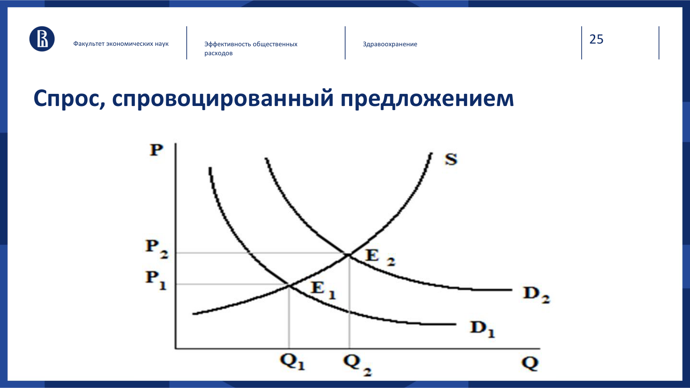
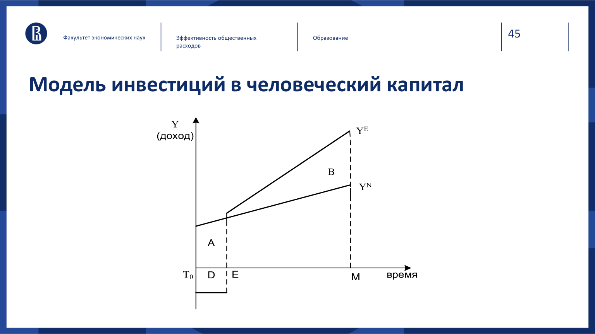
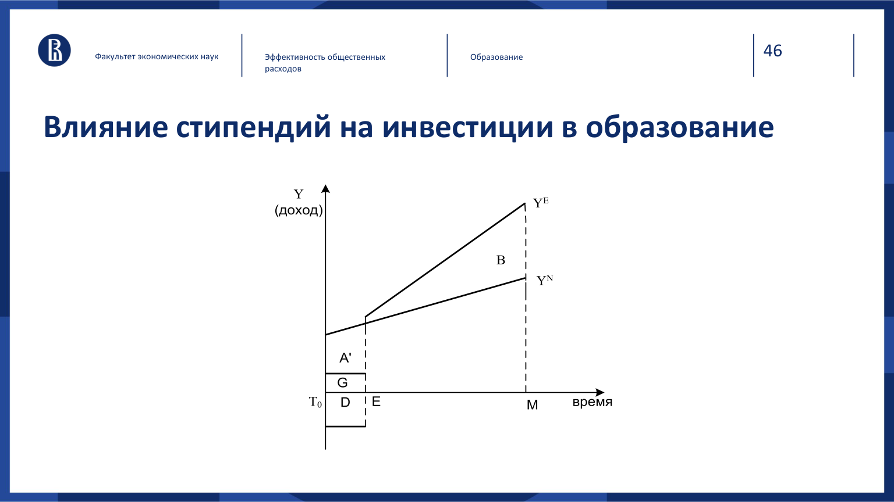
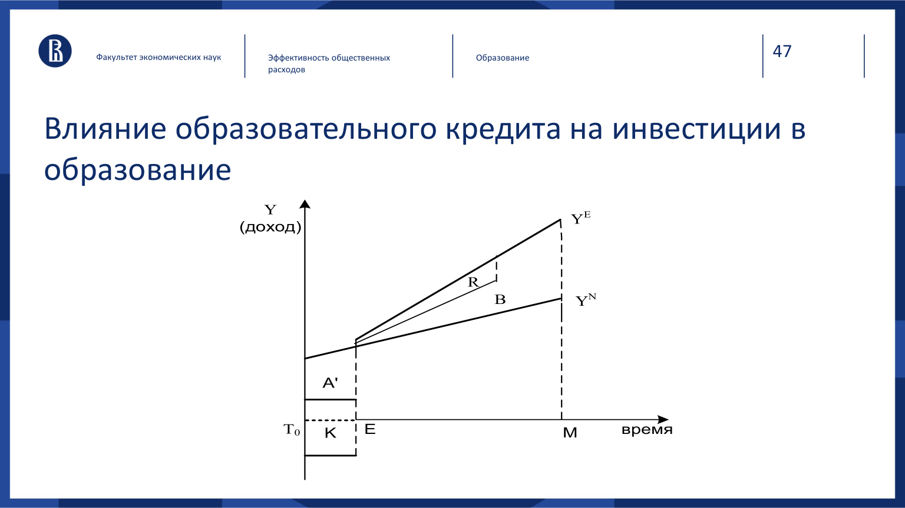
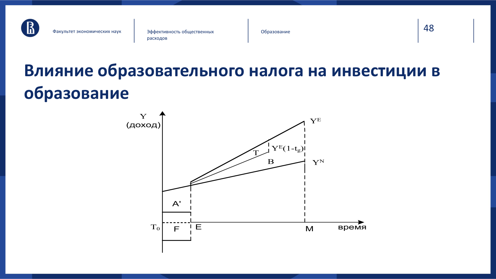

# Эффективность общественных расходов и экономика социальных отраслей

Хоркина Н. А., **8 октября 2026 года**. [Презентация](../materials/eos/eos-lecture-2026-10-08.pdf). Ниже — структурированный конспект; расчётные пояснения дополняют слайды.

## 1. Что оценивают в программе

Нужно проследить путь от расходов до результата: закупленные ресурсы → оказанные услуги → изменение состояния людей. Количество оплаченных процедур показывает объём деятельности. Для оценки программы нужен эффект: предотвращённые случаи болезни, дополнительные годы жизни, изменение качества жизни или доходов.

Перед расчётом задают альтернативу, срок оценки и перспективу: бюджет, пациент или общество. Для общества учитывают также время пациента, потерянный заработок и внешние эффекты. Одну и ту же статью расходов нельзя учитывать дважды.

## 2. Четыре метода оценки

| Метод | В чём измеряется результат | Расчёт | Что можно сравнить |
| :--- | :--- | :--- | :--- |
| CBA — затраты и выгоды | Деньги | \(C/B\), \(NPV=B-C\) в приведённых величинах | Разные проекты, если выгоды обоснованно монетизированы |
| CEA — затраты и результативность | Натуральные единицы | \(CER=C/E\) | Программы с сопоставимым результатом |
| CUA — затраты и полезность | Показатель, учитывающий качество жизни, например QALY | \(C/QALY\) | Изменения продолжительности и качества жизни |
| wCEA — взвешенная результативность | Сумма эффектов с весами | \(C/\sum_i w_iE_i\) | Программы с несколькими результатами при общих весах |

### CBA

На слайдах используется отношение **затраты / выгоды**. При положительных величинах \(C/B<1\) означает, что выгоды превышают расходы. В другой записи используют \(B/C\), и условие меняется на \(B/C>1\). Затраты и выгоды разных лет сначала дисконтируют.

Основные проблемы: какие последствия включить и как оценить их в деньгах. При оценке вакцинации общественные выгоды могут включать предотвращённое лечение и потери рабочего времени. При оценке платной услуги выручка учреждения и общественная выгода — разные показатели.

### CEA и сравнение альтернатив

\[
CER=\frac{C}{E},\qquad ICER=\frac{C_B-C_A}{E_B-E_A}.
\]

CER показывает средние затраты на результат; ICER — цену дополнительного эффекта при смене программы. Более дешёвая и более эффективная альтернатива доминирует. Если эффект вырос вместе с расходами, решение зависит от бюджета и того, сколько готовы платить за дополнительный результат.

CEA применяют, когда денежная оценка выгод затруднена или слишком неопределённа. Сравнивать рубли за один диагноз с рублями за один год жизни без дополнительного перехода нельзя.

### CUA и wCEA

CUA учитывает изменения качества жизни: боли, подвижности, способности к повседневной деятельности. При постоянной полезности \(u\) за \(T\) лет получаем \(QALY=uT\). Сравнение программ требует **прироста** QALY относительно альтернативы. [Разбор QALY на занятии Власова](../module-1/vlasov-health-technology-assessment.md).

В wCEA вес каждого эффекта влияет на итог. Слайды предлагают экспертную оценку весов. Нужно объяснить выбор, привести показатели к сопоставимой шкале и проверить, изменится ли решение при других весах.

Ограничение слайда 14 относится к прямой денежной или натуральной оценке самочувствия. Это причина использовать показатели полезности, а не запрет оценивать такое улучшение вообще.

### Как выбрать метод

| Пример со слайдов | Возможный метод и условие |
| :--- | :--- |
| Высшее образование и перспективы заработка | CBA: прирост доходов, прямые и альтернативные издержки |
| Лечение определённого заболевания | CEA при общей клинической цели; CUA при существенном изменении качества жизни |
| Вакцинация | CEA по предотвращённым случаям; CBA при денежной оценке выгод; CUA по приросту QALY |
| Крупное спортивное событие | CBA или wCEA; учитывать альтернативное использование денег и объектов |

Суммы **1,5 трлн руб. для Сочи-2014** и **1,2 трлн руб. для ЧМ-2018** приведены в лекции как примеры затрат. Сами по себе они не позволяют оценить эффективность и здесь не выдаются за проверенную итоговую смету.

## 3. Здравоохранение

### Спрос и провалы рынка

Спрос на медицинские услуги производен от спроса на здоровье. Здоровье даёт текущую полезность и влияет на будущую способность работать. Неожиданная потребность в дорогой помощи создаёт спрос на страхование.

| Проблема | Механизм | Возможная мера |
| :--- | :--- | :--- |
| Внешний эффект | Лечение инфекционного пациента приносит выгоду окружающим | Финансирование лечения и профилактики |
| Асимметрия информации | Пациенту трудно проверить показания и качество | Стандарты, независимое мнение, контроль качества |
| Монопольная власть | Мало заменителей или поставщиков | Регулирование, закупки, поддержка конкуренции |
| Спрос, индуцированный поставщиком | Рекомендации врача влияют на объём приобретаемой помощи | Проверка показаний, изменение стимулов оплаты |

Информационное преимущество не означает, что любой врач злоупотребляет им. Проблема возникает при расхождении интересов врача и пациента. [Кейс семинара №4](public-sector-economics-seminar-4.md#task-4).

На схеме при том же предложении S спрос сдвигается из D₁ в D₂: равновесие переходит из E₁ в E₂, растут цена и объём услуг. Это схематичная иллюстрация изменения спроса, а не доказательство пользы дополнительных назначений.

### Справедливость и финансирование

**Горизонтальная справедливость:** сопоставимая помощь при сопоставимой потребности. **Вертикальная:** различия в потребности или платёжеспособности обосновывают разное лечение либо разный вклад в финансирование.

Источники оплаты на слайдах: налоги, общественное страхование, частные страховые взносы, платежи пациента. При сравнении систем важны охват, финансовая защита, стимулы поставщиков и административные расходы. Перечни стран в презентации иллюстрируют сочетания механизмов; это не актуальный справочник национального законодательства.

Государство действует через регулирование качества и лекарственного рынка, налоги и субсидии, организацию производства услуг. Публичное производство может обеспечить доступ и контроль расходов. При слабом конкурентном давлении возможны потери эффективности. Форма собственности сама по себе не определяет качество, конкуренцию и скорость внедрения инноваций.

## 4. Образование и человеческий капитал

Вмешательство государства объясняют внешними эффектами, недостатком информации, локальной монополией и ограничениями рынка капитала. Будущий доход трудно предсказать; студент может недооценивать отдачу или не получить кредит, даже если обучение окупается. Справедливость требует учитывать возможность поступить и оплатить обучение при разных доходах семьи.

В лекции к внешним эффектам отнесены рост производительности, налоговых поступлений, культурного уровня и снижение преступности. При строгом расчёте общественных выгод нужно исключать повторный учёт: налог — перераспределение части дохода, а не дополнительный выпуск сам по себе.

### Решение об инвестиции

\[
NPV=-C_0+\sum_{t=1}^{T}\frac{\Delta Y_t-C_t}{(1+r)^t}.
\]

\(C_0\) — первоначальные затраты, \(\Delta Y_t\) — дополнительный доход относительно работы без обучения, \(C_t\) — дальнейшие дополнительные расходы. К первоначальным издержкам относят оплату курса и упущенный заработок. При \(NPV>0\) обучение выгодно в рамках денежной модели.

На графике слайда 45 по вертикали указан доход, по горизонтали время: во время учёбы возникает потеря дохода и прямые расходы (область A); затем доход с образованием \(Y_E\) превышает доход без него \(Y_N\) (область B). Отдалённые выгоды нужно дисконтировать: простого сравнения геометрических площадей недостаточно.

| Инструмент | Что меняет |
| :--- | :--- |
| Стипендия | Снижает собственные расходы во время учёбы; для бюджета остаётся затратой |
| Образовательный кредит | Переносит оплату на будущие периоды, добавляет платежи по долгу |
| Образовательный налог | Финансирует обучение за счёт будущих платежей, снижая располагаемую отдачу |

### Схемы финансовой поддержки со слайдов

Стипендия G уменьшает собственные издержки обучения до A′.

Кредит снижает расходы, которые нужно покрыть сейчас, до A′; будущие платежи R уменьшают чистую отдачу.

Будущий доход после образовательного налога Y_E(1−t_g) ниже дохода до него Y_E; область T обозначает соответствующее сокращение дохода. Эти схемы сравнивают потоки расходов и доходов во времени.

Модель предполагает рост производительности от образования и учитывает только денежные последствия. Для решения конкретного человека также важны риск, качество программы, нематериальные выгоды и доступность средств сейчас. [Расчёты Карлсона и Сидорова](public-sector-economics-seminar-4.md#task-6).

## 5. Эссе

Слайд 49 повторяет четыре пункта: эффективность и провалы рынка; горизонтальная и вертикальная справедливость; наиболее подходящий принцип справедливости; результативность на основе статистики или эмпирических данных. [Полные требования и уточнение преподавателя](public-sector-economics-market-failures-redistribution.md#essay).

## Материалы

- [Семинар №4 с решениями](public-sector-economics-seminar-4.md).
- [Лоренц и подходы к справедливости: дополнения к семинару №3](public-sector-economics-welfare-supplement.md).
- [Условие ДЗ №3](../materials/eos/homework-3-assignment.png): «Мнимый больной», четыре вопроса; срок **18 октября 2026 года, 23:59**, Smart LMS.
