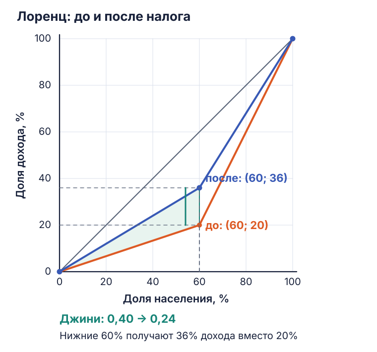

# Лоренц и подходы к справедливости — дополнения к семинару 3

Эти задачи уже разобраны в [семинаре №3](public-sector-economics-seminar-3.md). Здесь собраны новые исходные PDF и пояснения к неточностям в них.

## Кривая Лоренца и Джини

[Дополнительный материал с решением](../materials/eos/lorenz-gini-worked-example.pdf).

Пять равных групп населения получают 100, 200, 400, 800 и 1 500 млн денежных единиц. Общий доход — 3 000. Налог 40% на последнюю группу даёт 600, которые поровну перечисляют первым трём группам: каждой по 200.

| Доля населения накопленным итогом, % | Доход группы до | Доля дохода накопленным итогом до, % | Доход группы после | Доля дохода накопленным итогом после, % |
| ---: | ---: | ---: | ---: | ---: |
| 0 | — | 0 | — | 0 |
| 20 | 100 | 3,333 | 300 | 10 |
| 40 | 200 | 10 | 400 | 23,333 |
| 60 | 400 | 23,333 | 600 | 43,333 |
| 80 | 800 | 50 | 800 | 70 |
| 100 | 1 500 | 100 | 900 | 100 |

Доходы обеих последовательностей упорядочены по возрастанию. Если после перераспределения порядок изменился бы, группы пришлось бы пересортировать.

При долях от 0 до 1 и линейном соединении точек:

\[
G=1-\sum_{i=1}^{5}(Y_i+Y_{i-1})(X_i-X_{i-1}).
\]

Получаем **\(G_{до}=0{,}453333\)** и **\(G_{после}=0{,}213333\)**. Снижение — 0,24, или 24 процентных пункта при процентной записи индекса. В заданной модели неравенство уменьшается; общий доход не меняется. Расчёт по группам не учитывает неравенство внутри каждой группы.

В исходном пояснении ошибочно сказано, что предыдущие группы «входят» в следующую. Они остаются отдельными группами; складываются только доходы при расчёте накопленного показателя. Площадь треугольника равна 5 000 при осях от 0 до 100, либо 0,5 при осях от 0 до 1. Нельзя смешивать эти масштабы.

## Подходы к общественному благосостоянию

[Дополнительный материал](../materials/eos/welfare-approaches-worked-example.pdf). В этой учебной модели доход используют как показатель благосостояния. В общем случае утилитаризм максимизирует сумму полезностей, которая не обязана совпадать с суммой доходов.

| Налог, % | Часы | Доход A до налога, долл. | Налог и трансферт B | Доход A после налога | Общий доход |
| ---: | ---: | ---: | ---: | ---: | ---: |
| 0 | 6 | 600 | 0 | 600 | 600 |
| 15 | 7 | 700 | 105 | 595 | 700 |
| 30 | 5 | 500 | 150 | 350 | 500 |
| 50 | 2,5 | 250 | 125 | 125 | 250 |
| 80 | 1 | 100 | 80 | 20 | 100 |
| 100 | 0 | 0 | 0 | 0 | 0 |

В строке 50% в присланном PDF опечатка: налог \(250\times0{,}5=125\), а не \(200\times0{,}5\).

| Подход | Критерий в задаче | Ставка |
| :--- | :--- | ---: |
| Эгалитарный | Равенство доходов; из равных вариантов выбираем более высокий доход | 50% |
| Утилитарный | Максимум общего дохода при принятой линейной оценке полезности | 15% |
| Либертарный | Отказ от принудительного перераспределения | 0% |
| Роулсианский | Максимум дохода наименее обеспеченного: \(\max\min(Y_A,Y_B)\) | 30% |
| Ницшеанский в терминологии курса | Максимум дохода наиболее обеспеченного | 0% |

При 100% доходы тоже равны, но оба нулевые; распределение при 50% улучшает положение обоих. Роулсианский критерий проверяет минимум двух доходов: при 80% минимум уже доход A, равный 20. Либертарный подход нельзя свести только к Парето-эффективности: в нём существенны права и допустимость перераспределения.

В строке 15% часы возрастают относительно 0%: это задано условием. Возможная интерпретация — эффект дохода перевешивает эффект замещения. Между указанными ставками предложение труда неизвестно; универсальной зависимости из таблицы не следует.

## Уточнение к эссе и ДЗ

[Сообщение преподавателя](../materials/eos/essay-clarification-2026-10.png) просит сопоставить выбранную меру с пятью подходами и описать отношение к перераспределению, если оно предусмотрено. Наибольшее соответствие одному подходу нужно обосновать устройством программы и составом получателей. Диагноз или бюджетное финансирование сами по себе не доказывают роулсианский характер меры.

[ДЗ №3](../materials/eos/homework-3-assignment.png) — четыре ёмких аргументированных ответа по «Мнимому больному»: провалы рынка; ограничение конкуренции; статус Пургона; взаимодействие врача и аптекаря и современный аналог. Срок — **18 октября 2026, 23:59**, Smart LMS.
