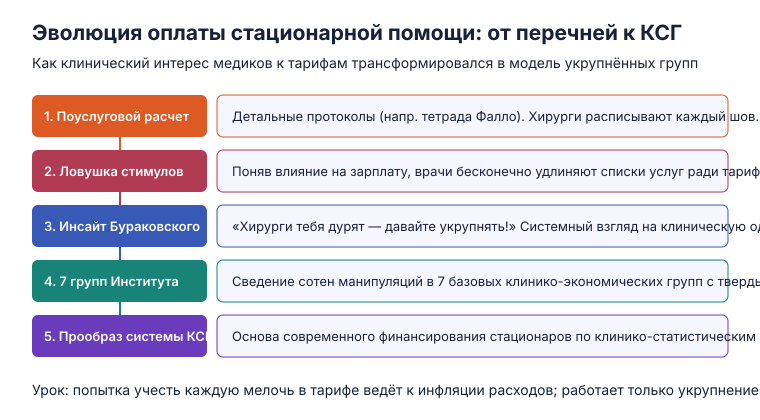
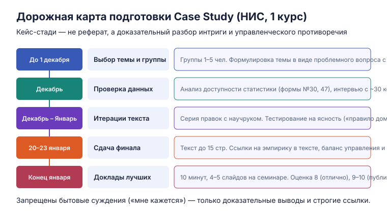
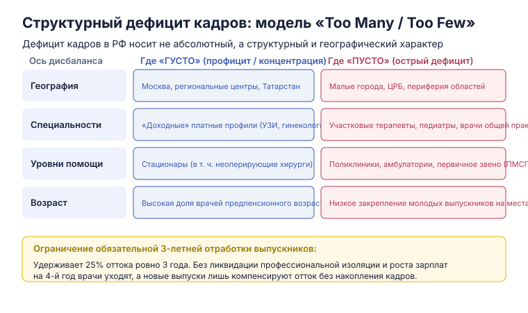

Научно-исследовательский семинар · 5 ноября 2026

# Экономика и организация здравоохранения: от создания КСГ до кадрового дефицита и методологии Case Study

* **Преподаватель:** **Шейман Игорь Михайлович** — кандидат экономических наук, профессор кафедры управления и экономики здравоохранения НИУ ВШЭ, ведущий эксперт в области финансирования здравоохранения и первичной медико-санитарной помощи.
* **Дисциплина:** Научно-исследовательский семинар (НИС), 1 курс магистратуры.
* **Дата и время:** Четверг, **5 ноября 2026 года**, 1-я и 2-я пары (18:10–21:00, Мясницкая ул., д. 20, ауд. 227).
* **Ключевые дедлайны по Case Study:**
  * **1 декабря:** выбор темы (в виде проблемного вопроса с интригой), согласование плана и состава группы (1–5 человек);
  * **20–23 января:** сдача итогового текста Case Study (до 15 страниц).

!!! tip "TL;DR (Краткая выжимка для магистра)"
    1. **Системный взгляд важнее детальных прейскурантов:** опыт разработки хозрасчёта в Институте Бакулева показал, что поуслуговая тарификация провоцирует бесконечное удлинение протоколов. Управлять системой можно только через укрупнённые клинико-статистические группы (КСГ).
    2. **«Правило домохозяйки» как стандарт ясности мысли:** научный текст должен формулировать сложные управленческие противоречия просто, логично и доказательно. Черновик — лишь отправная точка для серии совместных итераций с преподавателем.
    3. **Ключевые дисбалансы здравоохранения РФ:** слабость первичного звена (лишь 16% участковых врачей против 30–45% в Европе и Канаде), фрагментация помощи из-за поуслуговой оплаты, формализм в сроках ожидания и дефицит диспансерного наблюдения хронических больных (<1 визита в год).
    4. **Case Study — не реферат:** это краткое аналитическое расследование с острой интригой (столкновением позиций регуляторов, врачей и экономистов), опирающееся на строгие эмпирические данные, без бытовых мнений.
    5. **Обязательная отработка выпускников медвузов — временная мера:** без ликвидации *профессиональной изоляции* на селе и выравнивания условий труда эффект закрытия 25% оттока кадров исчерпает себя за 3 года.

---

## 1. Исторический кейс: как родились КСГ и системное мышление

Семинар открылся личным свидетельством профессора И. М. Шеймана о зарождении методов клинико-экономического анализа в советской кардиохирургии.

### Кейс Института сердечно-сосудистой хирургии им. А. Н. Бакулева
В конце 1980-х годов выдающийся советский кардиохирург, академик **Владимир Иванович Бураковский** (директор Института им. Бакулева) поставил перед группой экономистов задачу: внедрить внутриинститутский хозрасчёт и привязать оплату труда хирургических бригад к реальному объёму и сложности выполненных операций.

<figure class="lecture-figure" markdown>

{ loading=lazy }
  <figcaption markdown>Генезис клинико-статистических групп: переход от детальных прейскурантов к укрупнённым тарифам в Институте им. Бакулева.</figcaption>
</figure>

* **Шаг 1. Попытка поминутной тарификации:** экономисты начали скрупулёзно хронометрировать этапы сложнейших операций (например, коррекцию тетрады Фалло), рассчитывая стоимость каждого инструмента, шва и манипуляции.
* **Ловушка поведения агентов:** как только хирурги поняли, что детальный перечень процедур напрямую формирует фонд оплаты труда, протоколы операций стали разрастаться в геометрической прогрессии. Врачи стремились вписать в историю болезни максимальное количество манипуляций, удорожая каждый случай.
* **Инсайт академика Бураковского:** академик пригласил экономиста и откровенно заметил: *«Мои хирурги тебя просто дурят. Никакой прейскурант не угонится за фантазией врача, если от этого зависит его зарплата. Давайте укрупнять!»*
* **Рождение КСГ:** Бураковский предложил сгруппировать всё многообразие кардиохирургических вмешательств института в **7 укрупнённых клинико-экономических групп** с фиксированными комплексными тарифами на случай излечения. Этот подход исключил финансовую манипуляцию объёмами услуг и стал прямым отечественным прообразом современной системы **клинико-статистических групп (КСГ)**.

> **Управленческий вывод:** Настоящий клиницист мыслит системно — воздействуя на один орган, он держит в голове реакцию всей сосудистой системы и организма. В экономике здравоохранения действует тот же закон: изолированная поуслуговая оплата порождает клинический оппортунизм, тогда как укрупнённые группы стимулируют соблюдение доказательных стандартов.

### Реформы 2003–2004 годов
В 2003–2004 годах И. М. Шейман совместно с С. В. Шишкиным возглавлял аналитическую экспертную группу при Администрации Президента РФ по реформированию здравоохранения. Группа заложила базовые стратегические векторы, определившие повестку на два десятилетия вперёд:
* перенос центра тяжести с дорогостоящего коечного фонда стационаров на амбулаторное звено;
* оптимизация избыточных коек круглосуточного пребывания;
* развитие института общей врачебной практики (семейной медицины);
* трансформация фондов ОМС в реальных институциональных заказчиков помощи.

---

## 2. Философия НИС, академическое письмо и стандарты ясности

### Почему в НИУ ВШЭ акцент смещён на семинары
В ведущих исследовательских университетах мира (включая Бостонский университет, где преподавал лектор) пассивные лекции сведены к минимуму. Главная задача высшего образования — вовлечение студента в самостоятельную аналитическую работу, проектную деятельность и научную дискуссию.

### Три взаимосвязанные задачи НИС
1. **Погружение в доказательную повестку:** знакомство с ключевыми прикладными исследованиями кафедры и системными барьерами отрасли.
2. **Самостоятельное исследование:** на 1-м курсе студенты выполняют **Case Study**, на 2-м курсе — готовят магистерскую ВКР.
3. **Культура академического соавторства:** обучение конструктивному оппонированию по правилу *«критикуешь — предлагай альтернативу»* (`если не так — то как?`).

### «Правило домохозяйки» как стандарт ясности мысли
Лектор поделился поучительным уроком из аспирантуры Института мировой экономики и международных отношений (ИМЭМО РАН). Научный руководитель автора, профессор Е. А. Громов, демонстративно разорвал первую главу диссертации молодого исследователя со словами:

> *«Представь, что твоя жена — домохозяйка. Ты имеешь право приносить текст научному сообществу только после того, как пересказал его содержание своей жене-домохозяйке, и она без подсказок всё поняла. Сложные вещи нужно излагать предельно ясным языком».*

**Критерий оценки исследователя:** люди делятся не на «умных» и «не очень», а на **ясно мыслящих** и **мыслящих смутно**. Первая редакция текста — это неизбежно черновик. Суть научной школы НИС — в **итеративной доработке**: студент пишет лаконичный проект $\to$ преподаватель оставляет плотные содержательные замечания $\to$ автор переосмысливает логику и шлифует аргументы.

### Шкала оценивания Case Study

| Балл | Качественный критерий |
| :--- | :--- |
| **8 баллов** | **Отличная оценка.** Работа написана ясно, логично, доказательно, содержит острую интригу и опирается на выверенную эмпирику. |
| **9–10 баллов** | **Уровень научной статьи.** Текст рекомендован к доработке и публикации в ведущих рецензируемых журналах перечня ВАК / Белого списка (например, *«Вопросы государственного и муниципального управления»*). |

---

## 3. Карта исследований кафедры (2015–2025 гг.): 8 узловых проблем РФ

За последние 10 лет кафедра управления и экономики здравоохранения ВШЭ реализовала цикл фундаментальных прикладных исследований по заказу Правительства РФ, Минздрава и международных организаций.

| № | Направление / Проект | Ключевой вывод исследования | Метрики и иллюстративные кейсы |
| :-: | :--- | :--- | :--- |
| **1** | **Сила первичной помощи (ПМСП)** | Конечные показатели смертности и затрат определяются институциональной силой поликлинического звена. | `Avoidable admissions`, `avoidable mortality`; многопрофильные поликлиники РФ vs расширенные врачебные практики Запада. |
| **2** | **Кадровые диспропорции** | Дефицит врачей носит структурный характер из-за гиперспециализации и отсутствия сильного ВОП. | Доля участковых врачей: РФ ~16%, Франция ~30%, Канада ~45%. Кейс Йоркского университета. |
| **3** | **Транспарентность медицины** *(2022)* | Культура открытого признания врачебных ошибок статистически снижает летальность и осложнения. | Исследование допустимых границ открытости данных (для пациентов vs для профессионального сообщества). |
| **4** | **Институты ОМС** *(2021)* | Подмена страховых принципов административно-сметным распределением ведёт к потере стимулов к качеству. | ОМС («окрашенные» страховые взносы, оплата за результат) vs Бюджет («общий котёл», оплата за койко-дни). |
| **5** | **Интеграция помощи** | Поуслуговая оплата дробит лечебный процесс; пациент «теряется» между стационаром и поликлиникой. | Личный кейс инсульта; инструмент *discharge planning* в госпитальной сети Kaiser Permanente (США). |
| **6** | **Диспансеризация и хроники** | Массовая диспансеризация перегружает дефицитных врачей; хроники наблюдаются менее 1 раза в год. | Необходимость таргетирования групп риска взамен «вала» формальных осмотров. |
| **7** | **Сроки ожидания помощи** | Разрыв между отчётами чиновников и жалобами пациентов порождён манипуляцией точкой отсчёта и горизонтом записи. | Искусственное ограничение записи в ЕМИАС 14 днями; прямое поручение Президента РФ об открытии долгосрочных слотов. |
| **8** | **Цифровизация и производительность** | Автоматизация и ИИ не дают автоматического скачка производительности труда клиницистов. | Анализ реальных временных затрат врача на работу в МИС и поиск узких зон роботизации. |

---

### Аналитический разбор ключевых дискуссий семинара

#### 1. Сила первичного звена и эконометрические маркеры
В рамках экспертной группы И. И. Шувалова исследователям кафедры потребовалось математически обосновать фундаментальный тезис: инвестиции в амбулаторное звено дают максимальную отдачу для общества.

<figure class="lecture-figure" markdown>

{ loading=lazy }
  <figcaption markdown>Эффективность барьерной фильтрации (Gatekeeping): сравнение охвата первичной помощи в странах ОЭСР и в России.</figcaption>
</figure>

* **Клинико-экономическая цепочка:** раннее выявление факторов риска $\to$ эффективный превентивный контроль $\to$ предупреждение декомпенсации хронических заболеваний $\to$ разгрузка дорогостоящего коечного фонда стационаров.
* **Международные эконометрические индикаторы:**
  * **Avoidable admissions (предотвратимые госпитализации):** случаи попадания в стационар при бронхиальной астме, артериальной гипертензии, сахарном диабете или ХСН, которых можно было гарантированно избежать при адекватном амбулаторном ведении.
  * **Avoidable mortality (предотвратимая смертность):** смертность от причин, поддающихся терапевтическому контролю на первичном уровне.
* **Миф об укрупнении поликлиник:** зарубежный тренд объединения врачей в групповые практики преследует цель междисциплинарного взаимодействия (врач + социальный работник + психолог), но **не имеет ничего общего** с механическим созданием советских гигантских поликлинических объединений на 100 тыс. прикреплённого населения.

#### 2. Институт ВОП против гиперспециализации: дискуссия с клиницистами
В большинстве развитых стран семейный врач (врач общей практики) выступает строгим институциональным диспетчером (*Gatekeeper*). Этому есть две фундаментальные причины:
1. **Полиморбидность стареющего населения:** как говорила Фаина Раневская, *«Для меня счастье, когда болит в одном месте»*. Пожилому человеку с 4–5 хроническими патологиями смертельно опасен «веер» несогласованных назначений от пяти узких врачей — ему требуется один специалист с широким кругозором.
2. **Навигация в море технологий:** пациенту нужен компетентный проводник, отсекающий избыточную диагностику.

**Острые вопросы аудитории:**
* *Нужны ли отдельные гериатры?* Профессор Г. Е. Ройтберг отмечает: зачем плодить специальность гериатра, если базовую терапию пожилого человека обязан знать любой грамотный ВОП? Студенты-клиницисты из Института геронтологии им. Н. И. Пирогова возразили: пожилой пациент имеет специфический метаболизм и синдром старческой астении, а участковый терапевт за 12–15 минут физически не способен провести комплексную гериатрическую оценку.
* *Феномен «раздвоения» врачей в РФ:* в России узкие специалисты искусственно разделены на госпитальных (оперирующих хирургов, урологов, гинекологов) и амбулаторных (не оперирующих врачей поликлиник, сводящихся к роли диспетчеров). Подобное дублирование искусственно **удваивает дефицит кадров**.
* *Кейс Йоркского университета (личный опыт лектора):* при остром заболевании глаз в Англии семейный врач сам провёл биомикроскопию, назначил терапию, а на настойчивую просьбу направить к профессору-офтальмологу записал на консультацию через 2 месяца. За два месяца глаз полностью восстановился. **Вывод:** сложность записи к узкому специалисту на Западе — естественный результат эффективного фильтра ВОП, который закрывает до **80–90% всех обращений**, избавляя специализированные центры от тривиальных случаев.

#### 3. «Бесшовная медицина» и провал поуслуговой оплаты
Принцип *«деньги следуют за пациентом»* при поуслуговой тарификации привёл к катастрофической фрагментации системы:

!!! example "Личный кейс лектора (инсульт у близкого родственника)"
    Бригада скорой помощи и стационар сработали безупречно: провели тромболизис, стабилизировали пациента и выписали домой. На следующий день пришёл участковый терапевт, который даже не снял пальто у порога, сухо бросив: *«Это не мой больной, это профиль невролога»*. А запись к неврологу поликлиники открывалась только через три недели. Возник клинический вакуум: стационар получил деньги за КСГ и «забыл» пациента, а поликлиника не имела стимулов подхватить тяжелейшего больного.

* **Международный золотой стандарт (Kaiser Permanente, США):** с первого часа госпитализации пациента в стационаре начинает работать служба **планирования выписки (*discharge planning*)**. Она заранее организует патронаж на дому, доставку кислородного концентратора и визиты медсестры до того, как пациент переступит порог больницы.

#### 4. Детектив со сроками ожидания помощи
Официальные отчёты главврачей и Департамента здравоохранения Москвы (в лице Л. Печатникова) рапортовали об образцовой доступности: 6–7 дней на плановую госпитализацию, попадание к терапевту за 24 часа. Фокус-группы пациентов ВШЭ вскрыли обратную картину: люди неделями не могли попасть на лечение.

**Исследователи кафедры вскрыли две скрытые манипуляции:**
1. **Сдвиг точки отсчёта:** стационар отсчитывает срок ожидания с момента получения готового пакета анализов и направления формы 057/у, тогда как для пациента срок ожидания начинается в день появления симптомов и длится месяцами хождения по кабинетам.
2. **Искусственный 14-дневный горизонт:** электронная запись в поликлиниках на 1 ноября была открыта строго до 15 ноября (формальный норматив 14 дней соблюдён!). На 16 ноября запись была заблокирована администратором. Пациенты должны были в 7:30 утра «ловить» редкие выпавшие слоты.
* **Результат работы кафедры:** доказательный доклад был передан руководству страны, что привело к прямому поручению Президента РФ перестроить регламенты электронных очередей.

---

## 4. Методологический арсенал доказательного исследования

Кафедра ориентирует магистров на отказ от описательного «реферирования» в пользу 6 прикладных методов:

1. **Систематический обзор литературы:** не компиляция случайных цитат, а строгий отбор публикаций по базам Scopus, Web of Science, PubMed, eLibrary с формулировкой поисковой строки и оценкой риска систематических ошибок (PRISMA).
2. **Глубинные интервью с организаторами здравоохранения:** экспертный срез позиций главных врачей, руководителей ТФОМС и чиновников.
3. **Структурированный опрос коллег (экспресс-метод для практикующих врачей):** анкетирование **~30 коллег-клиницистов** по выверенному гайду позволяет выйти за рамки субъективного опыта одной клиники и собрать верифицированную эмпирику.
4. **Фокус-группы с пациентами:** качественный социологический инструмент, выявляющий институциональные барьеры, скрытые от администраторов.
5. **Эконометрический регрессионный анализ:** построение эконометрических моделей. При этом техническую часть расчётов можно доверить специалисту по анализу данных, но содержательная постановка гипотез и интерпретация коэффициентов — исключительная ответственность автора.
6. **Клинико-экономический анализ (Cost-Effectiveness Analysis, CEA):**
   * Сопоставление дополнительных затрат ($\Delta C$) с приростом клинического эффекта ($\Delta E$).
   * *Кейс магистра-нейрохирурга (оценка 10 баллов):* сравнение роботических операций на комплексе **Da Vinci** с классической микрохирургией. Расчёт показал, что при сопоставимой выживаемости и частоте осложнений инкрементальная стоимость робота делает технологию *затратно-неэффективной*. Исследование пошло вразрез с официальной закупкой института, подтвердив научную смелость автора.

---

## 5. Методология подготовки Case Study (1 курс)

<figure class="lecture-figure" markdown>

{ loading=lazy }
  <figcaption markdown>Этапы, контрольные точки и график работы над исследовательским проектом Case Study.</figcaption>
</figure>

### Требования к структуре и содержанию работы

* **Формат:** командный (до 5 человек) или индивидуальный.
* **Объём и параметры вёрстки:** компактный текст объёмом **до 15 страниц** (12 кегль, 1,5 интервал, активное использование таблиц и списков).
* **Чего НЕ должно быть:** классического длинного введения, теоретических общих мест, переписывания определений ВОЗ, шаблонных гипотез, отдельного библиографического списка в конце.
* **Что ОБЯЗАТЕЛЬНО должно быть:**
  1. **Заголовок в виде проблемного вопроса.**
  2. **Острая интрига:** реальный конфликт интересов, несовместимость позиций ведомств, расхождение между клинической пользой и экономической ценой.
  3. **Доказательность фактов:** ссылки оформляются прямо внутри текста (*«В исследовании Иванова (2024) доказана отрицательная корреляция...»*). Категорически запрещены бытовые домыслы (*«мне кажется»*, *«по опыту моей соседки»*).
  4. **Организационно-экономический баланс:** работа должна вскрывать экономические стимулы и финансовые механизмы исследуемой проблемы.

> ⚠️ **Предупреждение о доступе к медицинской статистике:**  
> Доступ к формам федерального статистического наблюдения (**форма № 30** «Сведения о медицинской организации», **форма № 47** «Сведения о сети и деятельности медицинских организаций») сегодня существенно ограничен. Перед утверждением темы обязательно убедитесь в наличии открытых эмпирических источников либо проконсультируйтесь с преподавателем.

### Банк рекомендованных тем для Case Study

1. **Нужно ли сохранять систему ОМС в Российской Федерации?**
2. **Что необходимо изменить в программе диспансеризации взрослого населения для повышения её результативности?**
3. **Что нужно сделать для преодоления барьеров внедрения телемедицинских технологий в клиническую практику?**
4. **Каковы барьеры развития диспансерного наблюдения за больными с хроническими заболеваниями?** *(Сопоставление отечественной практики с зарубежными программами Disease Management).*
5. **Что необходимо предпринять для снижения доли предотвратимых (необоснованных) госпитализаций?**
6. **Что даёт объединение стационаров и поликлиник?** *(Анализ интеграционных реформ в Московской области: Королёв, Пушкино, Красногорск).*
7. **Почему в России буксует развитие института врачей общей практики (ВОП)?**
8. **Какие фундаментальные системные дефекты организации здравоохранения вскрыла пандемия COVID-19?**
9. **Проблемы организации и доступности высокотехнологичной медицинской помощи (ВМП) по выбранному профилю** *(офтальмология, сосудистая хирургия, травматология).*
10. **Перспективы реализации законодательства об обязательном закреплении (отработке) выпускников медицинских вузов.**

---

## 6. Тематический диспут: решит ли обязательная отработка проблему кадров?

Семинар завершился моделированием экспертной дискуссии по законопроекту об обязательном закреплении выпускников медвузов (отработка до 3 лет по целевым договорам).

<figure class="lecture-figure" markdown>

{ loading=lazy }
  <figcaption markdown>Матрица кадровых диспропорций в системе здравоохранения РФ («Too Many / Too Few»).</figcaption>
</figure>

### 1. Институциональные коллизии ординатуры
* Без ординатуры выпускник специалитета вправе работать только участковым терапевтом или педиатром (но не врачом общей практики).
* Поступление в ординатуру требует одновременной увязки трёх компонентов: наличия вакансии в целевой квоте региона, аккредитации клинической базы вуза и личного желания студента. Малейший сбой в цепочке приводит к отказу от целевого договора.

### 2. Динамическая ловушка 3-летнего цикла
* Сегодня около **25%** выпускников медвузов сразу уходят в коммерческий сектор, фармацевтический бизнес или вовсе меняют профессию.
* Введение принудительной отработки заморозит эти 25% на первые 3 года, создав временную иллюзию решения проблемы в отчётах.
* **Что произойдёт на 4-й год?** Если условия труда, оснащение больниц и оклады не изменятся, первая волна отработавших специалистов массово покинет государственные клиники. Новые выпуски будут лишь **компенсировать естественный отток**, не увеличивая чистую численность врачей.
* **Единственный реальный драйвер роста:** в РФ сейчас один из самых высоких в мире показателей приёма в медвузы на душу населения. Реальный прирост врачей на горизонте 5–10 лет обеспечивается **физическим расширением выпуска**, а не принудительным закреплением.

### 3. Матрица диспропорций «Too Many / Too Few» («Где пусто, где густо»)

Кадровый кризис в российском здравоохранении носит не столько абсолютный, сколько **структурный** характер:

| Вектор дисбаланса | Где «ГУСТО» (избыточная концентрация) | Где «ПУСТО» (катастрофический дефицит) |
| :--- | :--- | :--- |
| **Географический** | Москва, Санкт-Петербург, Казань, центры субъектов РФ. | Районные больницы (ЦРБ), малые города, сельские участки. |
| **Специализированный** | Платёжеспособные узкие специальности: дерматокосметология, стоматология, УЗИ, плановая гинекология. | Первичное звено: участковые врачи-терапевты, врачи общей практики, педиатры. |
| **Иерархический** | Крупные клинические стационары (включая неоперирующих специалистов). | Амбулаторно-поликлинические отделения на местах. |
| **Возрастной** | Высокая концентрация врачей предпенсионного и пенсионного возраста. | Низкая доля закрепляющихся молодых специалистов со стажем 3–7 лет. |

### 4. Три барьера, которые не преодолеть принуждением
1. **Право выбора vs распределение:** в отличие от советского жёсткого распределения, нынешний выпускник сам выбирает организацию для договора. Большинство находит способы закрепиться в областных центрах, обходя стороной проблемные ЦРБ (где на 15 участков приходится 2 врача).
2. **Барьер профессиональной изоляции (важнее денег):** программы «Земский доктор» доказали, что одни лишь финансовые подъёмные не удерживают молодёжь на селе. Молодой врач боится остаться один на один со сложными клиническими случаями без опытного наставника, диагностической базы и профессиональной среды.
3. **Отсутствие стратегического планирования:** регионы заказывают целевые места «по текущей дыре в расписании». С учётом 8-летнего лага подготовки специалиста (специалитет + ординатура), сегодняшняя дефицитная специальность через 8 лет рискует стать избыточной, и наоборот.

---

## Глоссарий семинара

* **КСГ (Клинико-статистические группы)** — классификационная система оплаты медицинской помощи по законченному случаю лечения на основе клинической и ресурсоёмкой однородности.
* **ПМСП** — первичная медико-санитарная помощь (основа системы здравоохранения).
* **Avoidable admissions / Avoidable mortality** — предотвратимая госпитализация / смертность; международные стандарты оценки качества амбулаторного контроля.
* **Gatekeeping (барьерная функция)** — институциональное правило, при котором доступ к узким специалистам и плановой госпитализации возможен только через фильтр врача общей практики.
* **Discharge planning (планирование выписки)** — организационная технология преемственности ведения больного при переводе из круглосуточного стационара под амбулаторный контроль.
* **Cost-Effectiveness Analysis (CEA)** — метод клинико-экономического анализа «затраты – результативность», соизмеряющий инкрементальные финансовые затраты с полученным натуральным эффектом.

---

## Чек-лист для студента 1 курса

- [ ] **До 1 декабря:** Определиться с составом группы (1–5 человек) или индивидуальным форматом.
- [ ] **До 1 декабря:** Сформулировать проблемную тему-вопрос с интригой и согласовать черновой план с И. М. Шейманом.
- [ ] **До 1 декабря:** Проверить доступность эмпирических данных и статистических форм.
- [ ] **В течение декабря:** Провести 1–2 итерации правок черновика по «правилу домохозяйки».
- [ ] **До 20–23 января:** Сдать вычитанный итоговый текст Case Study (до 15 страниц).
- [ ] **Конец января:** Подготовить презентацию на 4–5 слайдов (10 минут) для защиты на итоговом семинаре.
