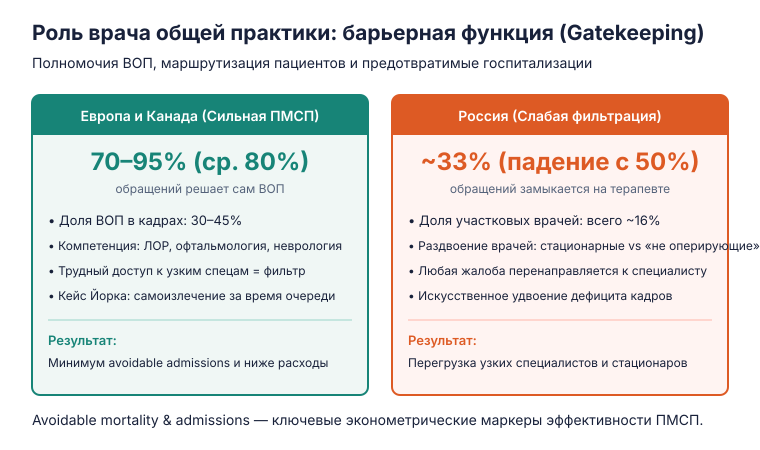

Научно-исследовательский семинар · 5 ноября 2026

# Экономика и организация здравоохранения: от создания КСГ до кадрового дефицита и методологии Case Study

* **Преподаватель:** **Шейман Игорь Михайлович** — кандидат экономических наук, профессор кафедры управления и экономики здравоохранения НИУ ВШЭ (`igor.sheim@g23.relcom.ru`), ведущий эксперт в области финансирования здравоохранения и первичной медико-санитарной помощи.
* **Дисциплина:** Научно-исследовательский семинар (НИС-1), 1 курс магистратуры (преподаватели: И. М. Шейман, О. В. Обухова, Б. Е. Степанов).
* **Дата и время:** Четверг, **5 ноября 2026 года**, 1-я и 2-я пары (18:10–21:00, Мясницкая ул., д. 20, ауд. 227).
* **Ключевые дедлайны по Case Study:**
  * **1 декабря 2026 г.:** представление состава групп (до 5 чел. или индивидуально), темы в виде проблемного вопроса с интригой и краткого плана работы;
  * **20 декабря 2026 г.:** представление первого варианта работы (черновика для содержательных замечаний руководителя);
  * **20–23 января 2027 г.:** представление финального вычитанного варианта работы (до 10–15 страниц);
  * **Семинары января — февраля 2027 г.:** доклады лучших кейсов (3–4 слайда, 10 минут выступления).

!!! tip "TL;DR (Краткая выжимка для магистра)"
    1. **Системный взгляд важнее детальных прейскурантов:** опыт разработки хозрасчёта в Институте Бакулева показал, что поуслуговая тарификация провоцирует бесконечное удлинение протоколов. Управлять системой можно только через укрупнённые клинико-статистические группы (КСГ).
    2. **«Правило домохозяйки» как стандарт ясности мысли:** научный текст должен формулировать сложные управленческие противоречия просто, логично и доказательно. Черновик — лишь отправная точка для серии совместных итераций с преподавателем.
    3. **Ключевые дисбалансы здравоохранения РФ:** слабость первичного звена (лишь 16% участковых врачей против 30–45% в Европе и Канаде), фрагментация помощи из-за поуслуговой оплаты, формализм в сроках ожидания и дефицит диспансерного наблюдения хронических больных (<1 визита в год).
    4. **Case Study — не реферат:** это краткое аналитическое расследование с острой интригой (столкновением позиций регуляторов, врачей и экономистов), опирающееся на строгие эмпирические данные, без бытовых мнений.
    5. **Обязательная отработка выпускников медвузов — временная мера:** без ликвидации *профессиональной изоляции* на селе и выравнивания условий труда эффект закрытия 25% оттока кадров исчерпает себя за 3 года.

---

## 1. Исторический кейс: как родились КСГ и системное мышление

Семинар открылся личным свидетельством профессора И. М. Шеймана о зарождении методов клинико-экономического анализа в советской кардиохирургии.

### Кейс Института сердечно-сосудистой хирургии им. А. Н. Бакулева
В конце 1980-х годов выдающийся советский кардиохирург, академик **Владимир Иванович Бураковский** (директор Института им. Бакулева) поставил перед группой экономистов задачу: внедрить внутриинститутский хозрасчёт и привязать оплату труда хирургических бригад к реальному объёму и сложности выполненных операций.

<figure class="lecture-figure" markdown>

{ loading=lazy }
  <figcaption markdown>Генезис клинико-статистических групп: переход от детальных прейскурантов к укрупнённым тарифам в Институте им. Бакулева.</figcaption>
</figure>

* **Шаг 1. Попытка поминутной тарификации:** экономисты начали скрупулёзно хронометрировать этапы сложнейших операций (например, коррекцию тетрады Фалло), рассчитывая стоимость каждого инструмента, шва и манипуляции.
* **Ловушка поведения агентов:** как только хирурги поняли, что детальный перечень процедур напрямую формирует фонд оплаты труда, протоколы операций стали разрастаться в геометрической прогрессии. Врачи стремились вписать в историю болезни максимальное количество манипуляций, удорожая каждый случай.
* **Инсайт академика Бураковского:** академик пригласил экономиста и откровенно заметил: *«Мои хирурги тебя просто дурят. Никакой прейскурант не угонится за фантазией врача, если от этого зависит его зарплата. Давайте укрупнять!»*
* **Рождение КСГ:** Бураковский предложил сгруппировать всё многообразие кардиохирургических вмешательств института в **7 укрупнённых клинико-экономических групп** с фиксированными комплексными тарифами на случай излечения. Этот подход исключил финансовую манипуляцию объёмами услуг и стал прямым отечественным прообразом современной системы **клинико-статистических групп (КСГ)**.

> **Управленческий вывод:** Настоящий клиницист мыслит системно — воздействуя на один орган, он держит в голове реакцию всей сосудистой системы и организма. В экономике здравоохранения действует тот же закон: изолированная поуслуговая оплата порождает клинический оппортунизм, тогда как укрупнённые группы стимулируют соблюдение доказательных стандартов.

### Реформы 2003–2004 годов
В 2003–2004 годах И. М. Шейман совместно с С. В. Шишкиным возглавлял аналитическую экспертную группу при Администрации Президента РФ по реформированию здравоохранения. Группа заложила базовые стратегические векторы, определившие повестку на два десятилетия вперёд:
* перенос центра тяжести с дорогостоящего коечного фонда стационаров на амбулаторное звено;
* оптимизация избыточных коек круглосуточного пребывания;
* развитие института общей врачебной практики (семейной медицины);
* трансформация фондов ОМС в реальных институциональных заказчиков помощи.

---

## 2. Философия НИС, академическое письмо и стандарты ясности

### Почему в НИУ ВШЭ акцент смещён на семинары
В ведущих исследовательских университетах мира (включая Бостонский университет, где преподавал лектор) пассивные лекции сведены к минимуму. Главная задача высшего образования — вовлечение студента в самостоятельную аналитическую работу, проектную деятельность и научную дискуссию.

### Три взаимосвязанные задачи НИС
1. **Погружение в доказательную повестку:** знакомство с ключевыми прикладными исследованиями кафедры и системными барьерами отрасли.
2. **Самостоятельное исследование:** на 1-м курсе студенты выполняют **Case Study**, на 2-м курсе — готовят магистерскую ВКР.
3. **Культура академического соавторства:** обучение конструктивному оппонированию по правилу *«критикуешь — предлагай альтернативу»* (`если не так — то как?`).

### «Правило домохозяйки» как стандарт ясности мысли
Лектор поделился поучительным уроком из аспирантуры Института мировой экономики и международных отношений (ИМЭМО РАН). Научный руководитель автора, профессор Е. А. Громов, демонстративно разорвал первую главу диссертации молодого исследователя со словами:

> *«Представь, что твоя жена — домохозяйка. Ты имеешь право приносить текст научному сообществу только после того, как пересказал его содержание своей жене-домохозяйке, и она без подсказок всё поняла. Сложные вещи нужно излагать предельно ясным языком».*

**Критерий оценки исследователя:** люди делятся не на «умных» и «не очень», а на **ясно мыслящих** и **мыслящих смутно**. Первая редакция текста — это неизбежно черновик. Суть научной школы НИС — в **итеративной доработке**: студент пишет лаконичный проект $\to$ преподаватель оставляет плотные содержательные замечания $\to$ автор переосмысливает логику и шлифует аргументы.

### Шкала оценивания Case Study

| Балл | Качественный критерий |
| :--- | :--- |
| **8 баллов** | **Отличная оценка.** Работа написана ясно, логично, доказательно, содержит острую интригу и опирается на выверенную эмпирику. |
| **9–10 баллов** | **Уровень научной статьи.** Текст рекомендован к доработке и публикации в ведущих рецензируемых журналах перечня ВАК / Белого списка (например, *«Вопросы государственного и муниципального управления»*). |

---

## 3. Карта исследований кафедры (2015–2025 гг.): 8 узловых проблем РФ

За последние 10 лет кафедра управления и экономики здравоохранения ВШЭ реализовала цикл фундаментальных прикладных исследований по заказу Правительства РФ, Минздрава и международных организаций.

| № | Направление / Проект | Ключевой вывод исследования | Метрики и иллюстративные кейсы |
| :-: | :--- | :--- | :--- |
| **1** | **Сила первичной помощи (ПМСП)** | Конечные показатели смертности и затрат определяются институциональной силой поликлинического звена. | `Avoidable admissions`, `avoidable mortality`; многопрофильные поликлиники РФ vs расширенные врачебные практики Запада. |
| **2** | **Кадровые диспропорции** | Дефицит врачей носит структурный характер из-за гиперспециализации и отсутствия сильного ВОП. | Доля участковых врачей: РФ ~16%, Франция ~30%, Канада ~45%. Кейс Йоркского университета. |
| **3** | **Транспарентность медицины** *(2022)* | Культура открытого признания врачебных ошибок статистически снижает летальность и осложнения. | Исследование допустимых границ открытости данных (для пациентов vs для профессионального сообщества). |
| **4** | **Институты ОМС** *(2021)* | Подмена страховых принципов административно-сметным распределением ведёт к потере стимулов к качеству. | ОМС («окрашенные» страховые взносы, оплата за результат) vs Бюджет («общий котёл», оплата за койко-дни). |
| **5** | **Интеграция помощи** | Поуслуговая оплата дробит лечебный процесс; пациент «теряется» между стационаром и поликлиникой. | Личный кейс инсульта; инструмент *discharge planning* в госпитальной сети Kaiser Permanente (США). |
| **6** | **Диспансеризация и хроники** | Массовая диспансеризация перегружает дефицитных врачей; хроники наблюдаются менее 1 раза в год. | Необходимость таргетирования групп риска взамен «вала» формальных осмотров. |
| **7** | **Сроки ожидания помощи** | Разрыв между отчётами чиновников и жалобами пациентов порождён манипуляцией точкой отсчёта и горизонтом записи. | Искусственное ограничение записи в ЕМИАС 14 днями; прямое поручение Президента РФ об открытии долгосрочных слотов. |
| **8** | **Цифровизация и производительность** | Автоматизация и ИИ не дают автоматического скачка производительности труда клиницистов. | Анализ реальных временных затрат врача на работу в МИС и поиск узких зон роботизации. |

---

### Аналитический разбор ключевых дискуссий семинара

#### 1. Сила первичного звена и эконометрические маркеры
В рамках экспертной группы И. И. Шувалова исследователям кафедры потребовалось математически обосновать фундаментальный тезис: инвестиции в амбулаторное звено дают максимальную отдачу для общества.

<figure class="lecture-figure" markdown>

{ loading=lazy }
  <figcaption markdown>Эффективность барьерной фильтрации (Gatekeeping): сравнение охвата первичной помощи в странах ОЭСР и в России.</figcaption>
</figure>

* **Клинико-экономическая цепочка:** раннее выявление факторов риска $\to$ эффективный превентивный контроль $\to$ предупреждение декомпенсации хронических заболеваний $\to$ разгрузка дорогостоящего коечного фонда стационаров.
* **Международные эконометрические индикаторы:**
  * **Avoidable admissions (предотвратимые госпитализации):** случаи попадания в стационар при бронхиальной астме, артериальной гипертензии, сахарном диабете или ХСН, которых можно было гарантированно избежать при адекватном амбулаторном ведении.
  * **Avoidable mortality (предотвратимая смертность):** смертность от причин, поддающихся терапевтическому контролю на первичном уровне.
* **Миф об укрупнении поликлиник:** зарубежный тренд объединения врачей в групповые практики преследует цель междисциплинарного взаимодействия (врач + социальный работник + психолог), но **не имеет ничего общего** с механическим созданием советских гигантских поликлинических объединений на 100 тыс. прикреплённого населения.

#### 2. Институт ВОП против гиперспециализации: дискуссия с клиницистами
В большинстве развитых стран семейный врач (врач общей практики) выступает строгим институциональным диспетчером (*Gatekeeper*). Этому есть две фундаментальные причины:
1. **Полиморбидность стареющего населения:** как говорила Фаина Раневская, *«Для меня счастье, когда болит в одном месте»*. Пожилому человеку с 4–5 хроническими патологиями смертельно опасен «веер» несогласованных назначений от пяти узких врачей — ему требуется один специалист с широким кругозором.
2. **Навигация в море технологий:** пациенту нужен компетентный проводник, отсекающий избыточную диагностику.

**Острые вопросы аудитории:**
* *Нужны ли отдельные гериатры?* Профессор Г. Е. Ройтберг отмечает: зачем плодить специальность гериатра, если базовую терапию пожилого человека обязан знать любой грамотный ВОП? Студенты-клиницисты из Института геронтологии им. Н. И. Пирогова возразили: пожилой пациент имеет специфический метаболизм и синдром старческой астении, а участковый терапевт за 12–15 минут физически не способен провести комплексную гериатрическую оценку.
* *Феномен «раздвоения» врачей в РФ:* в России узкие специалисты искусственно разделены на госпитальных (оперирующих хирургов, урологов, гинекологов) и амбулаторных (не оперирующих врачей поликлиник, сводящихся к роли диспетчеров). Подобное дублирование искусственно **удваивает дефицит кадров**.
* *Кейс Йоркского университета (личный опыт лектора):* при остром заболевании глаз в Англии семейный врач сам провёл биомикроскопию, назначил терапию, а на настойчивую просьбу направить к профессору-офтальмологу записал на консультацию через 2 месяца. За два месяца глаз полностью восстановился. **Вывод:** сложность записи к узкому специалисту на Западе — естественный результат эффективного фильтра ВОП, который закрывает до **80–90% всех обращений**, избавляя специализированные центры от тривиальных случаев.

#### 3. «Бесшовная медицина» и провал поуслуговой оплаты
Принцип *«деньги следуют за пациентом»* при поуслуговой тарификации привёл к катастрофической фрагментации системы:

!!! example "Личный кейс лектора (инсульт у близкого родственника)"
    Бригада скорой помощи и стационар сработали безупречно: провели тромболизис, стабилизировали пациента и выписали домой. На следующий день пришёл участковый терапевт, который даже не снял пальто у порога, сухо бросив: *«Это не мой больной, это профиль невролога»*. А запись к неврологу поликлиники открывалась только через три недели. Возник клинический вакуум: стационар получил деньги за КСГ и «забыл» пациента, а поликлиника не имела стимулов подхватить тяжелейшего больного.

* **Международный золотой стандарт (Kaiser Permanente, США):** с первого часа госпитализации пациента в стационаре начинает работать служба **планирования выписки (*discharge planning*)**. Она заранее организует патронаж на дому, доставку кислородного концентратора и визиты медсестры до того, как пациент переступит порог больницы.

#### 4. Детектив со сроками ожидания помощи
Официальные отчёты главврачей и Департамента здравоохранения Москвы (в лице Л. Печатникова) рапортовали об образцовой доступности: 6–7 дней на плановую госпитализацию, попадание к терапевту за 24 часа. Фокус-группы пациентов ВШЭ вскрыли обратную картину: люди неделями не могли попасть на лечение.

**Исследователи кафедры вскрыли две скрытые манипуляции:**
1. **Сдвиг точки отсчёта:** стационар отсчитывает срок ожидания с момента получения готового пакета анализов и направления формы 057/у, тогда как для пациента срок ожидания начинается в день появления симптомов и длится месяцами хождения по кабинетам.
2. **Искусственный 14-дневный горизонт:** электронная запись в поликлиниках на 1 ноября была открыта строго до 15 ноября (формальный норматив 14 дней соблюдён!). На 16 ноября запись была заблокирована администратором. Пациенты должны были в 7:30 утра «ловить» редкие выпавшие слоты.
* **Результат работы кафедры:** доказательный доклад был передан руководству страны, что привело к прямому поручению Президента РФ перестроить регламенты электронных очередей.

---

## 4. Методологический арсенал доказательного исследования

Кафедра ориентирует магистров на отказ от описательного «реферирования» в пользу 6 прикладных методов:

1. **Систематический обзор литературы:** не компиляция случайных цитат, а строгий отбор публикаций по базам Scopus, Web of Science, PubMed, eLibrary с формулировкой поисковой строки и оценкой риска систематических ошибок (PRISMA).
2. **Глубинные интервью с организаторами здравоохранения:** экспертный срез позиций главных врачей, руководителей ТФОМС и чиновников.
3. **Структурированный опрос коллег (экспресс-метод для практикующих врачей):** анкетирование **~30 коллег-клиницистов** по выверенному гайду позволяет выйти за рамки субъективного опыта одной клиники и собрать верифицированную эмпирику.
4. **Фокус-группы с пациентами:** качественный социологический инструмент, выявляющий институциональные барьеры, скрытые от администраторов.
5. **Эконометрический регрессионный анализ:** построение эконометрических моделей. При этом техническую часть расчётов можно доверить специалисту по анализу данных, но содержательная постановка гипотез и интерпретация коэффициентов — исключительная ответственность автора.
6. **Клинико-экономический анализ (Cost-Effectiveness Analysis, CEA):**
   * Сопоставление дополнительных затрат ($\Delta C$) с приростом клинического эффекта ($\Delta E$).
   * *Кейс магистра-нейрохирурга (оценка 10 баллов):* сравнение роботических операций на комплексе **Da Vinci** с классической микрохирургией. Расчёт показал, что при сопоставимой выживаемости и частоте осложнений инкрементальная стоимость робота делает технологию *затратно-неэффективной*. Исследование пошло вразрез с официальной закупкой института, подтвердив научную смелость автора.

---

## 5. Методология подготовки Case Study (1 курс)

<figure class="lecture-figure" markdown>

{ loading=lazy }
  <figcaption markdown>Этапы, контрольные точки и график работы над исследовательским проектом Case Study.</figcaption>
</figure>

### Требования к структуре и содержанию работы

* **Формат:** командный (до 5 человек) или индивидуальный.
* **Объём и параметры вёрстки:** компактный текст объёмом **до 15 страниц** (12 кегль, 1,5 интервал, активное использование таблиц и списков).
* **Чего НЕ должно быть:** классического длинного введения, теоретических общих мест, переписывания определений ВОЗ, шаблонных гипотез, отдельного библиографического списка в конце.
* **Что ОБЯЗАТЕЛЬНО должно быть:**
  1. **Заголовок в виде проблемного вопроса.**
  2. **Острая интрига:** реальный конфликт интересов, несовместимость позиций ведомств, расхождение между клинической пользой и экономической ценой.
  3. **Доказательность фактов:** ссылки оформляются прямо внутри текста (*«В исследовании Иванова (2024) доказана отрицательная корреляция...»*). Категорически запрещены бытовые домыслы (*«мне кажется»*, *«по опыту моей соседки»*).
  4. **Организационно-экономический баланс:** работа должна вскрывать экономические стимулы и финансовые механизмы исследуемой проблемы.

> ⚠️ **Предупреждение о доступе к медицинской статистике:**  
> Доступ к формам федерального статистического наблюдения (**форма № 30** «Сведения о медицинской организации», **форма № 47** «Сведения о сети и деятельности медицинских организаций») сегодня существенно ограничен. Перед утверждением темы обязательно убедитесь в наличии открытых эмпирических источников либо проконсультируйтесь с преподавателем.

### Банк рекомендованных тем для Case Study

1. **Нужно ли сохранять систему ОМС в Российской Федерации?**
2. **Что необходимо изменить в программе диспансеризации взрослого населения для повышения её результативности?**
3. **Что нужно сделать для преодоления барьеров внедрения телемедицинских технологий в клиническую практику?**
4. **Каковы барьеры развития диспансерного наблюдения за больными с хроническими заболеваниями?** *(Сопоставление отечественной практики с зарубежными программами Disease Management).*
5. **Что необходимо предпринять для снижения доли предотвратимых (необоснованных) госпитализаций?**
6. **Что даёт объединение стационаров и поликлиник?** *(Анализ интеграционных реформ в Московской области: Королёв, Пушкино, Красногорск).*
7. **Почему в России буксует развитие института врачей общей практики (ВОП)?**
8. **Какие фундаментальные системные дефекты организации здравоохранения вскрыла пандемия COVID-19?**
9. **Проблемы организации и доступности высокотехнологичной медицинской помощи (ВМП) по выбранному профилю** *(офтальмология, сосудистая хирургия, травматология).*
10. **Перспективы реализации законодательства об обязательном закреплении (отработке) выпускников медицинских вузов.**

---

## 6. Тематический диспут: кадровый дефицит в здравоохранении и пределы обязательной отработки

Семинар завершился моделированием экспертной дискуссии о причинах кадрового кризиса в российском здравоохранении и путях его преодоления. Содержательным фундаментом дискуссии послужило фундаментальное исследование профессора кафедры И. М. Шеймана:

!!! quote "Научная публикация по материалам темы"
    **Шейман И. М.** Кадровый дефицит в здравоохранении: причины и пути преодоления // *Вопросы государственного и муниципального управления*. 2025. № 4. С. 110–138.  
    DOI: [10.17323/1999-5431-2025-0-4-110-138](https://doi.org/10.17323/1999-5431-2025-0-4-110-138).

<figure class="lecture-figure" markdown>

{ loading=lazy }
  <figcaption markdown>Матрица кадровых диспропорций в системе здравоохранения РФ («Too Many / Too Few»).</figcaption>
</figure>

### 6.1. Макроэкономический и международный контекст: миф об абсолютном дефиците

В общественном дискурсе господствует представление о физической нехватке врачебных кадров. Однако кросс-национальные сопоставления и данные статистики подготовки опровергают гипотезу недостаточного валового выпуска:

* **Выпуск врачей в РФ существенно выше европейского:** Россия выпускает **21,4** новых врача на 100 тыс. населения, тогда как средний показатель по странам Европейского союза составляет **15,5** на 100 тыс. (в РФ выпуск в 1,38 раза выше).
* **Динамичный рост выпуска ординатуры:** за 2019–2023 гг. совокупный выпуск по клинической медицине увеличился на **41,6%** (с 19 148 до 27 122 человек).
* **Ключевой фактор потерь:** около **25%** выпускников медицинских вузов сразу после окончания обучения покидают государственный сектор (переход в коммерческие центры, фарминдустрию, смежные сферы либо полный уход из медицины).
* **Природа кризиса:** проблема российского здравоохранения заключается не в общем объеме подготовки, а в **глубоких структурных диспропорциях** (между первичием и стационаром, центром и периферией, платными и дефицитными профилями) и низкой привлекательности работы в первичном звене государственного сектора.

---

### 6.2. Эмпирическая база: зарплаты, реальные доходы и выпуск ординаторов

#### Таблица 1. Динамика соотношения среднемесячной заработной платы в здравоохранении и средней по экономике РФ (2010–2024 гг.)

*Источник: расчеты И. М. Шеймана (2025) по данным Росстата (форма № ЗП-здрав).*

| Год | Отношение зарплаты в здравоохранении к средней по экономике, % | Контекст и институциональные факторы |
| :---: | :---: | :--- |
| **2010** | **75,4%** | Базовый дореформенный уровень |
| **2011** | **74,7%** | Программы модернизации здравоохранения |
| **2012** | **78,9%** | Принятие «Майских указов» Президента РФ № 597 |
| **2013** | **82,9%** | Развертывание дорожных карт повышения оплаты труда |
| **2014** | **85,9%** | Плановый рост целевых показателей |
| **2015** | **83,5%** | Коррекция на фоне инфляционного шока 2014 г. |
| **2016** | **82,9%** | Стагнация фондов ОМС |
| **2017** | **80,0%** | Откат показателей перед выборным циклом |
| **2018** | **88,4%** | Пиковое исполнение Майских указов к президентским выборам |
| **2019** | **89,3%** | Инерция нацпроекта «Здравоохранение» |
| **2020** | **92,7%** | **Исторический пик:** масштабные ковидные специальные выплаты |
| **2021** | **88,5%** | Свертывание части пандемических надбавок |
| **2022** | **84,8%** | Трансформация ковидных выплат в дифференцированные надбавки |
| **2023** | **82,7%** | Падение ниже уровня 2013–2014 гг. |
| **2024 (1 полугодие)** | **80,5%** | **Возврат к уровню 2017 г.:** эффект указов 2012 г. практически нивелирован |

> ⚠️ **Искажение статистики Росстата коэффициентом совместительства:**  
> Номинальный рост заработной платы врачей в отчетах Росстата маскирует высокую трудовую перегрузку. Средний коэффициент совместительства в госсекторе составляет **1,3–1,5 ставки** (а в ряде регионов превышает 1,7). Если пересчитать доход на **одно физическое лицо при работе на одну базовую ставку**, отношение заработной платы врача к средней по экономике опускается существенно ниже паритета.

#### Таблица 2. Индексы реальной начисленной заработной платы работников здравоохранения РФ (2019–2022 гг.)

*В процентах к предыдущему году (с поправкой на индекс потребительских цен ИПЦ). Источник: Шейман (2025).*

| Год | Индекс реальной зарплаты к предыдущему году, % | Динамика покупательной способности медиков |
| :---: | :---: | :--- |
| **2019** | **104,1%** | Умеренный реальный рост |
| **2020** | **108,7%** | Существенный прирост за счет федеральных ковидных траншей |
| **2021** | **95,9%** | **Падение реальных доходов** (инфляция опережает индексацию базовых окладов) |
| **2022** | **96,1%** | **Продолжение реального спада** |

*Социологический срез (исследование AlphaRM, 2025 г.):* **20,5%** опрошенных врачей заявили, что в ближайшие 1–2 года всерьез рассматривают возможность ухода из практической медицины или перехода из государственного сектора в частный бизнес из-за несоответствия трудозатрат и материального вознаграждения.

#### Таблица 3. Выпуск ординаторов по специальностям укрупненной группы «Клиническая медицина» (2019–2023 гг., человек)

*Источник: Шейман (2025) по данным форм статистического наблюдения Минздрава России.*

| Специальность | 2019 г. | 2020 г. | 2021 г. | 2022 г. | 2023 г. | Динамика 2023 к 2019, % |
| :--- | :---: | :---: | :---: | :---: | :---: | :---: |
| **Клиническая медицина (всего)** | **19 148** | **20 286** | **23 207** | **24 538** | **27 122** | **+41,6%** |
| *В том числе по отдельным профилям:* | | | | | | |
| **Терапия** *(базовый дефицит ПМСП)* | **2 052** | 2 033 | 2 089 | 2 153 | **1 846** | **-10,0%** (спад с 2022 г. на 14,3%) |
| **Акушерство и гинекология** | 1 657 | 1 662 | 1 677 | 1 687 | **1 454** | **-12,3%** |
| **Неврология** | 1 202 | 1 207 | 1 247 | 1 278 | **1 092** | **-9,2%** |
| **Анестезиология-реаниматология** | 1 475 | 1 547 | 1 738 | 1 784 | 1 893 | **+28,3%** |
| **Хирургия** | 1 185 | 1 228 | 1 244 | 1 292 | 1 319 | **+11,3%** |
| **Онкология** *(приоритет нацпроекта)* | **744** | 868 | 1 035 | 1 146 | **1 247** | **+67,6%** |

> **Парадокс динамики:** на фоне общего роста выпуска ординаторов на 41,6% выпуск по наиболее критической для первичного звена специальности — **терапии** — в 2023 году упал на 14,3% по сравнению с 2022 годом, вернувшись к уровню ниже 2019 года.

---

### 6.3. Матрица структурных диспропорций «Too Many / Too Few»

Кадровый дефицит в России носит избирательный, структурно поляризованный характер:

| Вектор дисбаланса | Где «ГУСТО» (профицит / избыточная концентрация) | Где «ПУСТО» (острый системный дефицит) |
| :--- | :--- | :--- |
| **Географический** | Москва, Санкт-Петербург, региональные административные центры, города-миллионники. | Сельские территории, малые города, районные больницы (ЦРБ), удаленные поселки. |
| **Специализированный** | Платные и высокомаржинальные специальности: косметология, стоматология, лучевая диагностика (УЗИ, МРТ), пластическая хирургия. | Первичное звено здравоохранения: участковые терапевты, врачи общей практики (семейные врачи), участковые педиатры. |
| **Иерархический** | Крупные многопрофильные стационары, федеральные НМИЦ, ведомственные клиники. | Районные поликлиники, амбулатории, фельдшерско-акушерские пункты (ФАП). |
| **Возрастной** | Высокая доля работающих врачей пенсионного и глубоко предпенсионного возраста. | Низкая доля закрепляющихся специалистов молодого возраста со стажем от 3 до 7 лет. |

---

### 6.4. Пять фундаментальных причин дефицита по И. М. Шейману

На основе комплексного анализа статистики и нормативной базы проф. И. М. Шейман выделяет **5 системных причин** кадрового кризиса:

1. **Чрезмерная специализация первичного звена и маргинализация врача общей практики (ВОП):**  
   Российская городская поликлиника искусственно фрагментирована на 20+ узких специальностей. Доля ВОП (семейных врачей) составляет лишь **~15%** от численности участковых врачей (в европейских странах — 70–90%). Дефицит участковых терапевтов достигает **32%**. Узкие специалисты в поликлиниках лишены возможности оперировать и низведены до роли кабинетных диспетчеров, дублируя диагностику стационаров.
2. **«Строительный экстенсив» и разрыв капитального строительства со штатным планированием:**  
   Государство массово возводит новые здания (перинатальные центры, онкодиспансеры, сельские ФАПы) без предварительного расчета их кадрового наполнения.  
   * За 2017–2022 гг. число врачебных должностей в стационарах выросло на **11,1%**, тогда как в поликлиниках сократилось на **2,2%**.  
   * Открытие новых перинатальных центров привело к оттоку акушеров из районов и закрытию **более 80 родильных отделений** в малых городах.  
   * Созданные Центры амбулаторной онкологической помощи (ЦАОП) укомплектованы врачами-онкологами лишь на **43%**.  
   * Сотни построенных сельских ФАПов простаивают без медперсонала либо обслуживаются медсестрами, совмещающими функции клинициста, истопника и санитарки.
3. **Отсутствие среднесрочного и долгосрочного планирования кадров (на 7–10 лет):**  
   Минздрав и региональные органы власти формируют план подготовки на горизонт **2–3 года**, исходя из текущих «дыр» в штатном расписании медицинских организаций. При минимальном цикле подготовки квалифицированного врача в **6–8 лет** такой подход систематически воспроизводит структурные дисбалансы.
4. **Рыночный перекос коммерческого набора в медицинских университетах:**  
   Вузы заинтересованы в наращивании платного приема по высокооплачиваемым на рынке специальностям (стоматология, дерматовенерология, ортодонтия, косметология), где платный контингент превышает бюджетный в разы, усугубляя кадровый голод в первичном звене и скорой помощи.
5. **Откат реальной заработной платы, бюрократический прессинг и выгорание:**  
   Снижение реальных доходов после 2020 г., колоссальная нагрузка по заполнению дублирующей медицинской документации, штрафной контроль страховых компаний (СМО) и токсичная организационная культура выталкивают специалистов из государственной медицины.

---

### 6.5. Критика законопроекта об обязательной 3-летней отработке

В ответ на кадровый голод Минздрав России инициировал законопроект об обязательном закреплении выпускников медицинских вузов (письмо Минздрава № ММ-П8-32141): предложение обязать всех выпускников бюджета отработать **3 года** в государственной системе под угрозой выплаты **3-кратного штрафа** от полной стоимости обучения.

Анализ профессора И. М. Шеймана вскрывает фундаментальную неэффективность силового закрепления:

<article class="feature-card" markdown>
**1. Отсутствие встречных гарантий**  
Законопроект перекладывает всю ответственность на выпускника, не гарантируя предоставления благоустроенного служебного жилья, инфраструктуры для семьи и достойного базового оклада.
</article>

<article class="feature-card" markdown>
**2. Блокировка научной ординатуры**  
Перевод 100% мест ординатуры на целевое распределение закрывает возможность поступления выпускникам, нацеленным на академическую науку и узкоспециализированную медицину.
</article>

<article class="feature-card" markdown>
**3. Барьер профессиональной изоляции**  
Молодого специалиста без наставников и современной диагностической базы бросают на тяжелый участок в ЦРБ, провоцируя профессиональный паралич и страх врачебной ошибки.
</article>

<article class="feature-card feature-card--accent" markdown>
**4. Репрессивный штраф выталкивает из профессии**  
3-кратный штраф (достигающий нескольких миллионов рублей) не удержит специалиста на селе, а лишь ускорит его уход из официальной медицины в «серый» сектор или смену профессии.
</article>

> *«Введение принудительного закрепления — это попытка административной командой заткнуть системную брешь. Это приведет к затяжной позиционной окопной войне между недовольным ведомством и медицинским сообществом, которая продлится бесконечно, но не создаст условий для мотивации врача».*  
> — **профессор В. В. Фадеев**, зав. кафедрой эндокринологии Первого МГМУ им. И. М. Сеченова (цит. по Шейман, 2025).

#### Динамическая ловушка 3-летнего цикла
1. **Годы 1–3 (Иллюзия стабильности):** административный заслон временно удержит 25% уходящих выпускников в поликлиниках. Показатели укомплектованности на бумаге вырастут.
2. **Год 4 (Массовый исход):** как только истечет 3-летний срок отработки, первая когорта массово покинет государственные клиники из-за нерешенности жилищных, финансовых и организационных проблем.
3. **Результат:** ежегодный приток новых «штрафников» будет лишь компенсировать лавинообразный отток предыдущих выпусков, консервируя разрушительную текучесть кадров и низкое качество медицинской помощи.

---

### 6.6. Программа реформ: 6 системных решений И. М. Шеймана

Взамен репрессивных мер статья предлагает пакет из **шести взаимосвязанных институциональных реформ**:

1. **Реформа первичного звена и расширение врачебной практики (ВОП):**  
   Довести квоту подготовки врачей общей практики в ординатуре до **15–20%** от всего клинического выпуска. Расширить функционал ВОП до уровня западных стандартов (самостоятельное ведение неосложненной патологии уха, горла, носа, глаз, кожи, простых травм). Передать рутинную работу (диспансерный учет стабильных хроников, выписку льготных рецептов) медицинским сестрам расширенной практики с высшим сестринским образованием.
2. **Смена инвестиционных приоритетов: от бетона к людям:**  
   Ввести мораторий на избыточное капитальное строительство дорогостоящих специализированных комплексов. Перенаправить высвобождающиеся инвестиционные ресурсы в фонд базовой оплаты труда медицинского персонала (повышение постоянного должностного оклада до 70–80% в структуре зарплаты).
3. **Механизм циклической ротации стационарных специалистов в поликлиники:**  
   Внедрить регламент совместной работы стационаров и амбулаторий по образцу британской модели **NHS**: обязательное прохождение каждым клиническим ординатором 4-месячного модуля в амбулаторном звене и регулярные амбулаторные приемы хирургов и узких специалистов стационаров в поликлиниках прикрепления.
4. **Переход к 10-летней модели планирования кадровой потребности:**  
   Разработать и внедрить методику долгосрочного кадрового прогнозирования на период **до 2030–2035 гг.**, основанную на демографических трендах старения населения, структуре заболеваемости и перспективных моделях организации помощи.
5. **Государственное квотирование и регулирование платного набора:**  
   Синхронизировать лицензионные нормативы коммерческого приема в медицинских университетах со структурой потребностей государственной системы здравоохранения; ввести квоты на платное обучение по профицитным специальностям.
6. **Пакет институциональной привлекательности и наставничества:**  
   Заменить принудительную отработку программами долгосрочной мотивации: целевая выдача служебного жилья с правом приватизации после 7–10 лет безупречной работы в регионе; внедрение оплачиваемого института наставничества (*mentoring*) для врачей первых трех лет работы; правовая и психологическая защита медработников от необоснованного преследования.

---

## Глоссарий семинара

* **КСГ (Клинико-статистические группы)** — классификационная система оплаты медицинской помощи по законченному случаю лечения на основе клинической и ресурсоёмкой однородности.
* **ПМСП** — первичная медико-санитарная помощь (основа системы здравоохранения).
* **Avoidable admissions / Avoidable mortality** — предотвратимая госпитализация / смертность; международные стандарты оценки качества амбулаторного контроля.
* **Gatekeeping (барьерная функция)** — институциональное правило, при котором доступ к узким специалистам и плановой госпитализации возможен только через фильтр врача общей практики.
* **Discharge planning (планирование выписки)** — организационная технология преемственности ведения больного при переводе из круглосуточного стационара под амбулаторный контроль.
* **Cost-Effectiveness Analysis (CEA)** — метод клинико-экономического анализа «затраты – результативность», соизмеряющий инкрементальные финансовые затраты с полученным натуральным эффектом.
* **ЦАОП** — центр амбулаторной онкологической помощи; специализированное структурное подразделение амбулаторного звена.
* **Коэффициент совместительства** — отношение числа занятых врачебных должностей к числу физических лиц врачей в медицинской организации.

---

## Контрольный чек-лист студента 1 курса магистратуры

- [ ] **До 1 декабря 2026 г.:** Определиться с составом группы (1–5 человек) или индивидуальным форматом исследования.
- [ ] **До 1 декабря 2026 г.:** Сформулировать проблемную тему-вопрос с интригой и направить черновой план И. М. Шейману (`igor.sheim@g23.relcom.ru`).
- [ ] **До 1 декабря 2026 г.:** Проверить доступность эмпирических данных (ведомственная статистика, формы ФСН № 30 и № 47, данные ТФОМС).
- [ ] **До 20 декабря 2026 г.:** Подготовить и сдать **первый вариант работы (черновик)** для содержательной рецензии и обратной связи преподавателя.
- [ ] **В течение новогодних каникул:** Доработать текст по «правилу домохозяйки», устранив все неясности аргументации.
- [ ] **До 20–23 января 2027 г.:** Сдать **итоговый финальный текст Case Study** (до 10–15 страниц).
- [ ] **Конец января — февраль 2027 г.:** Подготовить презентацию на 3–4 слайда (10 минут выступления) для очной защиты лучших кейсов на семинаре.
