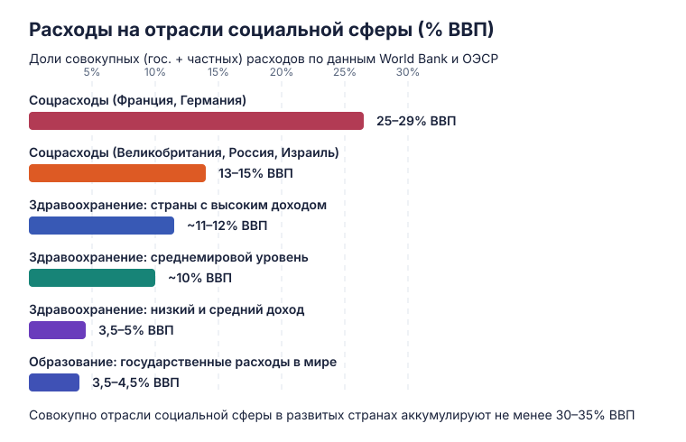
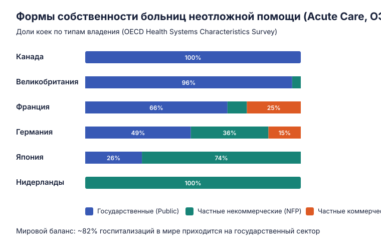
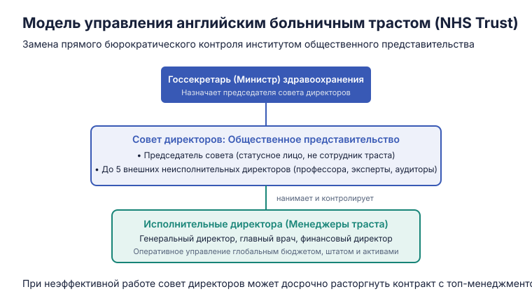
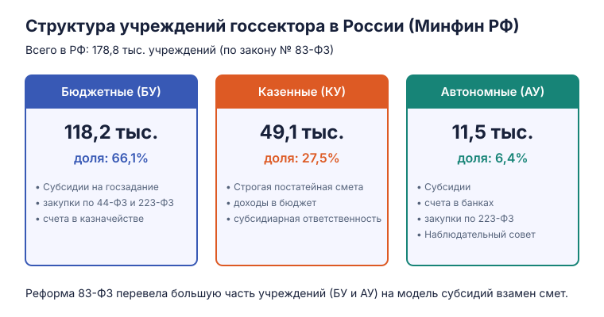

<span class="eyebrow">Управление и экономика социальной сферы · 1 курс · 2 модуль</span>

# Понятие социальной сферы и организационные формы в здравоохранении

Лектор — **Сергей Владимирович Шишкин**. Материал охватывает две вводные темы курса: определение границ и экономики социальной сферы, критерии социальной справедливости, а также типологию и реформы организационно-правовых форм организаций госсектора в России и за рубежом.

---

## 1. Состав и масштабы социальной сферы

Социальная сфера объединяет отрасли, чья деятельность напрямую направлена на развитие человеческого потенциала, поддержание жизнедеятельности и социальную защиту. 

К отраслям социальной сферы относятся:

* **Здравоохранение** *(базовый фокус курса)*;
* **Образование** (дошкольное, общее, профессиональное, высшее);
* **Социальное обслуживание** — уход, содержание, социальные услуги пожилым и людям с инвалидностью *(рассматривается в курсе)*;
* **Социальное обеспечение** — денежные выплаты, пособия и социальная помощь *(рассматривается в курсе)*;
* **Государственное социальное страхование** и пенсионное обеспечение *(рассматривается в курсе)*;
* **Государственное регулирование занятости** населения *(рассматривается в курсе)*;
* **Культура, искусство и кинематограф**;
* **Физическая культура и массовый спорт**;
* **Жилищное хозяйство (ЖКХ)** и средства массовой информации.

### Экономические масштабы отраслей

Совокупные государственные и частные затраты на социальную сферу в развитых странах составляют **не менее одной трети (30–35%) валового внутреннего продукта (ВВП)**:

1. **Здравоохранение:** в среднем в мире на него расходуется около **10% мирового ВВП**. В странах с высоким уровнем доходов показатель достигает **11–12,5% ВВП**, тогда как в государствах со средним и низким доходом держится в границах **3,5–5,5% ВВП**. По мере роста подушевого дохода доля расходов на охрану здоровья закономерно возрастает.
2. **Образование:** государственные расходы на образование в мире составляют в среднем **3,5–4,5% ВВП** с локальными колебаниями в периоды демографических волн и кризисов.
3. **Социальные расходы (пенсии, трансферты, уход):** в странах континентальной Европы с развитыми социальными системами (Франция, Германия) прямые социальные трансферты государства достигают **24–29% ВВП**. В Великобритании, Израиле и России государственные социальные трансферты составляют около **12–15% ВВП**.

<figure class="lecture-figure" markdown>

{ loading=lazy }
  <figcaption markdown>Экономические масштабы отраслей социальной сферы по данным World Bank и ОЭСР.</figcaption>
</figure>

### Три признака социальной сферы

Не всякая общественно полезная отрасль входит в социальную сферу. Экономическая теория выделяет три ключевых признака, объединяющих эти отрасли:

1. **Характер производимых благ:** здесь производятся преимущественно **услуги**, объектом непосредственного воздействия которых выступают сами люди — их здоровье, физические и интеллектуальные способности, социализация и возможности повседневной жизни.
2. **Значительные положительные экстерналии (внешние эффекты):** выгоды от потребления блага получает не только конкретный гражданин, но и общество в целом. Вакцинация защищает невакцинированных через популяционный иммунитет; качественное образование снижает уровень преступности и повышает совокупную производительность труда.
3. **Систематическое применение ценностных оценок (главный признак):** деятельность этих отраслей и доступность их услуг являются предметом непрерывных общественных дискуссий о справедливости, равенстве, базовых правах и человеческом достоинстве («справедливо / несправедливо», «должно гарантироваться / допустимо оставить на откуп рынку»).

!!! note "Пограничный случай: общественный транспорт"
    Городской транспорт производит услуги и создаёт явные положительные внешние эффекты (экология, снижение дорожных заторов). Когда общество начинает рассматривать право на мобильность как социально гарантированный минимум (льготные проездные пенсионерам, субсидирование маршрутов), транспорт вплотную приближается к социальной сфере, оставаясь инфраструктурной отраслью.

---

## 2. Пять аспектов анализа деятельности в социальной сфере

Любая деятельность внутри социальной сферы включает субъектов, цели, ресурсы, ограничения, правила, процессы и результаты. Чтобы понимать управление и экономику отрасли, её анализируют в пяти взаимосвязанных плоскостях:

```
                      ┌──────────────────────────────────────┐
                      │    Деятельность в социальной сфере   │
                      └──────────────────┬───────────────────┘
         ┌───────────────────────────────┼───────────────────────────────┐
         ▼                               ▼                               ▼
┌──────────────────┐           ┌──────────────────┐           ┌──────────────────┐
│ Организационно-  │           │   Экономический  │           │   Политический   │
│ технологический  │           │      аспект      │           │      аспект      │
│  (как устроена)  │           │ (эффективность)  │           │ (власть и права) │
└──────────────────┘           └──────────────────┘           └──────────────────┘
                 ┌───────────────────────┴───────────────────────┐
                 ▼                                               ▼
       ┌──────────────────┐                            ┌──────────────────┐
       │   Социально-     │                            │   Социально-     │
       │ организационный  │                            │    культурный    │
       │ (сети и кланы)   │                            │   (справедливость│
       └──────────────────┘                            └──────────────────┘
```

### I. Организационно-технологический аспект
Отвечает на вопрос: *«Как физически организована деятельность?»* (состав услуг, технологии, субъекты и правила маршрутизации).

#### Классификация видов медицинской помощи
В международной практике медицинская помощь группируется функционально: профилактическая, первичная, специализированная амбулаторная, специализированная стационарная, родовспоможение, психиатрическая помощь, медицинская реабилитация, долговременный уход (long-term care), скорая помощь и паллиативная помощь.

В российском законодательстве (ст. 32 Федерального закона № 323-ФЗ) закреплены **четыре официальных вида**:

1. **Первичная медико-санитарная помощь** (доврачебная, врачебная и первичная специализированная);
2. **Специализированная медицинская помощь**, включая высокотехнологичную (ВМП);
3. **Скорая медицинская помощь**, включая скорую специализированную;
4. **Паллиативная медицинская помощь**.

#### Уровни оказания помощи: международная и российская модели

| Уровень | Международная модель (3 уровня) | Российская модель (4 уровня) |
| :--- | :--- | :--- |
| **1 уровень** | **Первичный:** врачи общей практики (ВОП), семейные врачи, участковые терапевты и педиатры, профилактика, амбулаторный приём. | **Первичная медико-санитарная и скорая помощь:** поликлиники, ФАПы, амбулатории, станции скорой помощи. |
| **2 уровень** | **Вторичный:** амбулаторные специалисты широкого профиля и многопрофильные стационары общего типа. | **Специализированная стационарная помощь:** районные (ЦРБ) и городские больницы на базе массовых технологий. |
| **3 уровень** | **Третичный:** высокоспециализированные клиники, университетские центры сложных вмешательств. | **ВМП в стационарах субъектов РФ:** областные, краевые и республиканские клинические больницы. |
| **4 уровень** | *(Входит в третичный уровень)* | **ВМП в федеральных медицинских центрах:** институты и национальные медицинские исследовательские центры (НМИЦ). |

### II. Экономический аспект
Отвечает на вопрос: *«Какова эффективность использования ограниченных ресурсов?»*

Экономический подход рассматривает деятельность как сопоставление затрат ресурсов (трудовых, материальных, финансовых) с полученными результатами.

* **Результативность (*Effectiveness*):** степень достижения поставленной содержательной цели (число выздоровевших пациентов, предотвращённых смертей, проведённых скринингов).
* **Экономическая эффективность (*Efficiency*):** соотношение полученного эффекта и затраченных ресурсов (затраты на один случай излечения, стоимость одного сохранённого года качественной жизни QALY).

Экономический анализ раскладывается на два подаспекта:

1. **Политико-экономический:** кому принадлежат права собственности на используемые ресурсы и конечные результаты деятельности? Какие действия закон разрешает совершать с доходами и оборудованием?
2. **Экономико-технологический:** какие именно затраты и результаты соизмеряются и какими инструментами (методы клинико-экономического анализа CBA, CEA, CUA, анализ тарифов КСГ)?

### III. Политический (управленческий) аспект
Отвечает на вопрос: *«Как распределены властные полномочия, права и ответственность?»*

Управление здравоохранением в РФ распределено между тремя уровнями публичной власти:

* **Федеральный уровень:** Минздрав России, контрольно-надзорные службы (Росздравнадзор, Роспотребнадзор), Федеральное медико-биологическое агентство (ФМБА), Федеральный фонд ОМС (ФОМС). Федеральный центр утверждает стандарты, порядки оказания помощи, программу государственных гарантий (ПГГ) и распределяет субвенции.
* **Региональный уровень (основной массив полномочий):** министерства и департаменты здравоохранения субъектов РФ, Территориальные фонды ОМС (ТФОМС). Регионы владеют большинством больниц и поликлиник, формируют тарифные соглашения и отвечают за маршрутизацию пациентов.
* **Муниципальный уровень:** полномочия органов местного самоуправления в большинстве регионов были переданы на уровень субъектов РФ в ходе централизации. Муниципальные отделы здравоохранения сохранились лишь в отдельных крупных городах, не являющихся административными центрами субъектов (например, Череповец).

### IV. Социально-организационный аспект
Отвечает на вопрос: *«Как взаимодействуют участники системы вне рамок формальной иерархии?»*

Предмет анализа — неформальные профессиональные сообщества, сети, кланы и научные школы. В здравоохранении этот аспект критичен: именно медицинские профессиональные некоммерческие организации (ассоциации хирургов, кардиологов, онкологов) формируют клинические рекомендации, на основе которых строятся стандарты лечения и тарифы оплаты помощи. Корпоративная солидарность или сопротивление врачебного сообщества могут ускорить или заблокировать любые административные реформы.

### V. Социально-культурный аспект
Отвечает на вопрос: *«Какие социальные ценности определяют, как ДОЛЖНА быть устроена система?»*

Политика государства формируется под влиянием пяти ключевых ценностей: **социальная справедливость**, **социальный мир**, **социальная защищённость**, **сохранение человеческого достоинства** и **гуманизация труда**.

---

## 3. Социальная справедливость и равенство в здравоохранении

**Социальная справедливость** — это консенсусное представление общества о **пределах допустимого неравенства**: в каких сферах общество обязано гарантировать безусловное равенство, а где различия в доступе и доходах признаются легитимными.

В здравоохранении справедливость анализируется в двух измерениях: при **получении помощи** и при **распределении бремени расходов**.

### А. Справедливость в распределении медицинской помощи

#### 1. Справедливость процедуры (процесса)
Когда ресурсов объективно не хватает на всех одновременно, помощь распределяется по одному из четырёх правил:

* **По состоянию пациента (медицинский триаж):** первоочередной доступ получает тот, кому помощь нужна срочнее всего для спасения жизни.
* **Очередь (*waiting list*):** равное ожидание при плановых вмешательствах (эндопротезирование суставов, трансплантация, катаракта). Пациенты упорядочиваются по времени постановки на учёт.
* **Лотерея:** формально случайный жребий. На практике действует в виде **«географической и временной лотереи»**: шансы получить высокотехнологичную помощь зависят от того, родился ли пациент рядом с федеральным центром и обратился ли он в начале года (когда квоты открыты) или в ноябре (когда лимиты исчерпаны).
* **Свободный обмен правами:** теоретическая модель рыночных либертарианцев, предполагающая возможность продать или переуступить своё место в очереди за компенсацию. На практике в публичной медицине отвергается по этическим соображениям.

#### 2. Справедливость результата
* **Горизонтальная справедливость:** пациенты с одинаковыми медицинскими потребностями должны получать одинаковый объём и качество медицинской помощи (независимо от прописки, возраста и дохода).
* **Вертикальная справедливость:** пациенты с разными потребностями получают разный объём помощи, соразмерный тяжести их патологии.
* **Меритократическая справедливость:** доступ к помощи определяется заслугами перед государством или обществом. Яркий исторический пример — система 4-го Главного управления Минздрава СССР (номенклатурная медицина) и ведомственные медсанчасти оборонных министерств; в современной практике — закрытые ведомственные госпитали и спецполиклиники для госслужащих.
* **Либерально-экономическая справедливость:** доступ определяется платёжеспособным спросом. Тот, кто больше зарабатывает, вправе претендовать на более высокий сервис и быстрый доступ (коммерческая медицина, добровольное медицинское страхование).

### Б. Справедливость в оплате расходов

Под финансовым бременем понимается сумма прямых платежей из кармана (*out-of-pocket*), добровольной страховки и доли налогов со страховыми взносами, идущих на финансирование отрасли.

* **Горизонтальное равенство:** люди с одинаковыми доходами и потребностями несут равную финансовую нагрузку.
* **Вертикальное равенство:** люди с разным доходом несут разное финансовое бремя (**принцип «богатый платит за бедного»**).

!!! example "Канадская модель перераспределения расходов"
    В Канаде финансирование Medicare осуществляется за счёт прогрессивного общего налогообложения. Анализ по децильным (10%-ным) группам населения показывает выраженное вертикальное перераспределение:
    
    * **10% беднейших граждан** имеют худшие показатели здоровья, чаще госпитализируются и получают наибольший объём медицинских услуг в денежном выражении, уплачивая минимум налогов.
    * **10% богатейших граждан** болеют меньше и реже обращаются за сложной помощью, но выплачивают подавляющую часть налоговых поступлений, обеспечивающих систему.

---

## 4. Сектора экономики и мировой опыт владения больницами

В макроэкономическом анализе применяются две модели деления экономики:

1. **Двухсекторная модель:** Государственный сектор и Частный сектор.
2. **Трехсекторная модель:**
   * **Первый сектор:** государственные и муниципальные организации;
   * **Второй сектор (коммерческий):** частные коммерческие предприятия;
   * **Третий сектор (некоммерческий):** негосударственные некоммерческие организации (НКО), благотворительные фонды, религиозные и общественные объединения.

### Государственный и частный сектор в мировом здравоохранении

По данным Всемирного банка, в стационарном звене мировой медицины доминирует государство:

* **Госпитализации:** в среднем по миру **82% стационарных случаев** приходится на государственные клиники. Единственное крупное региональное исключение — Южная Азия (Индия, Пакистан, Бангладеш), где доля госсектора падает до 63%.
* **Амбулаторные визиты:** **62% приёмов** в мире проходят в государственных учреждениях. В Южной Азии картина обратная: 66% амбулаторной помощи обеспечивают частные кабинеты и клиники.

### Структура коечного фонда в странах ОЭСР

Доли форм собственности коек неотложной помощи (*acute care beds*) отражают исторические траектории развития национальных систем здравоохранения:

<figure class="lecture-figure" markdown>

{ loading=lazy }
  <figcaption markdown>Соотношение государственного, частного некоммерческого и коммерческого секторов в странах ОЭСР (OECD Health Systems Survey).</figcaption>
</figure>

* **Канада (100% Public):** все больницы неотложной помощи являются государственными (публичными).
* **Великобритания (96% Public, 4% NFP):** система NHS почти целиком опирается на публичные больничные трасты.
* **Нидерланды (100% Not-for-Profit):** исторически все больницы создавались как некоммерческие конфессиональные или благотворительные фонды. Коммерческих больниц общего профиля нет.
* **Германия (49% Public, 36% NFP, 15% For-Profit):** паритетное сосуществование муниципальных клиник, больниц Красного Креста/церковных фондов и коммерческих больничных сетей (Helios, Asklepios).
* **Франция (66% Public, 9% NFP, 25% For-Profit):** сочетание крупных публичных университетских центров (*CHU*) и частных коммерческих клиник.

---

## 5. Коммерческие и некоммерческие организации в праве РФ

Гражданский кодекс РФ проводит строгое водораздельное деление между коммерческими и некоммерческими юридическими лицами.

```
                         ┌────────────────────────────────────────┐
                         │   Юридические лица в законодательстве  │
                         └──────────────────┬─────────────────────┘
                 ┌──────────────────────────┴──────────────────────────┐
                 ▼                                                     ▼
     ┌───────────────────────┐                             ┌───────────────────────┐
     │      Коммерческие     │                             │     Некоммерческие    │
     │      организации      │                             │    организации (НКО)  │
     └───────────┬───────────┘                             └───────────┬───────────┘
                 │                                                     │
     ┌───────────┴───────────┐                             ┌───────────┴───────────┐
     ▼                       ▼                             ▼                       ▼
Закрытый перечень      Цель: извлечение              Открытый перечень       Цель вне прибыли;
в ГК РФ (АО, ООО,      прибыли; распределение        (фонды, АНО,            запрет на распределение
товарищества, МУП/ГУП) между учредителями            учреждения, союзы)      прибыли участникам
```

### Коммерческие организации

1. **Главные признаки:**
   * Основная цель — регулярное извлечение прибыли;
   * Свобода формирования товарного ассортимента и объёмов услуг;
   * Распределение чистой прибыли между учредителями (акционерами, пайщиками).
2. **Формы (закрытый перечень ст. 50 ГК РФ):** хозяйственные товарищества (полные и на вере), хозяйственные общества (ООО, АО — публичные и непубличные), производственные кооперативы, крестьянские (фермерские) хозяйства, государственные и муниципальные унитарные предприятия (ГУП и МУП).
3. **Различия:** состав участников и характер ответственности. В ООО и АО участники рискуют только стоимостью своих долей/акций, тогда как в полных товариществах участники отвечают по долгам всем личным имуществом.

### Некоммерческие организации (НКО)

1. **Главные признаки:**
   * Цели не связаны с извлечением прибыли (образовательные, медицинские, научные, благотворительные);
   * Право вести приносящую доход деятельность лишь постольку, поскольку это служит достижению уставных целей;
   * **Абсолютный запрет на распределение чистой прибыли** между членами, учредителями или работниками (вся прибыль инвестируется в уставную деятельность).
2. **Типология форм НКО по ГК РФ:**

| Тип НКО | Членство | Права участников на имущество | Примеры организационно-правовых форм |
| :--- | :--- | :--- | :--- |
| **Корпоративные** | Фиксированное членство | Члены **имеют** имущественные права (могут вернуть взнос при выходе или ликвидации) | Потребительские кооперативы, некоммерческие партнёрства, ТСЖ |
| **Корпоративные** | Фиксированное членство | Члены **не имеют** имущественных прав (имущество остаётся у организации или идёт на благотворительность) | Общественные организации, союзы и ассоциации, палаты, казачьи общества |
| **Унитарные** | Членства нет | Имущество принадлежит **самой организации** | Общественно полезные фонды, АНО, религиозные организации, госкорпорации |
| **Унитарные** | Членства нет | Часть имущества у учредителя, часть — у организации | Публично-правовые компании (ППК) |
| **Унитарные** | Членства нет | Имущество полностью закреплено **за учредителем на праве оперативного управления** | **Государственные, муниципальные и частные учреждения** |

!!! note "Почему в России такое разнообразие форм НКО?"
    В отличие от коммерческого сектора, список форм НКО формировался под давлением отраслевых групп интересов. Различные ведомства лоббировали в законах специальные конструкции «под себя», чтобы уйти от жёсткого регламента акционерного права. Так возникли **государственные корпорации** («Росатом», «Ростех») и **публично-правовые компании**, которые de jure являются некоммерческими унитарными организациями.

### Налогообложение и преференции НКО в России

В странах Запада для НКО действует широкий спектр льгот, но финансовые органы детально проверяют зарплаты директоров, чтобы исключить скрытый вывод прибыли. В РФ из-за сложности администрирования базовые налоговые льготы точечны:

* **Освобождение от НДС:** освобождены медицинские и социальные услуги (уход за больными и инвалидами, образование, культура), а также товары, производимые организациями инвалидов (ст. 149 НК РФ).
* **Налог на прибыль:** целевые поступления (гранты, субсидии, пожертвования) не учитываются в налоговой базе при условии раздельного бухгалтерского учёта и строгого использования по назначению (ст. 251 НК РФ).

#### Особые статусы НКО
1. **Социально ориентированная НКО (СО НКО):** статус присваивается организациям, решающим социальные задачи (за исключением госкорпораций и партий). Включение в реестр Минэкономразвития даёт приоритет в получении субсидий, льготные кредиты (под 2% с возможностью списания при сохранении штата) и отсрочки по страховым взносам и аренде государственного имущества.
2. **НКО — исполнитель общественно полезных услуг:** присваивается Минюстом РФ сроком на 2 года СО НКО, которая более года качественно оказывает социально значимые услуги без нареканий и налоговых задолженностей. Статус даёт приоритетный доступ к бюджетным субсидиям и бесплатным эфирным часам на региональном ТВ и радио.

---

## 6. Экономическая типология госсектора: зарубежный опыт

В мировой практике (классификация Ника Мэннинга / Всемирного банка) государственные организации дифференцируются по уровню управленческой автономии:

| Критерий | 1. Бюджетная организация | 2. Автономная организация | 3. Корпоративизированная организация |
| :--- | :--- | :--- | :--- |
| **Зарубежные аналоги** | Традиционные ведомственные госпитали, школы | Больничные трасты (*NHS Trusts*, Великобритания), публичные учреждения (Литва) | Государственные корпорации, 100% государственные АО (Швеция, Новая Зеландия, Израиль) |
| **Механизм управления** | Прямое административное подчинение чиновникам министерства | Широкая автономия наёмных менеджеров при подотчётности **наблюдательному совету** | Совет директоров назначается государством; действует по нормам корпоративного права |
| **Финансирование** | Постатейная бюджетная смета доходов и расходов. Запрет на переброску средств между статьями | **Глобальный единый бюджет** (*block grant*) по контракту с заказчиком. Свободный перенос средств между статьями | Выручка от продажи услуг по контрактам и тарифам; полная коммерческая свобода |
| **Кадры и оплата труда** | Единая тарифная сетка, жёстко утверждённое штатное расписание | Самостоятельный наём, гибкие оклады и премии, установление штатов внутри организации | Свободный рынок труда по общим нормам трудового законодательства |
| **Дополнительные доходы и активы** | Доходы от платных услуг изымаются в госбюджет. Запрет на займы и кредиты | Право оставлять внебюджетные доходы, сдавать площади в аренду, привлекать регулируемые кредиты | Полная свобода заимствований и распоряжения активами при сохранении госсобственности |
| **Ограничения и контроль** | Тотальный финансовый аудит каждой расходной строчки | Запрет финансовых спекуляций и залога активов. **Бюрократический контроль заменён общественным** | Государство не отвечает по долгам; финансовый контроль через аудиторов и совет директоров |

### Модель английского больничного траста (NHS Trust)

Английская реформа трастов продемонстрировала, как можно предоставить государственной больнице автономию без риска её приватизации или банкротства:

<figure class="lecture-figure" markdown>

{ loading=lazy }
  <figcaption markdown>Архитектура корпоративного управления и общественного контроля в госпитальном трасте Великобритании.</figcaption>
</figure>

1. Министр здравоохранения назначает **председателя совета директоров** — статусное авторитетное лицо, не являющееся сотрудником траста (независимый председатель).
2. Председатель подбирает и утверждает у министра до пяти **неисполнительных директоров** — независимых экспертов (профессоров экономики, юристов, представителей пациентов).
3. Шесть внешних членов формируют ядро совета директоров и проводят конкурс на должности **исполнительных директоров** (генерального директора, главврача, финансового директора). Менеджеры ведут оперативную деятельность, но могут быть уволены советом директоров при ухудшении качества помощи или перерасходе средств.

---

## 7. Эволюция и типы государственных учреждений в России

### Историческая динамика

1. **До 2006 года: унитарное бюджетное учреждение.**
   Имущество закреплялось на *праве оперативного управления*. Если учреждению не хватало денег для расчёта с кредиторами, закон возлагал на учредителя **субсидиарную ответственность** — государство обязано было покрыть долги учреждения из казны.
   
   *Парадокс 1990-х годов:* в условиях хронического недофинансирования государство не могло обеспечить смету больниц и закрывало глаза на их коммерческую деятельность. Больницы формально оставались *бюджетными организациями*, но фактически выживали как *автономные*. В начале 2000-х годов бюджет наполнился, и государство «закрутило гайки»: все счета перевели в Федеральное казначейство, а расходы загнали в узкие рамки бюджетной классификации.

2. **Закон об автономных учреждениях № 174-ФЗ (2006 год).**
   Государство попыталось дать передовым организациям автономию в обмен на снятие субсидиарной ответственности. Однако массового перехода не произошло: финансовые гарантии и защищённые статьи в Бюджетном кодексе оставались привязаны к статусу «бюджетное учреждение».

3. **Реформа Федерального закона № 83-ФЗ (2010–2011 годы).**
   Реформа ликвидировала прежнее единообразие, разделив всю государственную и муниципальную сеть на **три типа учреждений**:

<figure class="lecture-figure" markdown>

{ loading=lazy }
  <figcaption markdown>Распределение государственных и муниципальных учреждений по типам согласно данным Минфина России.</figcaption>
</figure>

### Сравнительный анализ: КУ, БУ и АУ

В экономической терминологии: **КУ = бюджетная организация**; **БУ и АУ = две градации автономной организации**.

| Параметр | Казенное учреждение (КУ) | Бюджетное учреждение (БУ) | Автономное учреждение (АУ) |
| :--- | :--- | :--- | :--- |
| **Механизм финансирования** | Жёсткая постатейная **бюджетная смета** | **Субсидии** на выполнение госзадания (единой суммой с защитой статей зарплаты и лекарств) | **Субсидии** на госзадание и содержание имущества |
| **Доходы от платных услуг** | 100% зачисляются в доход соответствующего бюджета РФ | Поступают в самостоятельное распоряжение учреждения | Поступают в самостоятельное распоряжение учреждения |
| **Распоряжение движимым имуществом** | Запрещено без прямого согласия учредителя | Обычным движимым — самостоятельно; **особо ценным движимым (ОЦИ)** — с согласия собственника | Обычным движимым — самостоятельно; закреплённым ОЦИ — с согласия собственника |
| **Распоряжение недвижимостью** | Запрещено | Запрещено без согласия учредителя | Запрещено без согласия учредителя |
| **Ответственность по долгам** | Только денежными средствами на счетах | Денежными средствами и движимым имуществом (кроме ОЦИ) | Денежными средствами и движимым имуществом (кроме закреплённого ОЦИ) |
| **Субсидиарная ответственность государства** | **Сохраняется** (государство платит по долгам КУ) | **Отменена** с 2011 года | **Отменена** |
| **Счета и расчёты** | Исключительно в органах Федерального казначейства | Исключительно в органах Федерального казначейства | В казначействе (субсидии) и **в коммерческих банках** (внебюджет) |
| **Регулирование закупок** | Строго по **44-ФЗ** | По **44-ФЗ** (госзадание) и по **223-ФЗ** (на платные услуги при наличии положения) | По более гибкому **223-ФЗ** (кроме капвложений за счёт бюджета) |
| **Органы управления** | Единоличный руководитель (главврач, директор) | Единоличный руководитель | Руководитель + **Наблюдательный совет** |

### Проблема общественных советов и лоббистский кейс в культуре

Концепция закона об АУ предполагала перенос английского опыта: расширение финансовых свобод уравновешивается сильным наблюдательным советом. Однако на практике модель трансформировалась:

* **Слабость Наблюдательных советов в РФ:** совет в АУ не утверждает план финансово-хозяйственной деятельности (ПФХД), а лишь выдаёт по нему заключение. Реальные распорядительные полномочия сведены к одобрению крупных сделок и сделок с конфликтом интересов (заинтересованностью).
* **Причина:** государственная бюрократия не приемлет коллегиальную ответственность. Принцип вертикали требует персонального виновника: *«С наблюдательного совета не спросишь, отвечать должен один человек — назначенный директор»*.
* **Кейс лоббизма Союза театральных деятелей:** при обсуждении закона об АУ руководство ведущих театров выступило категорически против наблюдательных советов. Публично аргументировалось, что совет превратится в советский худсовет и будет цензурировать творчество. В кулуарах же художественные руководители не хотели согласовывать траты и контракты с коллективным органом из независимых экспертов, предпочитая решать все вопросы напрямую с одним знакомым чиновником министерства. В результате для учреждений культуры создание наблюдательных советов сделали необязательным.

---

## Резюме

1. **Социальная сфера** аккумулирует от 30% до 35% ВВП развитых экономик и объединяет отрасли с высокой долей услуг, системными внешними эффектами и ценностным регулированием.
2. **Анализ отрасли** требует сопряжения организационно-технологического, экономического, политического, социально-организационного и культурного аспектов.
3. **Равенство в медицине** имеет процессуальное измерение (очередь, триаж) и результирующее (горизонтальное и вертикальное), а справедливость в финансировании строится на прогрессивном принципе «богатый платит за бедного».
4. **Государство доминирует** в мировом больничном звене (82% госпитализаций), однако спектр моделей варьируется от 100% госсобственности (Канада) до 100% частных некоммерческих фондов (Нидерланды).
5. **Федеральный закон № 83-ФЗ** закрепил три типа учреждений: казенные (сметные), бюджетные и автономные (субсидиарные с разной степенью автономии по счетам и закупкам 223-ФЗ).
