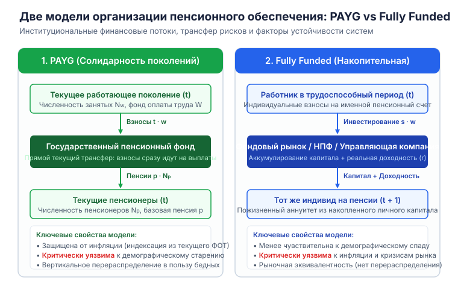
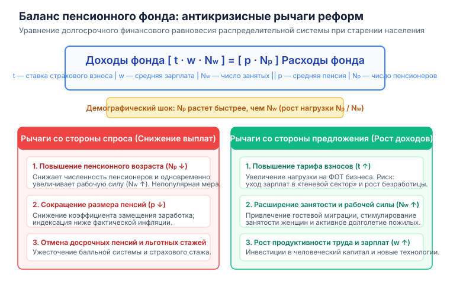

Управление и экономика социальной сферы · М. Г. Колосницына · 17 ноября 2026

# Пенсионные системы, демографический баланс PAYG и реформы пенсионных фондов

* **Преподаватель:** **Колосницына Марина Григорьевна** — доктор экономических наук, ординарный профессор факультета экономических наук (Департамент прикладной экономики) НИУ ВШЭ, заведующая Лабораторией экономических исследований общественного сектора (`mkolosnitsyna@hse.ru`, [профиль на портале ВШЭ](https://www.hse.ru/org/persons/65012)).
* **Дисциплина:** Управление и экономика социальной сферы (УЭСС), 1 курс магистратуры (2 модуль).
* **Дата и место:** Вторник, **17 ноября 2026 года**, 2-я пара (19:40–21:00, Мясницкая ул., д. 11, ауд. 432).
* **Контекст:** Вторая пара лекционного блока М. Г. Колосницыной (первая пара в этот день — [Основы социального страхования](social-sector-kolosnitsyna-social-insurance.md)). Конспект составлен по презентации `Лекция Пенсии.ppt` и научным публикациям профессора М. Г. Колосницыной.

!!! tip "TL;DR: Ключевые положения пенсионного модуля"
    1. **Почему частный рынок не способен обеспечить пенсии:** Долгосрочные пенсионные накопления подвержены двум неустранимым рыночным рискам — **непредсказуемой инфляции** (съедающей доходность частных фондов за 30–40 лет) и **росту ожидаемой продолжительности жизни** ($p \to 1$).
    2. **Две базовые пенсионные архитектуры:**
       * **PAYG (Pay-As-You-Go, распределительная система солидарности поколений):** взносы работающих граждан немедленно выплачиваются сегодняшним пенсионерам. Защищена от финансового краха рынков, но крайне уязвима перед демографическим старением.
       * **Fully Funded (накопительная система):** персональные счета, инвестирование в рыночные активы. Зависит от доходности фондового рынка и макроэкономических шоков.
    3. **Фундаментальное уравнение финансового баланса пенсионного фонда:**
       $$t \cdot w \cdot N_w = p \cdot N_p \implies \beta = \frac{p}{w} = t \cdot \frac{N_w}{N_p}$$
       При падении соотношения работающих к пенсионерам ($N_w / N_p \downarrow$) государство вынуждено либо поднимать пенсионный возраст ($N_p \downarrow, N_w \uparrow$), либо снижать коэффициент замещения ($\beta \downarrow$), либо увеличивать тариф взносов ($t \uparrow$).
    4. **Практикум по занятости (25% оценки):** 1 декабря (1-я группа) и 4 декабря (2-я группа) состоится семинар по кейс-стади «Активная политика занятости — субсидируемая миграция».

---

## 1. Пенсионное страхование: экономическая природа и провалы рынка

Пенсионная система представляет собой важнейший институт социального страхования, призванный защитить индивида от риска катастрофического падения дохода и бедности при наступлении нетрудоспособности в старости.

### Почему коммерческий рынок не обеспечивает адекватных пенсионных решений:
* **Неопределённость горизонта дожития ($p \to 1$):** Вероятность дожить до пенсионного возраста в современных обществах приближается к единице, а точный срок жизни после выхода на пенсию случаен. Для коммерческого страховщика неопределённость обязательств на горизонте 20–30 лет после выхода на пенсию создает непреодолимый актуарный риск.
* **Системный риск инфляции и рыночных кризисов:** Накопления, формируемые в течение 40 лет трудовой жизни, обесцениваются экономическими кризисами, обесценением валют и всплесками инфляции. Частные управляющие компании не могут гарантировать реальную покупательную способность пенсионных выплат.
* **Близорукость индивидов (*Myopia*):** В молодости люди систематически недооценивают потребность в пенсионных сбережениях, откладывая формирование фонда на предпенсионный возраст, когда времени для накопления уже нет.

---

## 2. Две модели пенсионных систем: PAYG vs Fully Funded

<figure class="lecture-figure" markdown>

{ loading=lazy }
  <figcaption markdown>Архитектура финансовых потоков: распределительная солидарность поколений vs персональные накопительные счета.</figcaption>
</figure>

| Критерий анализа | Распределительная система (PAYG) | Накопительная система (Fully Funded) |
| :--- | :--- | :--- |
| **Базовый экономический принцип** | **Солидарность поколений:** текущие работающие содержат текущих пенсионеров. | **Индивидуальная капитализация:** каждый работник финансирует свою будущую пенсию. |
| **Хранение и движение средств** | Деньги не аккумулируются; немедленно тратятся на выплату текущих пенсий. | Взносы аккумулируются на счетах и инвестируются в финансовые активы (акции, облигации, недвижимость). |
| **Главный риск системы** | **Демографический шок:** старение населения, снижение рождаемости, сокращение доли занятых. | **Экономический и фондовый шок:** падение фондовых рынков, инфляция, банкротство управляющих фондов. |
| **Устойчивость к инфляции** | **Высокая:** пенсии индексируются за счёт роста номинальных зарплат и текущего ФОТ. | **Низкая:** реальная доходность портфеля может оказаться отрицательной при высокой инфляции. |
| **Влияние на экономический рост** | Нейтральное (перераспределение текущего потребления). | Потенциально позитивное (формирование длинных инвестиционных денег в экономике). |

---

## 3. Демографический кризис и антикризисный баланс пенсионного фонда

### Фундаментальное уравнение финансового равновесия

Для бездефицитного функционирования распределительной пенсионной системы совокупный объем собранных страховых взносов обязан равняться совокупным пенсионным выплатам:

$$t \cdot w \cdot N_w = p \cdot N_p$$

* $t$ — ставка страхового взноса в пенсионный фонд;
* $w$ — средняя заработная плата занятых работников;
* $N_w$ — численность работающего населения, уплачивающего взносы;
* $p$ — средний размер назначенной пенсии;
* $N_p$ — численность получателей пенсий.

<figure class="lecture-figure" markdown>

{ loading=lazy }
  <figcaption markdown>Антикризисные рычаги балансировки бюджета пенсионного фонда со стороны спроса и предложения.</figcaption>
</figure>

#### Преобразование уравнения: коэффициент замещения заработка пенсией ($\beta = p / w$)

$$\beta = \frac{p}{w} = t \cdot \frac{N_w}{N_p}$$

При старении населения коэффициент демографической нагрузки растет: отношение числа работающих к числу пенсионеров ($N_w / N_p$) неуклонно падает. Если в 1970-е годы на 1 пенсионера в развитых странах приходилось 4–5 работающих, то к 2026 году этот показатель приблизился к **1,5–1,8**.

### Антикризисные меры государства

<article class="feature-card" markdown>
Рычаг 1: Сокращение расходов

**Повышение пенсионного возраста**  
Наиболее действенный мировой инструмент. Даёт **двойной фискальный эффект**: одновременно снижает число получателей пенсий ($N_p \downarrow$) и увеличивает число плательщиков взносов ($N_w \uparrow$).  
* *Мировая практика:* Дания и Норвегия — 67 лет; Германия, Испания, Нидерланды — 66–67 лет; Франция — 64–65 лет (реформа 2023 г.); Россия — 65 лет (мужчины) и 60 лет (женщины).
</article>

<article class="feature-card" markdown>
Рычаг 2: Доходы системы

**Повышение тарифа взносов ($t \uparrow$)**  
Прямое наращивание фискальной нагрузки на фонд оплаты труда. Ограничено риском ухода бизнеса в теневой сектор и снижения конкурентоспособности экономики.
</article>

<article class="feature-card" markdown>
Рычаг 3: Социальный компромисс

**Снижение коэффициента замещения ($\beta \downarrow$)**  
Индексация пенсий ниже темпов роста реальной заработной платы. Предотвращает коллапс фонда, но ведет к относительному обеднению пенсионеров.
</article>

<article class="feature-card" markdown>
Рычаг 4: Рынок труда

**Расширение предложения труда ($N_w \uparrow$)**  
Стимулирование занятости пожилых граждан, развитие ясельной инфраструктуры для возвращения женщин на работу, привлечение квалифицированных трудовых мигрантов.
</article>

---

## 4. Подготовка к семинару: Кейс-стади М. Г. Колосницыной {: #4 }

На третьем занятии блока М. Г. Колосницыной состоится практический семинар, формирующий **25% итоговой оценки** за курс «Управление и экономика социальной сферы».

### Параметры практического модуля:
* **Тема кейса:** **«Активная политика занятости — субсидируемая миграция»** (расчетный микроэкономический кейс оценки эффективности субсидий на переезд рабочей силы из трудоизбыточных регионов в регионы с дефицитом кадров).
* **Даты семинаров:**
  * **1-я академическая группа** (начинается с Е. Антиповой): **1 декабря 2026 года**;
  * **2-я академическая группа** (начинается с В. Горской): **4 декабря 2026 года**.
* **Регламент:** Работа ведётся в малых группах непосредственно на паре с последующей презентацией и защитой расчетов. Посещаемость строго фиксируется. Смена даты допускается **только при взаимной замене («1 на 1»)** со студентом другой группы.

---

## Чек-лист для подготовки к экзамену

- [ ] Уметь выводить формулу коэффициента замещения $\beta = t \cdot (N_w / N_p)$ и объяснять демографическую ловушку распределительных систем.
- [ ] Знать сравнительные преимущества и уязвимости систем PAYG и Fully Funded.
- [ ] Знать основные направления пенсионных реформ в странах ОЭСР и Российской Федерации.
- [ ] Ознакомиться с текстом методического пособия к кейс-стади по активной политике занятости.
