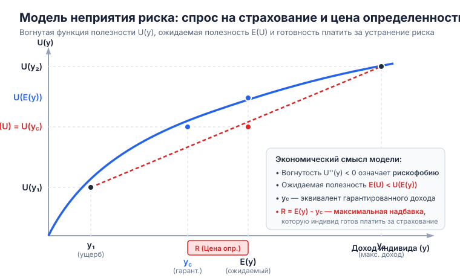
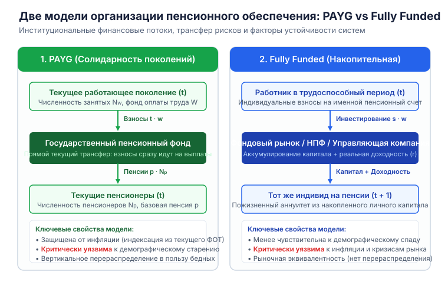
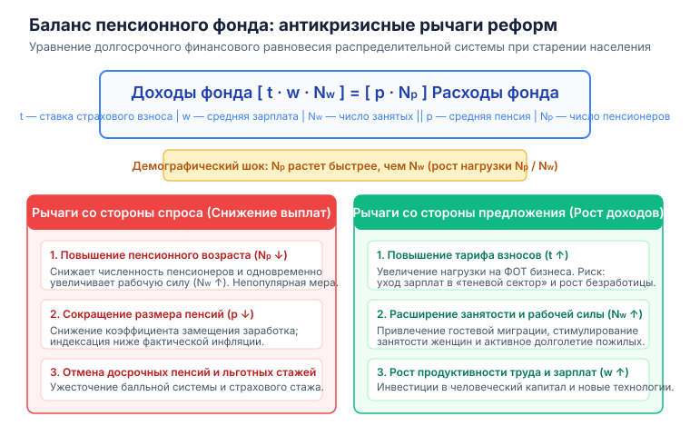

Управление и экономика социальной сферы · Блок М. Г. Колосницыной

# Государственное социальное страхование и пенсионные системы

* **Преподаватель:** **Колосницына Марина Григорьевна** — доктор экономических наук, ординарный профессор факультета экономических наук (Департамент прикладной экономики) НИУ ВШЭ (`mkolosnitsyna@hse.ru`, [профиль на портале ВШЭ](https://www.hse.ru/org/persons/65012)).
* **Дисциплина:** Управление и экономика социальной сферы (УЭСС), 1 курс магистратуры.
* **Лекционные занятия:** 17 ноября (4 академических часа) — основы социального страхования и пенсионные программы.
* **Практический семинар с кейс-стади (25% оценки за курс):**
  * **Тема кейса:** «Активная политика занятости — субсидируемая миграция» (командный анализ и групповая работа на паре);
  * **1-я группа:** **1 декабря 2026 года**;
  * **2-я группа:** **4 декабря 2026 года**;
  * **Регламент посещения:** на лекциях и семинарах ведётся обязательный учёт посещаемости. При невозможности очного присутствия в свой день необходимо заблаговременно договориться о взаимной замене со студентом другой группы, чтобы не допускать переполнения аудитории.

!!! info "Раздельные конспекты по парам"
    Материалы лекций также доступны в виде раздельных подробных конспектов:
    * **1-я пара:** [Основы социального страхования: модель рискофобии, провалы частных рынков и роль государства](social-sector-kolosnitsyna-social-insurance.md) — по полной аудиозаписи занятия (`Новая запись 12.m4a`) с подробным разбором кейсов ДМС ВШЭ, АЭС, Supplier-Induced Demand и сравнительной таблицей с безработицей.
    * **2-я пара:** [Пенсионные системы, демографический баланс PAYG и реформы](social-sector-kolosnitsyna-pensions.md) — формулы пенсионного баланса, антикризисные рычаги и подготовка к кейс-стади 1 и 4 декабря.

!!! tip "TL;DR (Краткая выжимка для магистра)"
    1. **Почему люди страхуются добровольно при прибыльности страховых компаний:** Индивиды обладают свойством **неприятия риска (рискофобией)**. Из-за убывающей предельной полезности дохода ожидаемая полезность от рискового дохода всегда строго ниже полезности от гарантированного дохода того же размера: $E(U) < U(E(y))$.
    2. **Цена определённости ($R$):** Максимальная надбавка сверх актуарно справедливой нетто-премии, которую рациональный гражданин готов заплатить страховщику за полное устранение неопределённости: $R = E(y) - y_c$.
    3. **Пять условий частного страхового рынка:** Независимость рисков, вероятность $p < 1$, объективная известность вероятности, отсутствие отрицательного отбора (*Adverse Selection*) и отсутствие морального ущерба (*Moral Hazard*).
    4. **Зачем нужно социальное страхование:** Частные рынки неизбежно проваливаются при системных рисках ($p=1$, инфляция, пандемия), при безработице и в здравоохранении. Государство формирует всеобщий обязательный пул, ликвидирует неблагоприятный отбор и осуществляет межвременное и межпространственное сглаживание шоков.
    5. **PAYG против Fully Funded:** Распределительная система (PAYG) защищена от инфляции, но критически чувствительна к старению населения ($N_p / N_w$); накопительная (Fully Funded) менее зависит от демографии, но беззащитна перед финансовыми кризисами и непрогнозируемой инфляцией.
    6. **Антикризисное уравнение пенсионного фонда:** $t \cdot w \cdot N_w = p \cdot N_p$. Балансировка при демографическом кризисе достигается либо со стороны спроса (повышение пенсионного возраста $N_p \downarrow$, урезание коэффициента замещения $p \downarrow$), либо со стороны предложения (рост тарифа $t \uparrow$, привлечение мигрантов и пожилых $N_w \uparrow$, рост продуктивности $w \uparrow$).

---

## 1. Экономическая теория страхования: спрос и модель рискофобии

### Цель против метода: определение страхования
В экономической науке понятие «страхование» используется в двух аспектах:
1. **По целевому признаку:** любой институциональный механизм или программа защиты человека и домохозяйства от риска падения благосостояния.
2. **По методу (строгий актуарный смысл):** формирование целевого денежного фонда за счёт регулярных страховых взносов участников пула, из которого осуществляются компенсационные выплаты пострадавшим при наступлении оговорённого страхового события.

Даже если государственные социальные программы не являются актуарно сбалансированными во втором смысле, они выполняют полноценную страховую функцию в первом значении.

### Парадокс спроса на страхование
В реальной экономике коммерческие страховые компании извлекают прибыль и несут административные расходы. Это означает, что **репрезентативный (средний) клиент в долгосрочном периоде гарантированно получает страховых выплат меньше, чем общая сумма уплаченных им взносов**.

Отсюда возникают два фундаментальных вопроса микроэкономики:
* **Спрос:** почему рациональные граждане добровольно покупают полисы по ценам выше актуарной стоимости потерь?
* **Предложение:** при каких технических условиях частные фирмы готовы поставлять страховые контракты на рынок?

---

### Модель рискофобии (неприятия риска)

Предположим, что индивид в течение года может оказаться в одном из двух состояний:
* **Неблагоприятное состояние (ущерб):** доход падает до величины $y_1$ с вероятностью $p_1 = p$;
* **Благоприятное состояние:** сохраняется высокий доход $y_2$ с вероятностью $p_2 = 1 - p$.

<figure class="lecture-figure" markdown>

{ loading=lazy }
  <figcaption markdown>Вогнутая функция полезности U(y), ожидаемая полезность E(U) и геометрический смысл цены определённости (премии за риск R).</figcaption>
</figure>

#### Математический аппарат модели

1. **Ожидаемый денежный доход:**
   
   $$E(y) = p_1 y_1 + p_2 y_2$$

2. **Ожидаемая полезность индивида в условиях неопределённости:**
   
   $$E(U) = p_1 U(y_1) + p_2 U(y_2)$$

3. **Свойство рискофобии:**  
   Большинство людей не склонны к риску (*risk averse*). Их функция полезности строго вогнута: $U'(y) > 0$, а вторая производная строго отрицательна:
   
   $$U''(y) < 0 \quad (\text{убывающая предельная полезность дохода})$$

4. **Неравенство Йенсена в теории страхования:**  
   Для любой вогнутой функции полезность от среднего (ожидаемого) дохода всегда строго выше, чем средняя (ожидаемая) полезность от рискового дохода:
   
   $$U(E(y)) > E(U)$$

5. **Гарантированный эквивалент дохода ($y_c$):**  
   Это гарантированная сумма денежного дохода, получение которой без всякого риска приносит индивиду ровно такую же полезность, как участие в рисковой лотерее:
   
   $$U(y_c) = E(U)$$

6. **Цена определённости (премия за риск, $R$):**  
   Разница между математическим ожиданием дохода и гарантированным эквивалентом:
   
   $$R = E(y) - y_c$$

> **Экономический смысл:** Величина $R$ — это **максимальная денежная сумма**, которую рациональный гражданин готов добровольно переплатить страховщику сверх математического ожидания потерь, лишь бы гарантировать себе стабильное потребление без риска катастрофического падения дохода.

---

### Структура страхового тарифа: нетто- и брутто-премии

* **Объём потерь (ущерба):** $L = y_2 - y_1$.
* **Нетто-премия (актуарно справедливая ставка):** сумма, равная математическому ожиданию выплат:
  
  $$P_{\text{net}} = p \cdot L$$

* **Брутто-премия (рыночная цена страхового полиса):** включает нетто-ставку, административные издержки ведения дела ($\alpha$) и прибыль страховщика ($\pi$):
  
  $$P_{\text{gross}} = P_{\text{net}} + \alpha + \pi = p \cdot L \cdot (1 + m)$$
  
  *(где $m$ — процент надбавки на расходы и прибыль).*

#### Числовой пример со слайдов профессора М. Г. Колосницыной

| Статья расчёта | Максимальный доход ($y_2$) | Минимальный доход ($y_1$) |
| :--- | :---: | :---: |
| **1. Первичный доход индивида** | **1 000** | **100** |
| **2. Брутто-премия (цена полиса)** | **550** | **550** |
| **3. Страховое возмещение (выплата при ущербе)** | **0** | **900** |
| **4. Чистый итоговый доход $(1 - 2 + 3)$** | **450** | **450** |
| **5. Нетто-премия (математическое ожидание)** | **100** | **100** |

* **Итог:** За счёт уплаты брутто-премии 550 индивид полностью устраняет неопределённость и гарантирует себе стабильный чистый доход **450** при любом исходе.
* **Условие рыночного равновесия:** Спрос на частном страховом рынке существует тогда и только тогда, когда готовность платить за устранение риска покрывает аппетиты страховщика:
  
  $$R \ge P_{\text{gross}} - P_{\text{net}} \iff E(y) - y_c \ge \alpha + \pi$$

---

## 2. Предложение на частных страховых рынках: 5 технических условий

Частное страхование основано на **объединении индивидуальных рисков в общий пул**. Согласно **закону больших чисел**, при объединении большого числа независимых рисков случайные индивидуальные отклонения взаимопогашаются, а совокупный убыток пула становится предсказуемой величиной с минимальной дисперсией.

Однако для устойчивого функционирования частного страхового рынка необходимо одновременное выполнение **пяти обязательных технических условий**:

<article class="feature-card" markdown>
Условие 1

### Независимость вероятностей
Вероятности наступления страхового случая для отдельных участников пула должны быть статистически независимы:
$$\operatorname{cov}(X_i, X_j) = 0$$
Если риск носит системный характер (война, ядерная катастрофа, общенациональный экономический кризис, гиперинфляция), ущерб наступает у всех одновременно, и закон больших чисел перестаёт работать.
</article>

<article class="feature-card" markdown>
Условие 2

### Вероятность меньше единицы ($p < 1$)
Событие не должно быть неизбежным. Если вероятность наступления события равна единице ($p = 1$), исчезает элемент случайности. Такое событие представляет собой не риск, а неизбежные регулярные затраты, которые невозможно застраховать на коммерческой основе.
</article>

<article class="feature-card" markdown>
Условие 3

### Известность и оцениваемость вероятности
Вероятность наступления ущерба должна поддаваться объективной актуарной оценке на основе накопленной эмпирической статистики. Если событие уникально или вероятность неизвестна, страховщик не способен рассчитать безубыточный тариф.
</article>

<article class="feature-card feature-card--accent" markdown>
Условие 4

### Отсутствие неблагоприятного отбора (Adverse Selection)
Не должно возникать информационной асимметрии, при которой полисы покупают преимущественно лица с максимальным скрытым риском. Если здоровые отказываются от покупки, средний риск пула взлетает, премия растёт, и рынок коллапсирует (*спираль Акерлофа*).
</article>

<article class="feature-card feature-card--accent" markdown>
Условие 5

### Отсутствие морального риска (Moral Hazard)
Наличие страхового полиса не должно провоцировать застрахованного на безответственное поведение или фальсификацию ущерба (курение, пренебрежение техникой безопасности, искусственное продление больничного листа).
</article>

---

## 3. Природа и преимущества государственного социального страхования

Когда хотя бы одно из пяти технических условий нарушается, коммерческий рынок терпит фиаско: частные компании либо выставляют запретительно высокие тарифы, либо полностью сворачивают предложение. Именно здесь возникает объективная необходимость **государственного социального страхования**.

### Четыре фундаментальных преимущества социального страхования

1. **Колоссальный масштаб пула и обязательное участие:**  
   По закону в государственное социальное страхование включается всё экономически активное население страны. Максимальный размер пула радикально снижает средний риск и обеспечивает абсолютную финансовую устойчивость системы.
2. **Ликвидация неблагоприятного отбора (*Adverse Selection*):**  
   Обязательный характер исключает возможность «бегства» из пула здоровых или богатых граждан с низким индивидуальным риском. В единую систему принудительно объединяются и те, чей риск близок к нулю, и те, чей риск максимален.
3. **Межвременное и межпространственное сглаживание системных макрошоков:**  
   Частный страховщик банкротится, если $p \to 1$. Государство обладает уникальным правом собирать налоги и эмитировать долговые обязательства, что позволяет перераспределять ресурсы **во времени** (покрывая дефициты текущего кризиса из будущих доходов) и **в пространстве** (дотируя депрессивные регионы за счёт благополучных).
4. **Перераспределительная функция (социальная солидарность):**  
   В отличие от частного страхования, где выплаты строго пропорциональны уплаченным премиям, социальное страхование осуществляет **вертикальное перераспределение**: высокодоходные работники платят в фонд существенно больше, чем получают при наступлении риска, субсидируя защиту бедных слоёв населения.

### Сферы неизбежного провала частного страхования

* **Страхование от безработицы:** риск потери работы во время макроэкономического спада носит массовый, взаимозависимый характер ($\operatorname{cov} > 0$). Кроме того, крайне высок моральный риск (демотивация к активному поиску нового рабочего места при высоких пособиях). Ни одна частная компания в мире не страхует риск рыночной безработицы.
* **Здравоохранение:** рынок частного медицинского страхования страдает от острейшей информационной асимметрии, гипердиагностики со стороны врачей (*Supplier-Induced Demand*) и вымывания пожилых и хронически больных граждан.

---

## 4. Пенсионное страхование: экономическая природа и провалы рынка

Пенсии выполняют три базовые экономические функции:
1. **Сглаживание потребления в течение жизненного цикла (*Life-Cycle Hypothesis*):** перенос части текущего дохода из периода высокой трудоспособности в период нетрудоспособной старости.
2. **Страхование сопутствующих рисков долгожительства:** защита от риска пережить свои личные сбережения (*longevity risk*), риска старческой инвалидности, тяжелой болезни и потери кормильца (вдовства).
3. **Сокращение бедности пожилых:** государственная выплата безусловной минимальной («базовой») пенсии гражданам без достаточного страхового стажа.

<figure class="lecture-figure" markdown>

{ loading=lazy }
  <figcaption markdown>Финансовые потоки и институциональные контуры солидарной (PAYG) и накопительной (Fully Funded) пенсионных систем.</figcaption>
</figure>

### Почему частных пенсионных сбережений недостаточно?

* **Провалы спроса (потребительская близорукость):**  
  Индивиды страдают от миопии (*short-sightedness*), когнитивных искажений и высокой ставки дисконтирования будущего. Молодые люди недооценивают ценность доходов через 40 лет. Для малообеспеченных граждан норма сбережений физически близка к нулю — весь доход уходит на текущее биологическое выживание.
* **Провалы предложения (риск непредсказуемой инфляции):**  
  Хотя частные страховщики способны составить актуарные таблицы дожития, они **не могут застраховать пенсионные сбережения от непрогнозируемой долгосрочной инфляции**. Инфляция обесценивает номинальные финансовые активы всех граждан одновременно ($p \to 1$), а темпы обесценения зависят от денежно-кредитной политики государства.

### Международные масштабы пенсионного охвата (ILO, 2024–2026)

*Доля населения старше пенсионного возраста, получающего пенсионные выплаты, % (World Social Protection Report).*

| Страна | Охват населения 65+, % | Страна | Охват населения 65+, % |
| :--- | :---: | :--- | :---: |
| **Япония** | **100,0%** | **Туркменистан** | **77,2%** |
| **Франция** | **100,0%** | **Египет** | **58,5%** |
| **Российская Федерация** | **100,0%** | **Индия** | **45,9%** |
| **США** | **100,0%** | **Саудовская Аравия** | **24,5%** |
| **Бразилия** | **88,6%** | **Нигерия** | **19,6%** |
| **ЮАР** | **79,9%** | **Гамбия** | **17,0%** |

---

## 5. Две модели пенсионных систем: PAYG vs Fully Funded

В мировой практике сформировались два принципиально разных метода организации государственных пенсионных обязательств:

1. **Распределительная модель солидарности поколений (Pay-As-You-Go, PAYG):** пенсионные взносы работающего населения текущего периода $t$ не аккумулируются, а **немедленно направляются на выплату пенсий текущим пенсионерам**.
2. **Накопительная модель (Fully Funded):** индивидуальные взносы каждого работника инвестируются на финансовом рынке в акции, облигации и недвижимость, а будущая пенсия складывается из накопленного капитала и полученного инвестиционного дохода.

### Сравнительный анализ пенсионных архитектур

| Параметр сравнения | Распределительная система (PAYG) | Накопительная система (Fully Funded) |
| :--- | :--- | :--- |
| **Мобильность рабочей силы** | **Не препятствует:** права учитываются в едином государственном фонде вне зависимости от смены работодателя. | **Может ограничивать:** при корпоративных схемах работник «привязан» к пенсионной программе конкретной фирмы. |
| **Скорость реализации права** | **Немедленно:** государство вправе начать выплату пенсий сразу после запуска программы. | **Требует 30–40 лет:** право на полноценный аннуитет возникает только после десятилетий накоплений. |
| **Устойчивость к инфляции** | **Высокая:** пенсии индексируются за счёт роста фонда оплаты труда и номинальных заработных плат текущих работников. | **Крайне низкая:** инфляционные шоки и падения фондового рынка безвозвратно сжигают накопленный капитал. |
| **Источник роста выплат** | Общий экономический рост, рост производительности труда и фонда зарплат в экономике ($g + n$). | Динамика реальной доходности на рынках капитала и процентных ставок ($r$). |
| **Чувствительность к демографии** | **Критическая уязвимость:** падение рождаемости и рост доли пожилых взрывают баланс фонда. | **Низкая зависимость:** каждый застрахованный формирует свой фонд независимо от числа молодых работников. |
| **Перераспределение доходов** | **Выраженное:** от богатых к бедным (социальная солидарность, выравнивание коэффициентов замещения). | **Отсутствует:** строгая рыночная эквивалентность (кто сколько накопил, тот столько и получает). |

---

## 6. Демографический кризис и антикризисный баланс пенсионного фонда

### Демографический сдвиг: старение населения
Все развитые страны и Россия столкнулись с системным демографическим кризисом, порождённым двумя факторами:
* **Рост ожидаемой продолжительности жизни в пожилом возрасте (ОПЖ 65+):** во Франции дожитие после 65 лет достигает 19,3 года у мужчин и 23,2 года у женщин; в Японии — 19,7 и 24,5 года; в РФ — 12,4 года у мужчин и 17,0 лет у женщин.
* **Падение суммарного коэффициента рождаемости (СКР):** суженное воспроизводство поколений сужает основание демографической пирамиды.

#### Динамика коэффициента пенсионной нагрузки (Росстат, Всемирный банк)
*Отношение числа пенсионеров к численности трудоспособного населения, %:*

| Регион / Страна | 1995–2000 гг. | 2020–2025 гг. | 2030–2035 гг. (прогноз) | 2040–2045 гг. (прогноз) |
| :--- | :---: | :---: | :---: | :---: |
| **Западная Европа** | 22,4% | 32,3% | 41,6% | **47,6%** |
| **Восточная Европа** | 18,4% | 24,4% | 31,0% | **35,5%** |
| **Российская Федерация** | 34,0% | 41,0% | 38,0% *(эффект реформы)* | **45,0%** |

---

### Уравнение баланса пенсионного фонда

Финансовое равновесие государственного распределительного фонда описывается формулой:

$$t \cdot w \cdot N_w = p \cdot N_p$$

Где:
* $t$ — ставка (тариф) страхового взноса в пенсионный фонд;
* $w$ — средняя заработная плата занятых работников;
* $N_w$ — численность работающего населения, уплачивающего взносы;
* $p$ — средний размер назначенной пенсии;
* $N_p$ — общая численность получателей пенсий.

<figure class="lecture-figure" markdown>

{ loading=lazy }
  <figcaption markdown>Антикризисные рычаги сбалансированности бюджета пенсионного фонда со стороны спроса и предложения.</figcaption>
</figure>

#### Преобразование уравнения: коэффициент замещения
Разделив обе части уравнения на $w \cdot N_p$, получаем формулу коэффициента замещения заработка пенсией ($\beta = p / w$):

$$\beta = \frac{p}{w} = t \cdot \frac{N_w}{N_p}$$

При росте коэффициента демографической нагрузки ($N_p / N_w \uparrow$) соотношение $N_w / N_p$ падает. Чтобы сохранить фонд без дефицита, правительство обязано задействовать регуляторные рычаги:

### Антикризисные меры со стороны спроса (сокращение расходов)
1. **Повышение пенсионного возраста ($N_p \downarrow$):**  
   Главный инструмент мировой политики. Повышение возраста одновременно выводит людей из состава пенсионеров ($N_p \downarrow$) и увеличивает численность занятых ($N_w \uparrow$), давая двойной фискальный эффект.  
   * *Мировая практика пенсионного возраста (ILO / OECD):* Дания и Норвегия — 67 лет; Германия, Испания, Нидерланды, Великобритания — 66–67 лет; Франция — 65+ лет (реформа 2023 г. вызвала волну забастовок профсоюзов в Ницце и Париже); Россия — переход к 65 годам у мужчин и 60 годам у женщин.
2. **Снижение реального размера пенсий ($p \downarrow$):**  
   Индексация пенсий ниже темпа роста зарплат или инфляции, ведущая к постепенному снижению коэффициента замещения.
3. **Ужесточение правил досрочного выхода:** отмена отраслевых льгот и повышение планки минимального страхового стажа.

### Антикризисные меры со стороны предложения (наращивание доходов)
1. **Повышение тарифа страховых взносов ($t \uparrow$):**  
   Прямое увеличение налоговой нагрузки на бизнес. Ограничено риском ухода зарплат в «серую» зону и ростом безработицы.
2. **Расширение предложения рабочей силы ($N_w \uparrow$):**  
   * Стимулирование активного долголетия и продолжения работы пожилыми;
   * Привлечение трудовых мигрантов на гостевой основе;
   * Вовлечение женщин через развитие детских садов и гибких форм занятости.
3. **Рост производительности труда и человеческого капитала ($w \uparrow$):**  
   Внедрение новых технологий повышает производительность труда, увеличивая фонд оплаты труда без роста ставки налога.

#### Экономическая активность пожилых в РФ (данные Росстата)
*Доля граждан, продолжающих трудовую деятельность:*
* **Возрастная группа 60–69 лет:** в 1995 г. работало лишь 17% мужчин и 9% женщин; к 2019 г. показатель вырос до **30% мужчин и 20% женщин**.
* **Возрастная группа «молодых пенсионерок» (55–59 лет):** до реформы пенсионного возраста в 1995 г. работала 31% женщин; к 2019 г. — **55% женщин**.

---

## 7. Практический модуль: кейс-стади М. Г. Колосницыной {: #7 }

На семинарских занятиях М. Г. Колосницыной студенты выполняют практическое командное исследование, дающее **25% итоговой оценки** за весь курс УЭСС.

### Параметры семинара и кейса
* **Тема кейса:** **«Активная политика занятости — субсидируемая миграция»**;
* **Формат:** командный анализ в малых группах непосредственно на семинарском занятии;
* **Даты проведения:**
  * **1-я академическая группа:** **1 декабря 2026 года**;
  * **2-я академическая группа:** **4 декабря 2026 года**;
* **Правила посещения:** посещаемость фиксируется в ведомости. Переход между группами допускается **исключительно в формате взаимного обмена («1 на 1»)** со студентом параллельной группы, чтобы аудитория не была перегружена.

### Базовые научные источники к блоку
1. **Колосницына М. Г.** Экономика общественного сектора: государственные расходы // *Экономический журнал ВШЭ*. 2003. Т. 7. № 2. С. 231–257 ([читать статью](https://ej.hse.ru/ru/article/view/29610/23859)); № 3. С. 371–401 ([читать статью](https://ej.hse.ru/ru/article/view/29606/23855)). Лекции 2 и 3.
2. **Ле Гранд Дж., Проппер К., Смит С.** *Экономический анализ социальных проблем*. Пер. с англ. М.: ИД ВШЭ, 2013. Глава 9.
3. **Колосницына М. Г., Канторович В. К.** *Государственное регулирование рынка труда*. Электронный учебник. М.: ВШЭ, 2001 ([электронная версия](https://economics.hse.ru/depe/gosreg/)). Раздел 4; текст расчётного кейса.

---

## Глоссарий блока

* **Рискофобия (Risk Aversion)** — предпочтение гарантированного дохода рисковому доходу с тем же математическим ожиданием; графически выражается вогнутостью функции полезности ($U'' < 0$).
* **Гарантированный эквивалент ($y_c$)** — детерминированный объём дохода, полезность которого в точности равна ожидаемой полезности в условиях неопределённости: $U(y_c) = E(U)$.
* **Цена определённости (Risk Premium, $R$)** — максимальная готовность индивида платить за устранение риска: $R = E(y) - y_c$.
* **Нетто-премия ($P_{net}$)** — актуарно справедливая ставка взноса, равная математическому ожиданию страхового возмещения: $P_{net} = p \cdot L$.
* **Брутто-премия ($P_{gross}$)** — полная рыночная стоимость полиса, включающая нетто-ставку, нагрузку на ведение дел и прибыль компании.
* **Неблагоприятный отбор (Adverse Selection)** — рыночный провал из-за информационной асимметрии, при котором в страховой пул собираются преимущественно высокорисковые клиенты.
* **Моральный риск (Moral Hazard)** — изменение поведения застрахованного лица в сторону менее осторожного после заключения страхового договора.
* **PAYG (Pay-As-You-Go)** — распределительная пенсионная модель «солидарности поколений», где текущие пенсии финансируются из текущих взносов работающих.
* **Fully Funded** — накопительная пенсионная система, при которой взносы инвестируются в рыночные активы на персональных счетах.
* **Коэффициент замещения ($\beta$)** — отношение средней пенсии к средней заработной плате в экономике: $\beta = p / w$.
* **Коэффициент пенсионной нагрузки** — отношение численности пенсионеров к численности трудоспособного населения ($N_p / N_w$).
