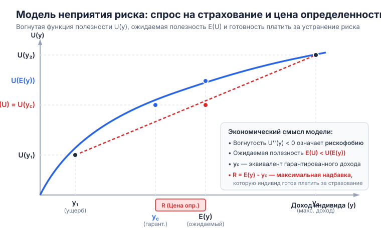
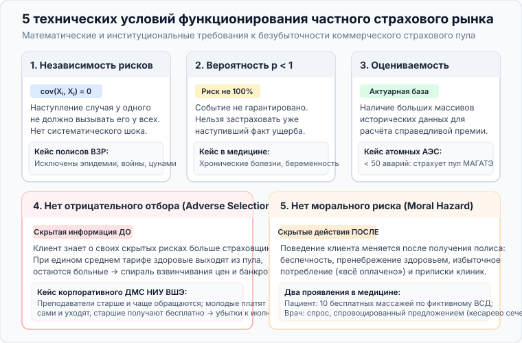

Управление и экономика социальной сферы · М. Г. Колосницына · 17 ноября 2026

# Основы социального страхования: экономика спроса, провалы частных рынков и необходимость государства

* **Преподаватель:** **Колосницына Марина Григорьевна** — доктор экономических наук, ординарный профессор факультета экономических наук (Департамент прикладной экономики) НИУ ВШЭ, заведующая Лабораторией экономических исследований общественного сектора (`mkolosnitsyna@hse.ru`, [профиль на портале ВШЭ](https://www.hse.ru/org/persons/65012)).
* **Дисциплина:** Управление и экономика социальной сферы (УЭСС), 1 курс магистратуры (2 модуль).
* **Дата и место:** Вторник, **17 ноября 2026 года**, 1-я пара (18:10–19:30, Мясницкая ул., д. 11, ауд. 432).
* **Контекст и аудиозапись:** Конспект составлен по полной аудиозаписи 1-й пары (`Новая запись 12.m4a`). Вторая пара этого дня была посвящена пенсионным программам (материалы представлены в [конспекте пенсионного страхования](social-sector-kolosnitsyna-pensions.md)).

!!! tip "TL;DR: Ключевые положения лекции профессора М. Г. Колосницыной"
    1. **Парадокс частного страхования:** Поскольку частная страховая компания извлекает коммерческую прибыль и несёт административные расходы, репрезентативный клиент в долгосрочном периоде неизбежно *платит взносов больше, чем получает страховых выплат*.
    2. **Модель рискофобии (спрос на страхование):** Большинство людей не склонны к риску (*risk averse*). Их функция полезности дохода строго вогнута ($U'' < 0$), а предельная полезность убывает. Поэтому полезность от гарантированного среднего дохода всегда строго выше ожидаемой полезности рисковой лотереи ($U(E(y)) > E(U)$). Индивид готов добровольно пожертвовать **ценой определённости ($\Phi$)** сверх ожидаемых потерь, чтобы зафиксировать безрисковый доход.
    3. **5 технических условий функционирования частного рынка:** Независимость рисков ($\operatorname{cov} = 0$), вероятность события $p < 1$, объективная оцениваемость вероятности (актуарная статистика), отсутствие неблагоприятного отбора (*Adverse Selection*) и отсутствие морального риска (*Moral Hazard*).
    4. **Провалы рынка в социальной сфере:** В страховании от безработицы частный рынок терпит стопроцентный крах (макрокризисы создают системный риск, $p=1$ для уязвимых групп, острый моральный риск). В здравоохранении частный рынок фрагментируется из-за хронических заболеваний, асимметрии информации (кейс корпоративного ДМС ВШЭ) и спроса, навязанного врачами (*Supplier-Induced Demand*).
    5. **Преимущества государственного соцстрахования:** Обязательный всеобщий охват ликвидирует отрицательный отбор, колоссальный масштаб гарантирует платёжеспособность, государственные займы обеспечивают сглаживание шоков во времени, а социальные трансферты сокращают неравенство.

---

## Организационный блок: структура курса, семинары и литература

### Разделение направлений кафедр внутри ВШЭ
В магистратуре дисциплина объединяет два взаимодополняющих исследовательских подхода:
* **Профессор С. В. Шишкин (ФГМУ, Центр политики в сфере здравоохранения):** макроэкономика отрасли, институциональная организация здравоохранения, тарифная политика ОМС, методы оплаты стационаров (КСГ) и амбулаторного звена.
* **Профессор М. Г. Колосницына (ФЭН, Лаборатория исследований общественного сектора):** микроэкономика социальной сферы (*Health Economics*), экономический анализ индивидуального поведения, экономика здорового образа жизни и зависимостей (табак, алкоголь), теория спроса на страхование и политика занятости.

### График учебного модуля и элементы контроля
* **День 1 (17 ноября, лекции, 4 часа):**  
  * 1-я пара: Теория спроса на страхование, рискофобия и условия частных рынков *(текущий конспект)*;  
  * 2-я пара: Пенсионные программы и демографический баланс PAYG.
* **День 2 (лекции, 4 часа):** Системы адресной социальной помощи и государственные программы регулирования занятости.
* **День 3 (семинары по 4 часа раздельно по академическим группам):**  
  Командный разбор и защита расчетного **Case Study «Активная политика занятости — субсидируемая миграция»** (дает **25%** итоговой оценки за весь курс УЭСС):
  * **1-я группа** (список начинается с Елизаветы Антиповой): **1 декабря 2026 года** (вторник);
  * **2-я группа** (список начинается с Варвары Горской): **4 декабря 2026 года** (пятница);
  * *Регламент посещения:* на семинарах ведётся строгий учёт. Переход между группами допускается **исключительно по взаимному обмену («1 на 1»)** с одногруппником по предварительному согласованию по почте, чтобы сохранить равную численность команд.
* **Экзаменационный контроль (50% оценки):** Письменный тест из 10 закрытых вопросов в конце декабря, куда включены вопросы по блокам С. В. Шишкина и М. Г. Колосницыной.

### Литература и базовые первоисточники
1. **Ле Гранд Дж., Проппер К., Смит С.** *Экономический анализ социальных проблем*. Пер. с англ. под ред. М. Г. Колосницыной и Л. С. Засимовой. М.: ИД ВШЭ, 2013 (глава по здравоохранению доступна в электронных ресурсах библиотеки ВШЭ).
2. **Колосницына М. Г., Канторович В. К.** *Государственное регулирование рынка труда*. Электронный учебник. М.: ВШЭ, 2001 (раздел 4 и текст кейс-стади).
3. **Колосницына М. Г.** Экономика общественного сектора: государственные расходы // *Экономический журнал ВШЭ*. 2003. Т. 7. № 2. С. 231–257; № 3. С. 371–401.

---

## 1. Природа страхования и главный экономический парадокс

### Целевое против формального определения
В экономической теории термин «страхование» используется в двух базовых значениях:
1. **Общее (целевое) определение:** любой институциональный механизм, направленный на устранение или смягчение финансовых последствий неблагоприятных рисков.
2. **Формальное (актуарное) определение:** математически выверенный механизм переноса индивидуального риска в общий пул через регулярные взносы, формирующие целевой фонд для выплат пострадавшим.
   * *Важная оговорка:* многие государственные социальные программы (например, распределительные солидарные пенсии PAYG) не сбалансированы строго актуарно, однако являются страховыми институтами по своей целевой функции.

### Исторический прецедент: караваны византийских купцов
Первые прообразы страховых пулов зафиксированы в купеческих гильдиях Византии. Владельцы торговых караванов, регулярно несшие разорительные убытки от нападений кочевников в пустыне, договорились перед каждым походом вносить фиксированную сумму в общий кошель. Если караван одного из купцов грабили, его убытки возмещались из собранного фонда. Если же все караваны доходили благополучно, собранные взносы не возвращались, оставаясь резервом на будущее.

### Главный микроэкономический парадокс частного страхования
Частная страховая компания — коммерческое предприятие, преследующее цель извлечения прибыли и несущее высокие административные издержки (содержание филиалов, IT-инфраструктура, оплата труда актуариев).

Следовательно, совокупная сумма собранных страховых премий заведомо превышает совокупный объём выплат застрахованным лицам:

$$\sum \text{Премий} > \sum \text{Выплат}$$

В долгосрочной перспективе репрезентативный (средний) потребитель **гарантированно проигрывает частному страховщику в чистых деньгах**. Почему же рациональные индивиды массово покупают полисы? Ответ даёт **теория неприятия риска (рискофобии)**.

---

## 2. Сторона спроса: модель рискофобии и математика страховой премии

### Типология индивидов по отношению к риску
Форма функции полезности дохода $U(Y)$ отражает психологический и экономический тип индивида:

| Тип отношения к риску | Функция полезности $U(Y)$ | Предельная полезность $MU = U'(Y)$ | Экономическое поведение |
| :--- | :--- | :--- | :--- |
| **Рискофоб** *(Risk Averse)* — *подавляющее большинство людей* | **Вогнутая (выпуклая вверх):** $U'' < 0$ | **Убывающая:** каждая последующая единица дохода ценится ниже предыдущей | Готов добровольно заплатить за устранение неопределенности и зафиксировать стабильный доход. |
| **Нейтральный к риску** *(Risk Neutral)* | **Прямая линия:** $U'' = 0$ | **Постоянная:** ценность денег линейна | Сравнивает исключительно математическое ожидание исходов; страховка по цене выше актуарной не нужна. |
| **Рискофил** *(Risk Lover)* — *экстремалы, игроки* | **Выпуклая вниз:** $U'' > 0$ | **Возрастающая:** ценность предельного дохода возрастает | Получает полезность от неопределенности и азарта (казино, скалолазание без страховки). |

---

### Графическая модель неприятия риска

Для рискофоба ценность гарантированного сохранения стабильного уровня потребления многократно превышает полезность возможного случайного выигрыша:

<figure class="lecture-figure" markdown>

{ loading=lazy }
  <figcaption markdown>Вогнутая функция полезности U(Y), ожидаемая полезность лотереи E(U) и геометрический смысл цены определённости (надбавки за риск Ф).</figcaption>
</figure>

---

### Классический кейс «Фермер и урожай»: пошаговый расчет

Пусть годовой доход фермера зависит от капризов погоды:
* С вероятностью $p_2 = 0{,}5$ погода благоприятна (**высокий урожай**): доход $Y_2 = 1\,000$ д.е.
* С вероятностью $p_1 = 0{,}5$ случается засуха (**потеря урожая**): доход падает до $Y_1 = 100$ д.е. (ущерб $L = Y_2 - Y_1 = 900$ д.е.).

#### 1. Ожидаемый денежный доход ($\bar{Y}$):
$$\bar{Y} = E(Y) = 0{,}5 \times 100 + 0{,}5 \times 1\,000 = 550 \text{ д.е.}$$

#### 2. Ожидаемая полезность без страховки ($\bar{U}$):
$$\bar{U} = E(U) = 0{,}5 \cdot U(100) + 0{,}5 \cdot U(1\,000)$$

В силу строго вогнутого характера функции полезности $U(Y)$ выполняется **неравенство Йенсена**:
$$U(\bar{Y}) = U(550) > \bar{U}$$
*Полезность гарантированного дохода в 550 д.е. строго выше, чем полезность рисковой лотереи с тем же средним значением 550 д.е.*

#### 3. Гарантированный эквивалент дохода ($Y^*$):
Это детерминированный объём чистого дохода, получение которого без риска даёт ровно такую же полезность, как участие в лотерее с неопределенностью:
$$U(Y^*) = \bar{U} \implies Y^* = 450 \text{ д.е.}$$

#### 4. Цена определённости (максимальная надбавка за устранение риска, $\Phi$):
$$\Phi = \bar{Y} - Y^* = 550 - 450 = 100 \text{ д.е.}$$

**Экономический смысл $\Phi$:** Фермер согласен безвозвратно пожертвовать суммой в **100 д.е.** сверх ожидаемых потерь, лишь бы получить полную гарантию и избавиться от угрозы разорения при засухе.

---

### Финансовый баланс фермера при покупке полного страхового полиса

Предположим, коммерческая страховая компания предлагает полис по цене (брутто-премия) $\Pi = 550$ д.е., гарантируя возмещение убытка $L = 900$ д.е. при наступлении засухи:

| Статья расчета | Сценарий 1: Урожайный год ($p = 0{,}5$) | Сценарий 2: Засуха и неурожай ($p = 0{,}5$) |
| :--- | :---: | :---: |
| Первичный доход фермера ($Y$) | $1\,000$ | $100$ |
| Уплата брутто-премии (цена полиса, $-\Pi$) | $-550$ | $-550$ |
| Страховое возмещение от компании ($+$) | $0$ | $+900$ |
| **Итоговый располагаемый доход фермера ($Y^*$)** | **$450$** | **$450$** |

*Индивид устранил неопределённость: при любом исходе погоды его чистый располагаемый доход гарантирован на уровне $Y^* = 450$ д.е.*

---

### Ценообразование коммерческого страховщика и рыночное равновесие

Брутто-премия ($\Pi$) включает актуарно справедливую выплату и надбавку на расходы и прибыль страховщика ($\alpha$):

$$\Pi = p \cdot L + \Phi = (1 + \alpha) \cdot p \cdot L$$

* $p \cdot L = 0{,}5 \times 900 = 450$ д.е. — **нетто-премия** (математическое ожидание страхового возмещения).
* $\Phi = \alpha \cdot p \cdot L = 100$ д.е. — **нагрузка страховщика** (административные расходы, налоги, маржа прибыли). В данном примере коэффициент нагрузки $\alpha = 100 / 450 \approx 0{,}222$ ($22{,}2\%$).

**Условие существования частного страхового рынка:**
Рыночная сделка возможна тогда и только тогда, когда максимальная готовность рискофоба платить за определённость покрывает издержки и норму прибыли страховой компании:

$$\bar{Y} - Y^* \ge \alpha \cdot p \cdot L$$

---

## 3. Сторона предложения: Закон больших чисел и 5 условий частного рынка

Частное страхование основано на **законе больших чисел**: при формировании пула из множества независимых рисков случайные индивидуальные колебания взаимно погашаются, а суммарный убыток пула приближается к постоянной величине с околонулевой дисперсией.

Однако для устойчивого функционирования коммерческого рынка необходимо **одновременное выполнение пяти жестких технических условий**:

{ loading=lazy }

### Разбор условий и эмпирических кейсов их нарушения

#### 1. Независимость вероятностей наступления ущерба ($\operatorname{cov}(X_i, X_j) = 0$)
* **Суть:** Страховой случай у одного застрахованного не должен автоматически вызывать наступление страхового случая у остальных участников пула. Риск не должен быть системным.
* **Кейс полисов выезжающих за рубеж (ВЗР):** Мелким шрифтом в договорах ВЗР всегда исключаются природные катаклизмы (землетрясения, извержения вулканов, цунами), военные действия, массовые беспорядки (*social unrest*) и глобальные эпидемии. Если целый чартер туристов попадает в зону землетрясения, вероятность потерь для страховщика подскакивает до 100%, что неминуемо влечет банкротство частного фонда.

#### 2. Вероятность события строго меньше единицы ($p < 1$)
* **Суть:** Нельзя страховать событие, которое гарантированно наступит или уже свершилось. В противном случае это не страхование риска, а рассрочка неизбежных затрат со 100% убытком для компании.
* **Кейс в здравоохранении:** Ни одна частная страховая компания не продаст полис ДМС с опцией лечения онкологии человеку, у которого уже верифицирован злокачественный диагноз, либо полис ведения родов женщине на позднем сроке беременности по стандартному тарифу без стопроцентной надбавки.

#### 3. Объективная оцениваемость вероятностей (наличие актуарной статистики)
* **Суть:** Актуариям необходимы репрезентативные исторические массивы данных (таблицы смертности, половозрастная заболеваемость, статистика ДТП) для калькуляции безубыточного тарифа.
* **Кейс страхования атомной энергетики (исследования 1990-х годов):** За всю историю мировой атомной энергетики зафиксировано менее 50 масштабных инцидентов на реакторах. Статистическая база ничтожно мала для вычисления вероятности, а потенциальный масштаб ущерба носит характер катастрофического системного риска. В результате частные компании не страхуют ядерные риски — гражданскую ответственность АЭС несут государства, кооперирующиеся в международные страховые пулы под эгидой МАГАТЭ.

#### 4. Отсутствие неблагоприятного (отрицательного) отбора (*Adverse Selection*)
* **Суть:** Асимметрия информации *до* подписания договора. Покупатель знает о скрытых дефектах своего здоровья или рисках увольнения больше, чем страховщик. Если страховой тариф рассчитан по среднему уровню риска, здоровые клиенты отказываются от страховки, а в пуле остаются лица с максимальным риском. Тариф взлетает, отсекая следующий слой относительно здоровых — рынок входит в **«спираль смерти» Акерлофа**.

!!! example "Практический кейс: Корпоративное ДМС сотрудников НИУ ВШЭ"
    Каждый год страховая компания, победившая на открытом конкурсе по предоставлению ДМС коллективу университета, к июню–июлю входит в зону глубокой убыточности (объём страховых выплат клиникам превышает собранные премии).
    
    **Факторы классического отрицательного отбора:**
    
    1. **Демографический и образовательный профиль:** Преподавательский состав ВШЭ в среднем старше работников коммерческих банков и ритейла, по которым страховщики рассчитывают типовые актуарные таблицы. Кроме того, в социологии медицины научно доказано: люди с высшим образованием и учеными степенями обращаются к врачам в 2–3 раза чаще при первых симптомах недомогания.
    2. **Гибкость рабочего графика:** Академическое расписание позволяет преподавателям посещать поликлиники в дневные часы будней, не беря отгулов.
    3. **Асимметрия схемы корпоративного софинансирования:** Молодые преподаватели и аспиранты (обладающие крепким здоровьем, но низкой зарплатой и ипотеками) должны софинансировать покупку полиса за свой счёт — и массово отказываются. Профессора старшего возраста с большим стажем получают полис от университета бесплатно — и вступают в программу со 100% охватом. Через год страховая компания расторгает контракт или повышает цены, и цикл повторяется с новым страховщиком.

#### 5. Отсутствие морального риска (*Moral Hazard*)
* **Суть:** Асимметрия информации *после* подписания страхового договора. Сам факт наличия страховой защиты снижает стимулы индивида к осторожности и провоцирует необоснованное завышение потребления услуг («за всё заплачено»).
* **Два проявления морального риска в медицине:**
  1. **Со стороны пациента (эксцесс потребления):** кейс пациентки, которая дважды в год за символическую благодарность оформляет у участкового врача фиктивный диагноз «вегетососудистая дистония» (ВСД) ради 10 бесплатных сеансов массажа в ведомственной поликлинике. Ни пациент, ни врач не несут финансовых затрат — счёт выставляется страховщику.
  2. **Со стороны врача — Спрос, спровоцированный предложением (*Supplier-Induced Demand*, SID):** Врач выступает одновременно и диагностом, и продавцом услуги. Пациент не обладает специальными медицинскими знаниями и полностью доверяет рекомендациям доктора. 
     * *Классическое гарвардское исследование 1970-х годов в США:* доказано, что в штатах с избыточной концентрацией хирургов на 10 тыс. населения частота проведения операций **кесарева сечения** статистически достоверно выше при одинаковом соматическом статусе рожениц. Хирурги максимизируют доход клиники, навязывая оперативные вмешательства, оплачиваемые страховыми компаниями.

---

## 4. Провалы частных рынков vs Государственное социальное страхование

Для работы коммерческого страхования необходимы три элемента: **наличие платежеспособного спроса**, **выполнение всех пяти условий предложения** и **пересечение кривых в области положительных цен**. Если условия нарушаются, рынок коллапсирует:

### Сравнительный анализ фиаско рынка: Безработица vs Здравоохранение

| Аналитический критерий | Страхование от потери работы (безработица) | Медицинское страхование |
| :--- | :--- | :--- |
| **Осознанный платежеспособный спрос** | **Присутствует:** граждане боятся потери заработка. | **Высокий:** риски тяжелых заболеваний критичны. |
| **1. Независимость вероятностей** | **Грубо нарушается:** при экономических рецессиях безработица носит массовый, системный характер (спрос на труд производен от макроспада). | **Нарушается периодически:** при эпидемиях и глобальных пандемиях (COVID-19, испанка). |
| **2. Вероятность события $p < 1$** | **Нарушается для уязвимых страт:** лица предпенсионного возраста в РФ, неквалифицированная молодежь в Южной Европе имеют близкую к 100% вероятность затяжной безработицы. | **Нарушается при хронических патологиях:** генетические синдромы, диабет, онкологический анамнез переводят риск в категорию неизбежных затрат. |
| **3. Оцениваемость статистикой** | **Ограничена:** макроэкономические кризисы и геополитические циклы не поддаются точному актуарному прогнозированию на десятилетия. | **Искажена:** статистика опирается на обращаемость (мужчины скрывают симптомы и не ходят к врачам); с 2024 года Росстат ограничил детальные данные по смертности от причин. |
| **4. Неблагоприятный отбор** | **Критический:** первыми страховку от увольнения покупают сотрудники убыточных предприятий, знающие о грядущих сокращениях. | **Высокий:** пациент знает о своей наследственности и скрытых симптомах лучше диагностической службы страховщика. |
| **5. Моральный риск** | **Фатальный:** работник с щедрой страховкой теряет страх перед дисциплинарным увольнением и саботирует поиск новой работы. | **Двусторонний:** избыточные визиты застрахованных плюс навязывание ненужных платных манипуляций врачами (*Supplier-Induced Demand*). |
| **Итог рыночного механизма** | **Полный провал частного рынка:** коммерческого страхования от безработицы не существует в мире; функция на 100% закрывается государством. | **Сегментарный провал:** частное ДМС обслуживает узкие корпоративные сегменты; всеобщую защиту населения способно обеспечить только государственное ОМС. |

---

### Четыре системных преимущества государственного социального страхования

1. **Максимальный масштаб страхового пула:** Закон обязывает всех граждан (или всех работодателей) участвовать в системе. Гигантский размер пула гарантирует непревзойденную финансовую устойчивость к любым локальным всплескам выплат.
2. **Ликвидация отрицательного отбора:** Обязательность исключает селекцию рисков. В едином пуле объединены молодые и пожилые, здоровые и хронические больные. Происходит справедливое перераспределение средств от групп с низким риском к группам с высоким риском.
3. **Межвременное и межпространственное сглаживание шоков:** При катастрофических системных шоках (войны, пандемии, глубокие кризисы) государство способно привлекать внутренние и внешние займы, выпускать государственные облигации и обращаться к международным резервным фондам, чего лишена любая коммерческая фирма.
4. **Снижение социального неравенства:** Государственное социальное страхование выполняет перераспределительную функцию. В пенсионных системах пятикратный разрыв в трудовых доходах трансформируется в умеренную дифференциацию пенсионных выплат, защищая малообеспеченные слои от нищеты.

---

## 5. Глоссарий ключевых терминов лекции

* **Рискофобия (*Risk Aversion*)** — неприятие риска экономическим субъектом; выражается в вогнутой функции полезности ($U'' < 0$), при которой полезность гарантированного дохода строго выше ожидаемой полезности рисковой лотереи ($U(E(Y)) > E(U)$).
* **Цена определённости ($\Phi$)** — разница между математическим ожиданием дохода и гарантированным эквивалентом ($\Phi = \bar{Y} - Y^*$); предельная денежная сумма, которую индивид согласен переплатить за устранение неопределенности.
* **Гарантированный эквивалент ($Y^*$)** — безрисковый уровень дохода, приносящий индивиду ту же величину полезности, что и рискованная ситуация.
* **Брутто-премия ($\Pi$)** — совокупная рыночная стоимость страхового полиса: $\Pi = (1 + \alpha) \cdot p \cdot L$, включающая нетто-ставку выплат и нагрузку страховщика.
* **Систематический риск** — масштабный макроэкономический, природный или социальный шок, одновременно поражающий значительную часть застрахованных участников пула.
* **Отрицательный отбор (*Adverse Selection*)** — провал рынка из-за информационной асимметрии *до* заключения договора, при котором в страховой пул приходят преимущественно лица с наихудшим профилем риска.
* **Моральный риск (*Moral Hazard*)** — искажение поведения застрахованного лица *после* получения полиса, выражающееся в беспечности или искусственном завышении потребления медицинских услуг.
* **Supplier-Induced Demand (SID)** — объём медицинских услуг, навязанный врачом или медицинской организацией вопреки объективным клиническим потребностям пациента благодаря информационной асимметрии.

---

## Чек-лист студента для подготовки к семинарам и тесту

- [ ] **Проверка электронной почты группы:** Убедиться в получении слайдов М. Г. Колосницыной по социальному страхованию и пенсиям; скачать текст методического руководства к кейс-стади по рынку труда.
- [ ] **Дата своего семинара:** Проверить список группы: **Группа 1** (с Елизаветы Антиповой) защищает кейс **1 декабря**, **Группа 2** (с Варвары Горской) — **4 декабря**. При необходимости переноса — заранее согласовать взаимную замену 1 на 1 и уведомить преподавателя.
- [ ] **Освоение математического аппарата:** Уметь воспроизводить на экзамене графическую модель рискофобии, расчет ожидаемого дохода $\bar{Y}$, гарантированного эквивалента $Y^*$, премии за риск $\Phi$ и брутто-премии $\Pi = (1+\alpha)pL$.
- [ ] **5 условий эффективности частных страховых рынков:** Выучить наизусть 5 технических условий и уметь приводить кейсы их фиаско (ДМС ВШЭ, ВЗР, АЭС, SID кесаревых сечений).
- [ ] **Вторая пара от 17 ноября:** Изучить конспект лекции по пенсионным программам: [Пенсионные системы и демографический баланс PAYG](social-sector-kolosnitsyna-pensions.md).
