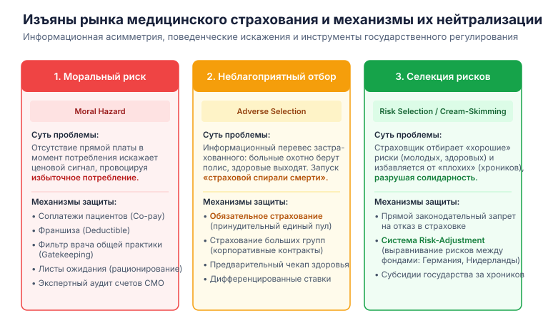
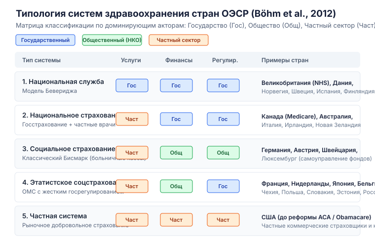
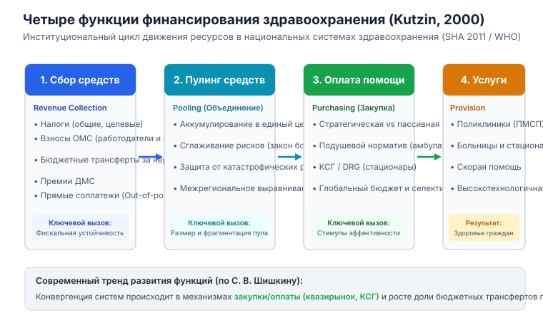

Управление и экономика социальной сферы · Темы 6 и 7 · С. В. Шишкин

# Особенности экономических отношений и системы финансирования здравоохранения

* **Преподаватель:** **Шишкин Сергей Владимирович** — доктор экономических наук, ординарный профессор, директор Центра политики в сфере здравоохранения НИУ ВШЭ, заведующий кафедрой управления и экономики здравоохранения.
* **Дисциплина:** Управление и экономика социальной сферы (УЭСС), 1 курс магистратуры.
* **Лекционные темы блока:**
  * **Тема 6:** Особенности экономических отношений в здравоохранении (изъяны рынка, доверительные блага, изъяны страхования, моральный риск, неблагоприятный отбор, селекция рисков, социальная справедливость);
  * **Тема 7:** Системы финансирования здравоохранения. Функциональный анализ систем финансирования здравоохранения (типология ОЭСР Böhm et al., 4 функции Джозефа Куцина, методы оплаты провайдеров, модели ДМС Mossialos, квазирынки и конвергенция).
* **Значение для экзамена:** блок формирует основу экзаменационного теста (50% итоговой оценки за курс).

!!! tip "TL;DR (Краткая выжимка для магистра)"
    1. **Здравоохранение — классический провал рынка:** Отрасль не подчиняется законам совершенной конкуренции из-за 6 системных дефектов: высокой неопределённости, глубокой информационной асимметрии, доверительного характера благ (*credence goods*), лицензионных барьеров входа, локального монополизма и мощных внешних эффектов (*externalities*).
    2. **Двойственная роль врача и навязанный спрос:** Врач одновременно выступает экспертным советником (агентом) пациента и поставщиком медицинских услуг. При поуслуговой оплате этот конфликт интересов неизбежно порождает индуцированный поставщиком спрос (*Supplier-Induced Demand*).
    3. **Триада изъянов медицинского страхования:**
       * *Моральный риск (Moral Hazard):* нулевая цена в момент обращения ведёт к перепотреблению; механизмы защиты — соплатежи, франшизы, фильтр ВОП (*Gatekeeping*) и аудит счетов страховщиками;
       * *Неблагоприятный отбор (Adverse Selection):* здоровые покидают систему, раскручивая «страховую спираль смерти»; нейтрализация — всеобщий обязательный пул;
       * *Селекция рисков (Cream-Skimming):* страховщики отсеивают хроников; нейтрализация — законодательный запрет селекции и система выравнивания рисков (*Risk-Adjustment*, опыт Германии и Нидерландов).
    4. **Типология систем ОЭСР (Böhm et al., 2012):** Классификация 5 моделей по доминирующим акторам (Гос / Общ / Част) в триаде «Услуги – Финансы – Регулирование»: Национальная служба Бевериджа (Гос/Гос/Гос), Национальное страхование Канады (Част/Гос/Гос), Социальное страхование Бисмарка (Част/Общ/Общ), Этатистское ОМС Франции и РФ (Част/Общ/Гос) и Частная система США (Част/Част/Част).
    5. **Четыре функции финансирования (Kutzin, 2000):** 1) Сбор средств $\to$ 2) Объединение в пулы (*Pooling*) $\to$ 3) Покупка/оплата (*Purchasing*) $\to$ 4) Предоставление услуг (*Provision*).
    6. **Квазирынок и пределы конвергенции:** В странах ОМС растёт доля бюджетных трансфертов (до 25–50%), а бюджетные системы внедряют страховые методы оплаты (КСГ/DRG, подушевой норматив). Однако конвергенция затрагивает лишь механизмы закупки помощи и сбора средств — различия в пулинге остаются фундаментальными.

---

## Часть I. Тема 6: Особенности экономических отношений в здравоохранении

Классическая микроэкономическая теория рассматривает свободный рынок как эффективный механизм распределения ресурсов. Однако здравоохранение признано во всём мире сферой **неустранимых рыночных провалов (*market failures*)**.

### 1. Шесть фундаментальных рыночных несовершенств отрасли

<article class="feature-card" markdown>
Особенность 1

### Неопределённость параметров
Деятельность клиник протекает в условиях тройной неопределённости:
1. **Случайность наступления заболевания:** невозможно точно предсказать время, тяжесть и стоимость болезни для конкретного человека;
2. **Неопределённость выбора метода лечения:** вариативность клинических практик;
3. **Неопределённость исхода:** биологическая уникальность ответа организма на терапию.  
*Парадокс регулятора:* жёсткий контроль за выводом новых фармакопрепаратов соседствует с фактическим отсутствием контроля над внедрением новых хирургических техник.
</article>

<article class="feature-card" markdown>
Особенность 2

### Глубокая асимметрия информации
Информационный разрыв носит двусторонний, но неравновесный характер:
* **Пациент** знает субъективные симптомы и образ жизни, но лишён профессиональных знаний;
* **Врач** объективно оценивает клиническую картину, риски вмешательства и прогноз.  
*Следствие:* пациент не способен сделать рациональный потребительский выбор в отношении места лечения, необходимого объёма услуг, справедливости цены и соотношения «цена / качество».
</article>

<article class="feature-card feature-card--accent" markdown>
Особенность 3

### Доверительные блага (Credence Goods)
Медицинские вмешательства и лекарства относятся к категории **доверительных благ**:
* Потребитель не может оценить качество блага **ни до покупки, ни даже после его длительного потребления** (выздоровление могло наступить спонтанно, а ухудшение — из-за прогрессирования патологии);
* Поставщики услуг сами формируют спрос на свои услуги;
* Возникает абсолютная необходимость внешней сертификации, клинических рекомендаций и государственного контроля.
</article>

<article class="feature-card" markdown>
Особенность 4

### Ограниченный доступ новых производителей
Рынок медицинских услуг защищён мощнейшими институциональными барьерами входа:
* Длительный образовательный ценз (специалитет, ординатура, непрерывное медицинское образование);
* Ограничивающие действия и фильтры профессиональных врачебных ассоциаций;
* Жёсткие лицензионные стандарты помещений, вентиляции, оборудования и санитарных режимов.
</article>

<article class="feature-card" markdown>
Особенность 5

### Локальный монополизм поставщиков
* **Фактор «золотого часа»:** при острых неотложных состояниях (инфаркт, инсульт, политравма) пациент лишён возможности выбирать клинику;
* **Иерархическая структура сети:** необходимость маршрутизации пациентов по уровням помощи (участок $\to$ ЦРБ $\to$ областная больница $\to$ федеральный НМИЦ) устраняет прямую рыночную конкуренцию;
* Покупатели помощи оказываются в заведомо слабой переговорной позиции.
</article>

<article class="feature-card feature-card--accent" markdown>
Особенность 6

### Экстерналии (Внешние эффекты)
Медицинская помощь генерирует мощные положительные экстерналии для третьих лиц:
* Вакцинация формирует коллективный иммунитет; лечение туберкулёза или ВИЧ защищает общество от распространения инфекций.  
*Рыночный провал:* свободный рынок хронически недопроизводит блага с положительными экстерналиями. Государство вынуждено создавать сектор **общественного здравоохранения** (*Public Health*), финансируемый по принципу *«содержания за постоянную готовность к работе»*.
</article>

---

### Типология экономических благ по прозрачности информации

Экономическая теория классифицирует блага по степени доступности информации о качестве:

| Категория благ | Возможность оценки качества | Типичные примеры | Механизм защиты потребителя |
| :--- | :--- | :--- | :--- |
| **Блага поиска** (*Search Goods*) | Оцениваются **до покупки** при визуальном осмотре. | Продукты питания, одежда, стандартные стройматериалы. | Свободная рыночная конкуренция цен и характеристик. |
| **Блага опыта** (*Experience Goods*) | Оцениваются **в процессе или после потребления**. | Бытовая техника, отели, рестораны, автомобили. | Гарантийные обязательства, бренды, повторные покупки. |
| **Доверительные блага** (*Credence Goods*) | **Не могут быть оценены** потребителем даже после потребления. | **Медицинские манипуляции, сложные операции, фармакотерапия.** | **Лицензирование, стандарты, аккредитация, этические кодексы.** |

### Двойственная роль врача и конфликт интересов

В здравоохранении нарушается базовый рыночный постулат о суверенитете потребителя:
* Врач выступает в двух взаимоисключающих ролях:
  1. **Агент пациента:** экспертный советник, призванный действовать исключительно в интересах здоровья больного;
  2. **Поставщик услуг:** субъект, заинтересованный в максимизации собственной загрузки, выручки клиники или фонда оплаты труда.
* При поуслуговой системе оплаты возникает явление **навязанного поставщиком спроса (*Supplier-Induced Demand*)** — назначение необоснованных обследований, избыточных анализов и повторных консультаций.

> **Механизмы сдерживания оппортунизма:**  
> Профессиональное сообщество, клятва Гиппократа, деонтологические кодексы, институциональная репутация клиник и формализованные стандарты медицинской помощи.

---

### 2. Изъяны рынка медицинского страхования

Поскольку медицинская помощь сопряжена с риском катастрофических индивидуальных расходов, её организация опирается на принцип страхования: **«здоровый платит за больного»** с объединением средств в общий пул по закону больших чисел.

Однако сам институт медицинского страхования порождает три классических изъяна рынка:

<figure class="lecture-figure" markdown>

{ loading=lazy }
  <figcaption markdown>Механизмы возникновения и инструменты нейтрализации морального риска, неблагоприятного отбора и селекции рисков.</figcaption>
</figure>

#### 1. Моральный риск (Moral Hazard)
* **Механизм:** Наличие страховки обнуляет цену медицинских услуг в точке потребления ($P = 0$). Отсутствие прямого ценового сигнала стимулирует пациента и врача к нерациональному потреблению ресурсов (*overconsumption*).
* **Инструменты нейтрализации:**
  * **Соплатежи населения (*Co-payments*):** фиксированная сумма оплаты за визит к врачу или рецептурный бланк;
  * **Франшиза (*Deductible*):** оговорённая сумма затрат за год (например, первые 300 евро), которую застрахованный оплачивает из своего кармана;
  * **Институт Gatekeeping:** обязательное направление от участкового терапевта для визита к узким специалистам;
  * **Рационирование через листы ожидания:** искусственное ограничение плановой госпитализации временем ожидания;
  * **Медико-экономический контроль:** проверка обоснованности назначений страховыми экспертами.

#### 2. Неблагоприятный отбор (Adverse Selection)
* **Механизм:** Информационная асимметрия работает в пользу гражданина: человек знает о своих скрытых симптомах больше страховщика.
* **«Страховая спираль смерти»:**
  1. Полис покупают преимущественно люди с хроническими патологиями;
  2. Убыточность пула возрастает, и страховщик вынужден повышать страховой тариф;
  3. Более здоровые граждане считают полис невыгодным и выходят из системы;
  4. Контингент застрахованных становится ещё более больным, тариф снова растёт $\to$ коллапс коммерческого рынка.
* **Инструменты нейтрализации:** Обязательный государственный характер страхования (принудительный охват), групповое корпоративное страхование работников предприятий, предварительный медицинский андеррайтинг.

#### 3. Селекция рисков («Снятие сливок» / Cream-Skimming)
* **Механизм:** В конкурентной среде частные страховщики заинтересованы привлекать молодых и здоровых клиентов и уклоняться от заключения договоров с пожилыми и хрониками. Это разрушает общественную солидарность.
* **Инструменты нейтрализации:**
  * Законодательный запрет на отказ в страховании (*open enrollment*);
  * **Система Risk-Adjustment (выравнивание рисков):** государство или центральный страховой фонд перераспределяет финансовые средства между конкурирующими фондами. Страховщик, набравший пожилых и тяжелых пациентов, получает подушевую надбавку, компенсирующую избыточные затраты (модели Германии и Нидерландов).

---

### 3. Роль государства и требования социальной справедливости

В силу специфики отрасли государство выполняет в здравоохранении три ключевые роли:
1. **Регулирование:** лицензирование специалистов и клиник, утверждение стандартов оснащения, контроль качества лекарств и изделий медтехники, регламентация условий доступа граждан к помощи;
2. **Финансирование:** аккумуляция бюджетных ресурсов и взносов ОМС для оплаты государственных гарантий;
3. **Прямое производство услуг:** содержание сети государственных и муниципальных больниц, станций скорой помощи и службы санитарно-эпидемиологического надзора.

> **Императив социальной справедливости:**  
> Современное цивилизованное общество базируется на ценностной аксиоме: **ни один человек не должен лишаться жизненно необходимой медицинской помощи только потому, что у него нет денег для её оплаты**. Государство обязано гарантировать равный минимальный стандарт помощи вне зависимости от уровня индивидуального дохода и социального положения.

---

## Часть II. Тема 7: Системы финансирования здравоохранения и функциональный анализ

**Система здравоохранения** — это совокупность субъектов (акторов), специализирующихся на предоставлении медицинской помощи, её финансировании и управлении, а также институциональных взаимосвязей между ними.

### 1. Типология систем здравоохранения стран ОЭСР (Böhm et al., 2012)

В сравнительной экономике здравоохранения разработано более 40 типологий. Ведущей признана матричная классификация К. Бёма и соавторов (*Böhm et al., 2012*), оценивающая доминирующий тип актора (**Государственный**, **Общественный/НКО**, **Частный**) по трём базовым функциям:

<figure class="lecture-figure" markdown>

{ loading=lazy }
  <figcaption markdown>Классификация пяти институциональных моделей здравоохранения стран ОЭСР по триаде «Услуги – Финансы – Регулирование».</figcaption>
</figure>

#### Характеристика 5 базовых моделей

| Модель системы | Предоставление услуг | Финансирование | Регулирование | Характерные страны |
| :--- | :---: | :---: | :---: | :--- |
| **1. Национальная медицинская служба** *(модель Бевериджа)* | **Государственный** | **Государственный** | **Государственный** | Великобритания (NHS), Дания, Норвегия, Швеция, Испания, Финляндия, Португалия, Исландия |
| **2. Национальное медицинское страхование** | **Частный** | **Государственный** | **Государственный** | Канада (Medicare), Австралия, Италия, Ирландия, Новая Зеландия |
| **3. Социальное медицинское страхование** *(классический Бисмарк)* | **Частный** | **Общественный** | **Общественный** | Германия, Австрия, Швейцария, Люксембург |
| **4. Этатистское социальное медстрахование** | **Частный** | **Общественный** | **Государственный** | Франция, Нидерланды, Япония, Бельгия, Чехия, Польша, Словакия, Эстония, Россия |
| **5. Частная система здравоохранения** | **Частный** | **Частный** | **Частный** | США (рыночный сегмент до реформы ACA / Obamacare) |

---

### 2. Бюджетная против Страховой системы: институциональное сравнение

#### Преимущества бюджетной системы (Беверидж / Семашко)
* **Минимальные административные издержки:** отсутствие трансакционных затрат на сбор взносов с работодателей, ведение персонифицированного учёта полисов и коммерческую маржу страховых посредников;
* **Эффективный прямой макроконтроль:** государство имеет возможность централизованно сдерживать рост общих расходов на здравоохранение через утверждение статей бюджета;
* **Единое планирование сети:** рациональное территориальное размещение дорогостоящих больниц и оборудования без дублирования мощностей.

#### Преимущества страховой системы (ОМС / Бисмарк)
* **Целевой характер средств:** страховые взносы носят характер «окрашенных» платежей и не могут быть произвольно изъяты Минфином на другие государственные нужды при политических кризисах;
* **Чёткая увязка гарантий и доходов:** размеры программы госгарантий прозрачно коррелируют с объёмом поступающих страховых отчислений;
* **Институциональное разделение функций:** чёткое разделение ролей между независимым плательщиком (страховщиком) и поставщиком медицинских услуг (больницей), стимулирующее контроль объёмов и качества.

---

### 3. Функциональный анализ систем финансирования по Джозефу Куцину

Всемирная организация здравоохранения и методология Системы счетов здравоохранения (*System of Health Accounts, SHA 2011*) структурируют финансирование отрасли через **четыре ключевые функции (*Joseph Kutzin, 2000*)**:

<figure class="lecture-figure" markdown>

{ loading=lazy }
  <figcaption markdown>Институциональный цикл четырёх функций финансирования здравоохранения по Джозефу Куцину (Kutzin, 2000).</figcaption>
</figure>

---

### Функция 1. Формирование финансовых средств (Revenue Collection)

Обеспечение притока денежных ресурсов в отрасль из различных источников:
* Общие налоговые доходы государственного бюджета;
* Обязательные страховые взносы работодателей и работников;
* Премии добровольного медицинского страхования (ДМС);
* Прямые платежи домохозяйств (*Out-of-pocket payments*).

#### Ставки взносов на ОМС в странах Европы и РФ (% от фонда оплаты труда)

| Страна | Взнос работодателя, % | Взнос работника, % | Совокупный тариф ОМС, % |
| :--- | :---: | :---: | :---: |
| **Хорватия** | **18,0%** | 0% | **18,0%** |
| **Венгрия** | 11,0% | 3,0% | **14,0%** |
| **Румыния** | 7,0% | 7,0% | **14,0%** |
| **Германия** | ~7,3% | ~7,3% | **~14,6%** *(паритет 50:50)* |
| **Франция** | — | — | **13,6%** |
| **Словакия** | 10,0% | 3,7% | **13,7%** |
| **Чехия** | 9,0% | 4,5% | **13,5%** |
| **Эстония** | 13,0% | 0% | **13,0%** |
| **Словения** | 6,4% | 6,4% | **12,8%** |
| **Российская Федерация** | **5,1%** | **0%** | **5,1%** |
| **Албания** | 1,7% | 1,7% | **3,4%** |
| **Литва** | 3,0% | 0% | **3,0%** |
| **Киргизия** | 2,0% | 0% | **2,0%** |

#### Страхование неработающего населения
* **Семейный принцип (Западная Европа):** неработающие супруги и дети автоматически страхуются по полису работающего члена семьи без внесения дополнительных платежей;
* **Бюджетный принцип (РФ и страны ЦВЕ):** взносы на ОМС за детей, пенсионеров, студентов и официально зарегистрированных безработных уплачиваются из региональных или федерального бюджетов.

---

### Функция 2. Объединение финансовых средств (Pooling)

Аккумулирование средств в единые пулы для сглаживания индивидуальных финансовых рисков и защиты населения от катастрофических расходов на лечение.

#### Структура страховщиков в странах ОМС
* **Западная Европа (множественность фондов):**  
  * Германия: **420 больничных касс** (объединённых в 7 ассоциаций);
  * Нидерланды: 30 фондов;
  * Бельгия: 100 фондов (5 национальных ассоциаций);
  * Швейцария: 109 касс; Австрия: 24 фонда; Люксембург: 9 фондов.
* **Центральная и Восточная Европа (консолидация):**  
  * Большинство стран перешли к **одному национальному фонду** с региональными филиалами;
  * Чехия: число фондов сократилось с 27 до **9**;
  * Словакия: число фондов снизилось с 12 до **5**;
  * **Россия:** действует двухуровневая модель: Федеральный фонд ОМС + **94 территориальных фонда (ТФОМС)**, а функции страховых посредников осуществляют **24 страховые медицинские организации (СМО)** (в 1990-е годы их было 538).

#### Три варианта организации пулинга средств
1. **Децентрализованный сбор с последующим выравниванием (Германия):** отдельные кассы сами собирают взносы, но обязаны перечислять часть ресурсов в единый фонд выравнивания для поддержки касс с пожилыми клиентами;
2. **Модель доминирующего страховщика (Чехия):** один крупнейший государственный фонд обслуживает 80–90% граждан, а малые отраслевые фонды отдают ему часть взносов;
3. **Централизованный сбор с подушевым распределением (Россия, Нидерланды):** взносы аккумулируются в центральном резервуаре и затем распределяются территориальным фондам и СМО по половозрастным подушевым нормативам.

---

### Функция 3. Покупка и оплата медицинской помощи (Purchasing)

Трансформация аккумулированных денег в стимулы для поставщиков медицинских услуг:

<article class="feature-card" markdown>
**Ретроспективные методы оплаты**  
Оплата фактических объёмов по факту оказания помощи (поуслуговая, койко-дни).  
*Стимул:* расширение объёмов услуг и удлинение сроков лечения.
</article>

<article class="feature-card feature-card--accent" markdown>
**Предварительные методы оплаты**  
Оплата согласованных плановых объёмов помощи (подушевой норматив, КСГ, глобальный бюджет).  
*Стимул:* сдерживание издержек и профилактика.
</article>

#### Методы оплаты амбулаторно-поликлинической помощи

1. **Сметное финансирование:** финансирование статей расходов клиники вне связи с объёмами работы (консервация неэффективности);
2. **Оплата за отдельную медицинскую услугу (*Fee-for-service*):** провоцирует гипердиагностику и навязывание ненужных приёмов;
3. **Оплата за услугу по балльной шкале:** общий бюджет поликлиники фиксирован, стоимость балла пересчитывается постфактум (немецкая модель врачебных ассоциаций KV);
4. **Оплата за законченный случай амбулаторного лечения:** оплата за законченный эпизод обращения по поводу заболевания;
5. **Подушевой норматив финансирования (*Capitation*):** фиксированная сумма за каждого прикреплённого жителя в месяц независимо от числа визитов. **Стимулирует профилактику**, но несёт риск недооказания помощи (*underprovision*).

#### Методы оплаты стационарной помощи

1. **Оплата за койко-день:** стимулирует искусственное затягивание сроков госпитализации;
2. **Оплата за законченный случай по КСГ / DRG (*Diagnosis-Related Groups*):** комплексный фиксированный тариф на госпитализацию в зависимости от диагноза, возраста и выполненной операции. Стимулирует сокращение сроков лечения и оптимизацию издержек;
3. **Глобальный бюджет (*Global Budget*):** согласованный годовой лимит финансирования больницы для оказания планового объёма медицинской помощи.

---

### 4. Добровольное медицинское страхование (ДМС) и накопительные счета

#### Три модели ДМС в смешанных системах (Mossialos & Thomson, WHO, 2004)

| Модель ДМС | Отношение к государственной системе | Что покрывает? | Целевая аудитория |
| :--- | :--- | :--- | :--- |
| **Замещающее** (*Substitutive*) | **Полностью или частично заменяет** государственную страховку. | Весь спектр медицинской помощи взамен государственного ОМС. | Граждане с высокими доходами, экспаты, самозанятые (Германия при доходе выше порога). |
| **Добавляющее** (*Supplementary*) | **Существует параллельно**, открывая доступ к альтернативной сети клиник. | Те же медицинские услуги, но с повышенным комфортом, выбором врача и без очередей. | Средний класс и корпоративные сотрудники, предпочитающие коммерческие медцентры. |
| **Дополняющее** (*Complementary*) | **Расширяет пакет госгарантий**, не дублируя основные протоколы. | Услуги, исключённые из ОМС (стоматология, плановые лекарства, реабилитация, соплатежи). | Широкие слои населения (во Франции дополняющие кассы *Mutuelles* покрывают 95% граждан). |

#### Медицинские накопительные счета (Medical Savings Accounts, MSA)
* Используются в Сингапуре (*Medisave*), США (счета *HSA*) и Китае;
* Обязательные персональные отчисления граждан на личные счета для оплаты текущего амбулаторного лечения;
* Сочетаются с катастрофическим страхованием тяжелых заболеваний;
* **Критический недостаток:** резко усиливают социальное неравенство в доступности медицины, перекладывая бремя на малообеспеченных и больных людей.

---

### 5. Квазирынки и проблема конвергенции систем здравоохранения

#### Концепция квазирынка (Quasi-market)
В 1990–2000-е годы страны с государственными системами (Великобритания) внедрили рыночные элементы, создав институт **квазирынка**:
1. Институциональное разделение покупателя (заказчика) и поставщиков медицинской помощи;
2. Контрактные отношения на конкурсной основе между плательщиками и клиниками;
3. Пациенты не платят напрямую, их предпочтения выражают уполномоченные врачи общей практики;
4. Поставщиками выступают преимущественно государственные и некоммерческие организации (*NHS Trusts*);
5. Отсутствуют классические свободные рынки труда и капитала (государство жёстко регулирует тарифы и стандарты).

#### Происходит ли глобальная конвергенция систем?
Профессор С. В. Шишкин подчёркивает: о **конвергенции** правомерно говорить лишь в отношении двух функций:
1. **В сборе средств:** растущая «бюджетизация» систем ОМС — около 2/3 стран ОМС покрывают от 25% до 50% своих расходов за счёт трансфертов из общего бюджета (Франция, Бельгия, Венгрия, Россия);
2. **В механизмах закупки и оплаты помощи:** и бюджетные, и страховые системы сегодня используют одинаковые инструменты квазирынка (подушевое финансирование поликлиник, оплату стационаров по КСГ/DRG, селективные контракты).

> **Фундаментальное различие сохраняется в функции пулинга:**  
> Бюджетные системы сохраняют единый национальный консолидированный пул налогоплательщиков, тогда как страховые системы опираются на целевые страховые фонды и многоуровневые механизмы выравнивания рисков.

#### Сравнительная эффективность систем в мире
* По данным ВОЗ, бюджетная система финансирования действует в **68 странах**, а система ОМС — в **126 странах мира**;
* В странах ОМС валовые расходы на здравоохранение и административные затраты на содержание аппарата страховщиков **статистически выше**, чем в бюджетных системах;
* Эконометрические исследования не дают однозначного ответа о преимуществе какой-либо модели: результативность зависит не от вывески («бюджет» или «ОМС»), а от институционального качества государственного управления, прозрачности тарифов и врачебной автономии.

---

## Глоссарий тем 6 и 7

* **Индуцированный спрос (Supplier-Induced Demand)** — навязывание врачом избыточных медицинских услуг за счёт своего информационного превосходства над пациентом.
* **Доверительные блага (Credence Goods)** — экономические блага, качество которых потребитель не может объективно оценить даже после их полного потребления.
* **Моральный риск (Moral Hazard)** — избыточное нерациональное потребление бесплатной в точке оказания медицинской помощи.
* **Неблагоприятный отбор (Adverse Selection)** — тенденция концентрации в страховом пуле лиц с максимальным скрытым риском заболеваний.
* **Селекция рисков («Снятие сливок», Cream-Skimming)** — оппортунистическая практика отбора страховщиками молодых и здоровых клиентов с отсевом хронически больных.
* **Risk-Adjustment** — государственная система актуарного выравнивания финансовых рисков между конкурирующими страховыми фондами.
* **Система Бевериджа** — бюджетная национальная служба здравоохранения, финансируемая из общих налогов (Великобритания, Скандинавия).
* **Система Бисмарка** — система обязательного социального медицинского страхования, финансируемая целевыми взносами работников и работодателей в паритетной пропорции (Германия, Австрия).
* **Квазирынок (Quasi-market)** — искусственно сконструированный конкурентный механизм, разделяющий государственного покупателя и автономных поставщиков помощи при сохранении регулируемых тарифов.
* **Purchasing (Закупка помощи)** — функция системы финансирования, преобразующая финансовые пулы в оплату конкретных медицинских услуг поставщикам.
* **КСГ (Клинико-статистические группы, DRG)** — метод классификации и оплаты законченных случаев госпитализации по ресурсоёмкой однородности.
* **Подушевой норматив (Capitation)** — предварительный метод оплаты поликлиники за каждого прикреплённого жителя за определённый период времени.

---

## Контрольные вопросы для подготовки к экзамену (50% оценки)

1. Каковы 6 ключевых особенностей экономических отношений в здравоохранении по С. В. Шишкину?
2. В чём выражается экономический конфликт ролей врача как «агента пациента» и «поставщика услуг»?
3. Чем отличаются блага поиска, блага опыта и доверительные блага? Почему медицина относится к доверительным благам?
4. Раскройте механизмы нейтрализации морального риска (*Moral Hazard*) в обязательном и добровольном медицинском страховании.
5. Как раскручивается «страховая спираль» неблагоприятного отбора и почему свободный рынок не способен предотвратить её без государства?
6. Что такое селекция рисков (*Cream-Skimming*) и как устроена система *Risk-Adjustment* в Германии и Нидерландах?
7. Назовите 5 типов систем здравоохранения стран ОЭСР по классификации *Böhm et al. (2012)* и приведите примеры стран.
8. Сопоставьте преимущества и недостатки бюджетной и страховой систем финансирования здравоохранения.
9. Охарактеризуйте 4 функции финансирования здравоохранения по Джозефу Куцину (*Kutzin, 2000*).
10. Какие методы оплаты амбулаторной и стационарной помощи относятся к ретроспективным, а какие — к предварительным?
11. В чём различие замещающего, добавляющего и дополняющего добровольного медицинского страхования (*Mossialos, 2004*)?
12. В каких аспектах происходит реальная конвергенция мировых систем здравоохранения, а в каких различия остаются непреодолимыми?
